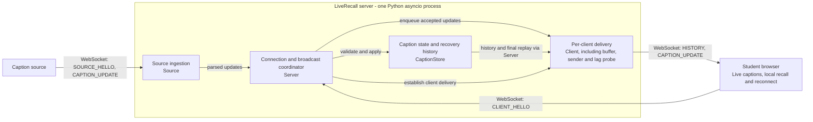

# LiveRecall component architecture

Arrows show data flow or connection setup. The four server components run in one
process; per-client delivery is instantiated separately for each receiver.
History and replay access to `CaptionStore` goes through `Server`.

| Component | Responsibility |
|---|---|
| Caption source | Generates deterministic caption segments and revisions. |
| Connection and broadcast coordinator | Routes connections, owns shared state and fans out accepted updates without awaiting socket sends. |
| Source ingestion | Validates producer messages and forwards session-matching caption updates. |
| Caption state and recovery history | Enforces revision/final rules and retains recent finals for recovery and replay. |
| Per-client delivery | Sends initial history and live updates; owns buffering, lag detection and paced catch-up for one receiver. |
| Student browser | Replaces revisions, stores local recall history and reconnects with a finalized cursor. |

**Delivery policy:** normal clients receive every revision. Under pressure, a
client replays finals from the shared log and keeps the latest active state in
its own buffer. Independent sender tasks keep a stalled socket send out of the
source ingestion path. The shared log retains finals for 90 seconds; expired
replay or terminal stalls close the affected connection rather than guarantee
delivery indefinitely.
