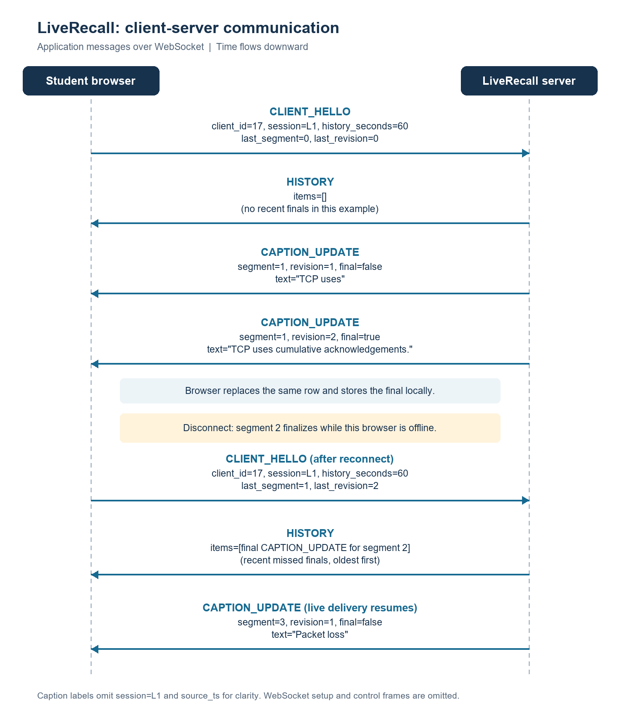

# Client-server communication

Time flows downward. The diagram shows application messages over an established
WebSocket; fields shared by all caption updates are listed below.

Each `CAPTION_UPDATE`, including each `HISTORY` item, contains `type`, `session`,
`segment`, `revision`, `source_ts` (Unix-epoch seconds), `final` and `text`.
For clarity, the diagram omits `session=L1` and `source_ts` from caption labels.

`HISTORY` contains recent finals after the client's reported finalized cursor,
oldest first, within the requested window. Live updates follow it. Normal recall
uses local browser state and sends no request. WebSocket setup and ping/pong
control frames are omitted.
