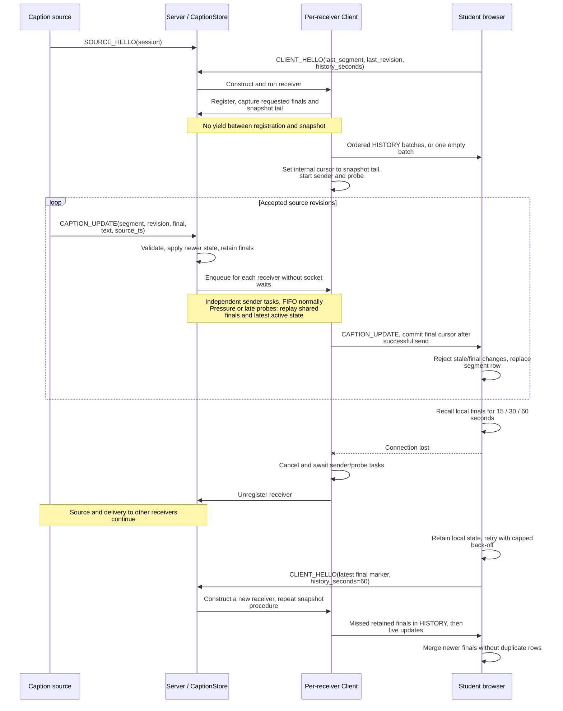

# LiveRecall communication sequence

This overview follows the current implementation in `submission_root/`.
Server includes source routing and shared `CaptionStore` access, each receiver
has a separate `Client`, buffer, sender and probe. These are responsibilities
inside one asyncio process, not separate services.
For task-level replay and probe interactions, see [the detailed component
sequence](sequence.md). The browser resume marker (`last_segment`,
`last_revision`) is distinct from the server's internal final-log cursor.

Initial history is sent directly by `Client` before sender/probe tasks start,
it is not queued in `OutboundBuffer`. Updates arriving during history are
buffered, and finals beyond the captured tail remain owed. Ping/pong probes
measure transport progress, not caption consumption. Finals are retained for
90 seconds, hello recovery requests at most 60 seconds. The finalized browser
marker assumes ordered completion and cannot represent holes below a later final.
