# LiveRecall - component interaction sequence

This diagram describes the proposed implementation. The components are logical responsibilities within the existing Python server and JavaScript client, not separate services or a requirement for one file per component.

- Member 1 owns caption state, revision rules, and bounded recovery history.
- Member 2 owns connection handling, per-client buffers, and sender tasks.
- Member 3 owns browser connection management, local caption state, and the UI.
- Member 4 owns integration checks and experiments using the supplied source and load clients. Simulated clients connect through the same protocol as browsers.

`cursor` below is shorthand for the required `last_segment` and `last_revision` fields in `CLIENT_HELLO`, not a new protocol field.

```mermaid
%%{init: {"theme": "base", "themeVariables": {"darkMode": true, "background": "#111827", "primaryColor": "#263449", "primaryTextColor": "#f8fafc", "primaryBorderColor": "#94a3b8", "lineColor": "#cbd5e1", "textColor": "#f8fafc", "actorBkg": "#263449", "actorBorder": "#94a3b8", "actorTextColor": "#f8fafc", "actorLineColor": "#94a3b8", "signalColor": "#e2e8f0", "signalTextColor": "#f8fafc", "noteBkgColor": "#374151", "noteBorderColor": "#94a3b8", "noteTextColor": "#f8fafc", "labelBoxBkgColor": "#263449", "labelBoxBorderColor": "#94a3b8", "labelTextColor": "#f8fafc", "loopTextColor": "#f8fafc"}}}%%
sequenceDiagram
    title LiveRecall - source, service components, and client components
    participant Source as Caption source
    box rgb(25, 38, 55) Service
        participant Handler as Connection handlers
        participant State as Caption state and final history
        participant Buffer as Per-client outbound buffer
        participant Sender as Per-client sender task
    end
    box rgb(26, 43, 36) Clients - one browser shown
        participant Connection as Browser connection manager
        participant Local as Local caption state
        participant UI as Caption and recall UI
    end

    Note over Handler,Sender: One shared caption state, one bounded buffer and sender per client.<br/>Source handling never waits for client network sends.
    Note over Connection,UI: Each browser has its own connection manager, state, and UI.<br/>These are logical parts of app.js, not separate applications.

    rect rgb(28, 42, 61)
        Note over Source,UI: 1. Initial connection or late join
        Source->>Handler: Open WebSocket, SOURCE_HELLO(session=L1)
        Connection->>Local: Read latest finalized resume position
        Local-->>Connection: last_segment and last_revision, or 0 and 0
        Connection->>Handler: Open WebSocket, CLIENT_HELLO(cursor, history_seconds=60)
        Note over Handler,Buffer: Prepare recovery and register live delivery without yielding.<br/>Queue HISTORY before any live updates for this client.
        Handler->>State: Get recent finals after reported cursor, up to 60 seconds
        State-->>Handler: Final captions ordered oldest first, or an empty list
        Handler->>Buffer: Create client buffer and enqueue HISTORY(items)
        Handler->>Handler: Register client for subsequent live updates
        Handler->>Sender: Start sender for this connection
        Sender->>Buffer: Take next message
        Buffer-->>Sender: HISTORY(items)
        Sender-->>Connection: Send HISTORY over WebSocket
        Connection->>Local: Merge recovered finals by segment and revision
        Local->>Local: Reject duplicates and stale revisions, retain at least 60 seconds
        Local-->>UI: Ordered recent captions
        Connection-->>UI: Show connected status
    end

    rect rgb(27, 46, 38)
        Note over Source,UI: 2. Live updates, revision replacement, and backpressure
        par Source ingestion and fan-out
            loop Each source revision, with any number of revisions per segment
                Source->>Handler: CAPTION_UPDATE(segment, revision, source_ts, final, text)
                Handler->>State: Validate and apply revision
                alt Duplicate, stale, or attempts to change a finalized segment
                    State-->>Handler: Reject, do not broadcast
                else Valid newer state
                    State->>State: Replace active revision, retain final when completed, expire old state
                    State-->>Handler: Accepted update
                    loop Each connected client
                        Handler->>Buffer: Offer accepted update without waiting for a send
                        alt Client has no backlog or send lag
                            Buffer->>Buffer: Queue every revision in order
                        else Client is falling behind
                            Buffer->>Buffer: Coalesce superseded provisional revisions
                            Note over State,Buffer: Preserve finals in segment order and latest useful active state.<br/>Do not drop a final to make room for a provisional update.
                        end
                        Buffer-->>Sender: Signal pending work
                    end
                end
            end
        and Independent delivery for each client
            loop While connection is open and messages are pending
                Sender->>Buffer: Take next message
                Buffer-->>Sender: Next live update, after initial HISTORY
                Sender-->>Connection: Send CAPTION_UPDATE over WebSocket
                Sender->>Buffer: Report send lag and transport pressure
                Note over Buffer,Sender: If a send stalls, only this sender waits.<br/>Keep pending work bounded and avoid flooding transport buffers.<br/>Resume full revision delivery when pressure clears.
                Connection->>Local: Apply live update by segment and revision
                alt Duplicate or older revision
                    Local->>Local: Ignore update
                else Newer accepted revision
                    Local->>Local: Replace segment state, retain finals, advance finalized cursor
                    Local-->>UI: Update existing segment row, distinguish provisional and final
                end
            end
        end
    end

    rect rgb(49, 43, 29)
        Note over Connection,UI: 3. Recall uses local finalized state
        UI->>Local: What did I miss? Request previous 30 seconds
        Local-->>UI: Final captions in selected time window
        UI->>Local: Change window to 15, 30, or 60 seconds
        Local-->>UI: Filter locally retained finals
        Note over Connection,UI: No server request during normal recall.
    end

    rect rgb(49, 35, 33)
        Note over Source,UI: 4. Temporary disconnect and incremental recovery
        Connection--xHandler: WebSocket connection lost
        Handler->>Handler: Unregister disconnected client
        Handler->>Sender: Cancel sender and release connection resources
        Handler->>Buffer: Discard this connection's pending buffer
        Connection-->>UI: Show disconnected or reconnecting status
        Note over Connection,Local: Retain browser state and finalized cursor across connection retries.

        loop Source continues while this browser is offline
            Source->>Handler: CAPTION_UPDATE
            Handler->>State: Apply accepted update and retain recent finals
            Note over Handler,Sender: Continue delivering to other connected clients independently.
        end

        Connection->>Connection: Wait for short capped retry delay
        Connection->>Local: Read latest finalized cursor, not latest provisional revision
        Local-->>Connection: last_segment and last_revision
        Connection->>Handler: Reconnect, CLIENT_HELLO(cursor, history_seconds=60)
        Note over Handler,Buffer: Repeat the same recovery-before-live registration procedure.
        Handler->>State: Get recent missed finals after finalized cursor
        State-->>Handler: Ordered finals within requested retained window
        Handler->>Buffer: Create new buffer, enqueue HISTORY first
        Handler->>Handler: Register connection for live updates
        Handler->>Sender: Start new per-client sender
        Sender->>Buffer: Take recovery message
        Buffer-->>Sender: HISTORY(missed finals)
        Sender-->>Connection: Send HISTORY, then queued live updates
        Connection->>Local: Merge recovery without duplicate or stale final state
        Local-->>UI: Refresh captions and recall history
        Connection-->>UI: Show connected status
        Note over State,Local: Recovery covers the bounded recent window, not the entire lecture.<br/>Do not advance the finalized cursor past missing earlier finals.
    end
```

