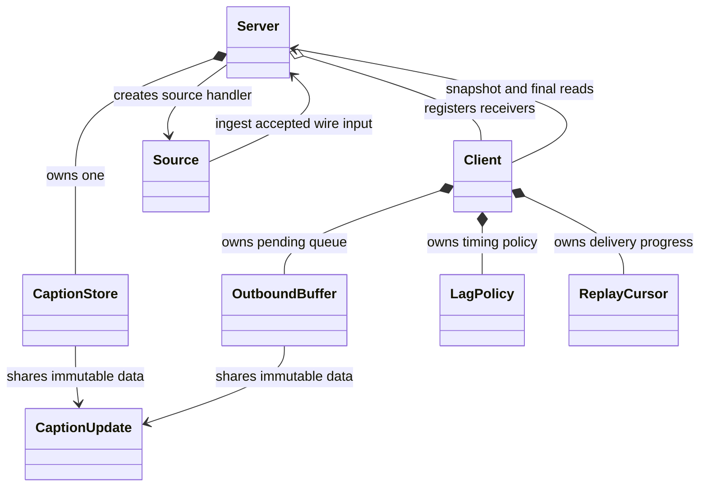

# LiveRecall server: ownership and OOP design

This describes the cleaned implementation in `submission_root/app/`. The two-file
`reorganised/app/` prototype has been promoted and retired. The fuller protocol
guide is [BACKEND_CLIENT_PROTOCOL.md](../docs/BACKEND_CLIENT_PROTOCOL.md).
Historical measurements below remain explicitly separated from the current design.

## Components



| Class/module | Responsibility |
|---|---|
| `protocol.py` | Parse typed wire messages and serialize them; caption JSON is cached. |
| `Server` | Listener, client registry, one source flag, shared store, routing, CLI. |
| `Source` | Source receive loop and message dispatch; no revision logic. |
| `CaptionStore` | Revision acceptance, segment lookup, active accounting, final log, expiry. |
| `Client` | One receiver's lifecycle, initial history, sender/probe tasks, mode changes, deadlines. |
| `Mode` | Stored `NORMAL` or `REPLAY` state. |
| `LagPolicy` | RTT, late threshold, sticky lease, adaptive back-off; no socket I/O. |
| `ReplayCursor` | Final-log position and final/active selection. |
| `OutboundBuffer` | Pending queue, FIFO/coalescing, capacity checks, enqueue age. |
| `Usage` | Projected active count, pending count, and serialized bytes for one offer. |

Source and Client have independent lifecycles rather than a shared connection
base class. State and scheduling use composition: a Client owns its policy,
cursor, and buffer. Pure store/buffer/policy logic can be exercised without a
running listener.

## Source ingestion and fan-out

```text
Source.run
  → CaptionUpdate.from_dict
  → Server.ingest_caption_update
      → CaptionStore.validate_and_apply
      → Server.broadcast
          → each Client.enqueue
```

After parsing, this chain contains no socket await. A receiver's blocked send
does not directly block another receiver or source ingestion. Shared CPU,
event-loop time, memory, and bandwidth still constrain the process.

The store rejects stale/duplicate revisions and changes to retained finals.
Accepted finals enter one shared rolling log. It uses:

- `_segments` for current revision lookup;
- `_active_segments` for unfinished-state accounting;
- `_final_history` for acceptance-ordered final reads;
- `_final_tail` and `_evicted_final_sequence` for cursor boundaries;
- `_retired_before` for retired source IDs.

The indexes share state objects. Source IDs, revision numbers, queue keys, and
internal final sequences are different quantities.

## Receiver lifecycle and recovery

1. Register the Client.
2. Immediately await `_send_initial_history()`, which captures a snapshot before
   its first network await.
3. Send ordered `History.batches()` responses; empty context still gets one
   empty response.
4. Return the captured tail, release helper locals, and commit the cursor.
5. Start the sender and probe tasks, then receive until closure.
6. Cancel and await owned tasks, unregister, and log counters.

There is no yield between registration and snapshot acquisition. Captions
arriving during history sends remain queued or replayable after the captured
tail. The tail is captured independently of requested context, so zero-second
history does not turn intentionally unrequested old finals into live work.

History framing targets 64 items and 256 KiB of complete JSON per message.
A single oversized caption travels alone. `History.to_json()` builds its
envelope from cached caption JSON, avoiding repeated text serialization.
Snapshot lists and the final batch are confined to the helper; steady-state
connections do not pin their initial recovery window.

## Queue and delivery ownership

Normal mode preserves every revision under a distinct FIFO key. During replay,
finals come from the shared log and the local queue holds each active segment's
latest useful state.

The buffer's `_by_segment` index supports replacement without moving the
original queue position. `_queued_at` preserves first enqueue age when replacing
text. Cached active count and byte count avoid rescanning on every offer.

An offer computes `Usage` once. The 256-entry soft threshold or byte pressure
first compacts; usage is recalculated only if compaction changed the queue.
Hard checks retain at most 4,000 active entries and 4 MiB of JSON. There is no
additional 4,096-final cap: the owning Client switches to shared-log replay
before that count could matter.

`set_coalescing()` expresses an owner request; pressure is an independent
buffer condition. `drop_finals_keep_latest_active()` compacts only if needed,
removes queued finals, and resets pressure/failure flags. A refused provisional
can then be retried. Useful active state that still does not fit causes an
explicit connection close.

Only one sender owns live network writes. It selects `(caption, sequence)`,
awaits the bounded send, then commits `ReplayCursor.position` on success.
The local caption variable provides in-flight ownership. No write-only
`_in_flight` field or old private-name compatibility properties remain.

`read_next_final(cursor)` returns one `(caption, sequence)` or `None`, with
`ReplayExpired` for an owed expired prefix. Connected replay has no generic
batch list or HISTORY-size accounting. Every live/replay frame is an individual
`CAPTION_UPDATE`.

`ReplayCursor` gives a ready active entry a turn after four finals, or when no
final is owed. Active entries use a one-second first-enqueue grace. A healthy,
final-caught-up client can return to normal while retaining young active entries;
the check and transition have no intervening await.

## Lag and bounded network operations

One probe task owns ping initiation and pong completion. The first timeout at
`max(0.5 seconds, 6 * RTT)` enters replay. There is no separate second replay
threshold and no derived `COALESCING` mode. Enqueue pressure and the overdue-probe
branch are the two entry routes; sender selection does not initiate another
lag transition.

The sticky lease starts at three seconds and can double to 30 after a quick
relapse following a normal trial. A sustained healthy trial resets it. Successful
RTT samples use weight 0.25 and are capped at the current late threshold. Probe
completion is followed by a 0.25-second pause.

During an active lease, the sender waits for probe completion before each burst.
The Client owns `MAX_BURST_ITEMS = 64` and `MAX_BURST_BYTES = 256 * 1024`.
These count individual messages; a caption can cross the byte target.
A pong is an indirect lag signal, not proof of application consumption.

Each whole probe and send has a 75-second terminal budget. Closing gets two
seconds before transport abort. `_wait_task()` keeps early probe timeouts from
cancelling the shared outstanding round trip; `_stop_task()` cancels and joins
owned operations. The library's second periodic heartbeat is disabled.

## Retained contracts and limitations

The cleanup preserves source validation, final durability within retention,
FIFO coverage when healthy, bounded pending active state, final/active fairness,
and explicit failure on expired replay or terminal stalls.

It does not resolve these separate design limits:

- One source/session namespace is retained for the server lifetime.
- Reconnect's greatest finalized source marker assumes sequential finalization;
  arbitrary overlap can leave unrepresented holes or interact with retirement.
- The 90-second shared log is age-bounded, not independently byte/count-bounded.
- A canonical outgoing Unicode caption can exceed a receiver's 1 MiB limit even
  when its compact incoming UTF-8 frame fitted the server limit.
- Four-final/one-active scheduling remains a capacity heuristic.
- Send completion and pong timing are not per-caption application ACKs.

See the protocol guide for clocks, framing, browser recall, and reproduction
commands. Use current test/experiment artifacts when assessing behavior.

## Verification

`test/test_delivery.py` and `test/test_live_delivery.py` exercise store expiry,
snapshot boundaries, normal revisions, pressure replay, cursor ownership,
active fairness, live frames, and bounded probe/send/close cleanup.
`test/test_cleanup.py` adds regressions for the narrowed interfaces and removal
of repeated work and retained snapshot references. The real 65-second stall
test remains opt-in.

```bash
./venv/bin/python -m unittest discover -s test -p 'test_*.py' -v
./venv/bin/python test/submission_check.py
```

Recorded cleanup validation discovered 33 tests: **32 passed and the opt-in
65-second stall case was skipped**. The actual WebSocket regression ran.
These results cover the regular regression suite, not performance experiments.

Use the unchanged public harness for performance experiments, with three
independent runs and medians. Record final identity completeness alongside
normal/slow freshness, latency, coverage, recovery, and RSS. Test definitions
alone are not a claim that current public or hidden workloads passed.

## Historical measurements: superseded reconnect policy

The following numbers were recorded in earlier design notes for a different
delivery policy. That implementation closed lagging connections at an adaptive
1.5-second-floor resync deadline and relied on recent HISTORY recovery. It also
used different local buffer limits and probe handling. **These are historical
observations, not results for the current shared-log replay implementation.**

The small public stream could fit in downstream buffers without visible server
write pressure. Pong delays provided an indirect lag signal for Python slow
readers; this did not prove application consumption. Current probes also time
ping initiation because `ping()` itself can block on writing.

Historical T3 comparison: 100 clients, 10% slow, 500 ms reads, 60 seconds.

| Previous-policy change | Recorded final completeness |
|---|---|
| original design (no probe) | 95.13% |
| + detect and hold | 99.07% |
| + hysteresis, finals-first, grace, pessimistic start | 98.75–98.93% |
| + sticky catch-up alone | 96.18% |
| + reconnect resync at 4.0 s | 98.80% |
| + reconnect resync at 1.5 s | 99.99% |
| + adaptive RTT thresholds | 99.91–99.93% |

The current policy has no 1.5-second replay threshold. These scores cannot be
attributed to it.

Historical public runs: one run each, not the required three-run medians.

| Previous-policy test | Duplicates | Stale | Final completeness | Coverage | P50 | P95 |
|---|---|---|---|---|---|---|
| T1 basic (20 clients) | 0 | 0 | 100% | 100% | 4.7 ms | 7.4 ms |
| T2 scale (100 clients) | 0 | 0 | 100% | 100% | 13.5 ms | 24.7 ms |
| T3 slow (10% at 500 ms) | 0 | 0 | 99.91% | 94.9% | 13.3 ms | 439 ms |
| T4 reconnect (20%) | 0 | 0 | 100% | 97.4% | 13.7 ms | 26.2 ms |
| late join (20%) | 0 | 0 | 100% | 93.3% | 3.8 ms | 6.2 ms |

No historical T5 result was recorded. Establish current T1–T5 and before/after
results from new artifacts rather than carrying these numbers into the report.
