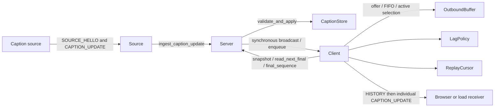

# LiveRecall: backend, client, and protocol

The cleaned OOP implementation lives in `submission_root/app/`. The earlier
`reorganised/app/` prototype has been retired; the submission is the authoritative
implementation. Paths below are relative to the repository root. Links point to
source files; method names are more useful than line numbers after edits.

The cleanup keeps the store, buffer, lag policy, replay cursor, and connection
responsibilities separate. It removes unused state and compatibility aliases,
computes buffer usage once unless compaction changes the queue, compacts once
on replay entry, reads one final directly, and releases completed recovery
snapshots. Lag now has one explicit transition: the first overdue probe enters
replay. Healthy clients can leave replay while preserving young active entries.

## 1. Components and ownership

| File or component | Owns and does |
|---|---|
| [solution_server.py](../submission_root/solution_server.py) | Required `python solution_server.py --port 8765` entry point; Python resolves `app` from the script directory for either documented working directory. |
| [Server](../submission_root/app/server.py) | Listener, one `CaptionStore`, client registry, source-connected flag, first-frame routing, and CLI. |
| [Source](../submission_root/app/source.py) | One source WebSocket; parses source messages and submits valid captions. |
| [CaptionStore](../submission_root/app/caption_store.py) | Revision validation, current segment state, retained final log, and recovery snapshots. No sockets or `await`. |
| [Client](../submission_root/app/client.py) | One receiver WebSocket, history setup, one sender task, one probe task, mode transitions, and bounded network operations. |
| `Mode` in `client.py` | Two stored delivery modes: `NORMAL` and `REPLAY`. |
| `LagPolicy` in `client.py` | RTT estimate, late-probe threshold, catch-up lease, and adaptive back-off. Receives timestamps; no socket I/O. |
| `ReplayCursor` in `client.py` | Committed final-log position and selection between owed finals and eligible active state. |
| [OutboundBuffer / Usage](../submission_root/app/outbound_buffer.py) | One client's pending entries, FIFO order, coalescing, enqueue ages, and count/byte admission. No network I/O. |
| [protocol.py](../submission_root/app/protocol.py) | Typed parsing and serialization; cached caption JSON and recovery framing. |
| [client/app.js](../submission_root/client/app.js) | Browser `Connection`, retained `CaptionState`, and `View`. |

There is one Python process with one asyncio event loop. Each source or receiver
has its own handler. A receiver's blocked send belongs to its sender task; the
source does not await receiver sockets during fan-out. CPU, memory, event-loop
time, and network bandwidth are still shared resources.



Composition is intentional. Source and Client do not need a common connection
base class: their protocols and lifecycles differ. The store and buffer remain
independently testable without running a listener.

## 2. Wire messages

All application messages are JSON text carried by WebSockets. The first frame
classifies a connection as a source or receiver.

| Message | Direction | Fields and handling |
|---|---|---|
| `SOURCE_HELLO` | Source → server, first frame | `session` must be a nonempty string. Only one active source is accepted. |
| `CLIENT_HELLO` | Receiver → server, first frame | `client_id`, `session`, `last_segment`, `last_revision`, `history_seconds`. Optional malformed values are repaired to defaults. |
| `CAPTION_UPDATE` | Source → server → receiver | `session`, positive integer `segment/revision`, finite nonnegative `source_ts`, boolean `final`, string `text`. Invalid source updates are ignored. |
| `HISTORY` | Server → receiver after hello | `items`: eligible finalized captions, ordered by acceptance. One or more messages precede all live updates. |
| `SOURCE_DONE` | Source → server | Optional source count/session notification; logged only. It does not flush receivers or stop the server. |
| Ping / pong | WebSocket control exchange | Connection lag signal, separate from application messages and acknowledgements. |

Unknown extra caption fields are ignored. `Source` also requires each caption's
session to match its source hello. Receiver hellos are deliberately lenient:
defaults are client ID 0, session `L1`, resume marker `0/0`, and 30 seconds of
history; the requested window is clamped to 0–60 seconds.

The numeric helpers reject booleans as identifiers. Caption parsing can fail;
the lenient client-hello and source-done parsers always return repaired objects.
Typed objects then travel through validation, storage, queueing, and delivery.

`CaptionUpdate.to_json()` serializes once and caches its complete JSON string.
The store and multiple queues share references to the same immutable caption.
`History.to_json()` uses those cached caption strings to construct its envelope,
so recovery does not escape all caption text a second time.

## 3. Source ingestion and revision state

The source path is synchronous after parsing:

```text
Source.run
  → CaptionUpdate.from_dict
  → Server.ingest_caption_update
      → CaptionStore.validate_and_apply
      → Server.broadcast
          → each Client.enqueue
```

The store trims expired finals, rejects retired IDs, rejects any change to a
retained final, and rejects a revision less than or equal to the current one.
Accepted provisionals replace the segment's current state. Accepted finals get
a new contiguous internal sequence and enter the shared final log once.

| Store index or counter | Purpose |
|---|---|
| `_segments` | Segment ID → latest accepted state for revision lookup. |
| `_active_segments` | Unfinished IDs for active-state accounting and retirement. |
| `_final_history` | Internal final sequence → finalized state for ordered recovery/replay. |
| `_final_tail` | Highest assigned final sequence; expiry never rewinds it. |
| `_evicted_final_sequence` | Last expired log sequence; detects an owed missing prefix. |
| `_retired_before` | Source-ID retirement watermark, separate from log sequence. |

These indexes share state objects; they are not separate transcript copies.
`SegmentState` adds monotonic acceptance time and final sequence to a
`CaptionUpdate`.

A source segment ID, a revision, a buffer key, and a final-log sequence are
different identifiers. For example, segment 42 revision 5 might have final
sequence 17 and appear under local queue key 103.

## 4. Connection setup and initial recovery

`Client.run()` registers the receiver and immediately awaits
`_send_initial_history()`. That helper obtains the snapshot synchronously before
its first network await. Source processing therefore cannot interleave between
registration and snapshot acquisition.

```mermaid
sequenceDiagram
    participant R as Receiver
    participant C as Client
    participant S as Server / CaptionStore
    participant P as Source
    R->>C: CLIENT_HELLO(resume marker, requested window)
    C->>S: Register receiver
    C->>S: Capture items and snapshot_tail without yielding
    loop Each recovery batch
        C->>R: HISTORY
        P->>S: New captions may arrive during network awaits
        S->>C: Enqueue post-snapshot updates
    end
    C->>C: Commit snapshot_tail; release helper locals
    C->>C: Start sender and probe tasks
    C->>R: Individual live CAPTION_UPDATE messages
```

The snapshot contains finals accepted within the requested 0–60-second window
whose `(segment, revision)` exceeds the receiver's finalized resume marker.
Its tail is the whole log's captured tail, not the number of requested items.
Even empty or zero-second recovery must commit that boundary so intentionally
unrequested old finals do not later appear as connected replay.

`History.batches()` targets at most 64 items and 256 KiB of complete JSON per
message, including the envelope and separators. Empty input produces one empty
`HISTORY`. One oversized item travels alone without truncation. The per-message
byte target is therefore not an absolute maximum individual-caption size.

All snapshot batches finish before live tasks start. The helper's list and last
batch go out of scope after success, allowing shared-log expiry to reclaim
captions that no longer have other owners. Each send has a stall budget; there
is no separate total-duration budget for a multi-message snapshot.

## 5. Pending buffer and admission

Normal delivery preserves every accepted revision under an increasing local
queue key. FIFO order includes multiple pending revisions of the same segment.

When pressure or replay enables coalescing, the buffer retains one useful entry
per segment at its original queue position and first enqueue time. Replacements
therefore do not keep restarting the active grace period.

| Buffer member | Purpose |
|---|---|
| `_pending` | Ordered queue key → pending caption. |
| `_queued_at` | First enqueue time for each retained queue entry. |
| `_by_segment` | Segment → queue key, used during coalescing. |
| `_active_count`, `_pending_bytes` | Admission accounting without rescanning on each offer. |
| Coalescing request and pressure flags | External queue policy and internal capacity pressure are distinct causes. |
| `should_close` | The latest useful state failed admission and needs client-level rescue or failure. |
| `coalesced/rejected` | Diagnostic counters printed during disconnect cleanup. |

`offer()` computes a projected `Usage(active, pending, bytes)`. Reaching 256
pending entries or exceeding the byte budget first compacts. Only that state
change requires recalculating usage. The resulting candidate must fit at most
4,000 pending active entries and 4 MiB of serialized JSON.

There is no separate 4,096-final cap: the owning Client enters shared-log replay
at the much earlier soft threshold, and the byte limit remains a hard bound.

The soft and hard byte checks have different jobs. The first tries removing
superseded work; the second refuses an update if the useful retained state still
does not fit. A refusal never makes room by silently deleting another segment's
latest useful state.

`drop_finals_keep_latest_active()` enables coalescing, compacts only if needed,
and removes queued finals because the shared log owns those finals. It resets
pressure/failure flags so a refused provisional can be retried. If latest active
state still cannot fit, the Client closes explicitly. A final arriving during
replay removes its segment's local active entry and wakes the sender.

## 6. Sender selection and delivery ownership

Only `_sender_loop()` sends live captions. It selects one caption and the final
sequence that should be committed after success, then awaits the bounded send.
The local `delivery` variable owns the selected message during that await.
There is no write-only `_in_flight` field.

Normal selection is a FIFO pop. For a final, the sequence is resolved before
awaiting the send so history expiry during a long send cannot invalidate a
later lookup. A failed send does not advance `ReplayCursor.position`.

Replay selection is delegated to `ReplayCursor.next_replay()`:

1. After four consecutive finals, try one active entry whose first enqueue age
   has reached the one-second grace.
2. Otherwise ask `Server.read_next_final(position)` for the next owed final.
3. If no final is owed, try an eligible active entry.
4. If nothing is ready and the lag lease has expired, return to normal FIFO
   while retaining any young active entries.

`read_next_final(cursor)` returns `(caption, sequence)` or `None`. It checks
expiry but does not remove shared entries or commit client progress. A cursor
older than the expired prefix raises `ReplayExpired`, including when the
retained log is empty. There is no generic batch list or HISTORY-byte accounting
on this one-final path.

The return-to-normal check and mode change have no intervening await. Young
active state therefore cannot keep a healthy, final-caught-up connection in
replay indefinitely. The next normal FIFO delivery retains that already
coalesced useful state and forwards subsequent revisions normally.

All replay messages are individual `CAPTION_UPDATE` frames. `HISTORY` belongs
to hello recovery. A shared-log read does not create another wire message type.

## 7. Lag, pacing, and failure deadlines

`LagPolicy` marks a probe late after:

```python
max(BEHIND_AFTER_SECONDS, BEHIND_RTT_MULTIPLIER * rtt)
# Defaults: max(0.5 seconds, 6 * rtt)
```

On the first timeout, the probe loop enters replay immediately. It renews the
catch-up lease while the same round trip remains pending. There is no separate
1.5-second replay threshold or derived `COALESCING` mode.

A successful late probe records its elapsed duration. Successful latency samples
are capped at the current behind threshold and incorporated with weight 0.25.
Each completed probe is followed by a 0.25-second pause.

The lease starts at three seconds. A quick return to lag after a normal trial
doubles it, up to 30 seconds; a sustained healthy trial resets it. A single long
stall does not by itself double the lease. This hysteresis reduces repeated
returns to a full revision stream that a slow receiver cannot sustain.

During an active catch-up lease, the sender waits for a completed probe before
each burst. `Client.MAX_BURST_ITEMS = 64` and
`Client.MAX_BURST_BYTES = 256 * 1024` bound when the next hold begins.
These are individual messages, not combined frames. The byte count is checked
after previous sends, so one message can cross the target.

A pong is not an application acknowledgement or a grant of 64 processing
credits. The library and OS may buffer messages before the receiver application
consumes them. Keep normal/slow final age and post-source drain in performance
measurements alongside completeness.

| Condition or resource | Bound / action |
|---|---|
| Opening hello | Five seconds, then close 1008 for missing/invalid role hello. |
| Whole probe, including ping initiation | 75 seconds, then close 1013. |
| Each socket send | 75 seconds, then close 1013. |
| Close handshake | Two seconds, then abort the transport if needed. |
| Owed final log prefix expired | `ReplayExpired`, then close 1013. |
| Latest active state still exceeds admission | Close 1013. |
| Receiver disconnect | Cancel and await owned tasks, unregister, log counters. |

The library's periodic heartbeat is disabled on the server because the custom
probe owns this policy. `_wait_task()` applies deadlines without cancelling a
probe on an early timeout; its owner eventually cancels and joins it through
`_stop_task()`. These helpers also preserve the supported Python 3.10 caller
cancellation behavior.

## 8. Browser and reconnect behavior

The browser has three objects in [app.js](../submission_root/client/app.js):

- `Connection` opens the WebSocket, sends the finalized resume marker, dispatches
  messages, and reconnects with 0.5–5-second exponential back-off.
- `CaptionState` keeps one accepted caption per segment and rejects older,
  duplicate, and post-final updates.
- `View` rewrites each segment's live row and renders recall from local state.

The browser asks for 60 seconds of history after hello. It keeps finals for 150
seconds of source age and caps unfinished segments at 400. The visible live
pane has an independent 80-row cap. Its 15/30/60-second recall uses local finals;
normal recall does not request server history. Reloading the page loses caption
memory; the tab's stored client ID is not a persistent delivery session.

Source timestamps use Unix wall time. Store retention, queue ages, probe
deadlines, and leases use monotonic clocks. Do not compare those clock domains
directly. Browser/source clock skew affects source-age recall and measured
network age.

## 9. Limits that remain

This cleanup removes redundant implementation paths; it does not establish
arbitrary-input or performance guarantees.

- The server has one source/session namespace for its lifetime. Restart and
  reload clients for a new lecture, or deliberately continue with new segment IDs.
- Reconnect uses the greatest finalized segment/revision marker. Out-of-order
  finalization can leave holes that this marker cannot represent. Retirement
  of a later ID can also reject a lower retained active segment. The starter
  generator finalizes sequentially; broader overlap needs a separate contract.
- The final log is retained for 90 seconds by server acceptance age, without an
  independent count/byte cap. Memory depends on input rate and caption size.
  Expiry is access-triggered, not an idle reclamation timer.
- ASCII JSON escaping can expand a valid inbound UTF-8 caption beyond the
  receiver's default 1 MiB message limit. Splitting aggregate history does not
  fix an oversized individual caption. Canonical outgoing-size admission
  remains a separate issue.
- The four-final/one-active policy remains a heuristic. If final traffic nearly
  fills a receiver's capacity, the optional draft quota can delay finals.
- Snapshot framing bounds individual messages, not total recovery volume.
  Send completion proves transport progress, not acceptance or rendering.
- The fixed-deadline public harness can stop clients before a delayed source
  finishes. Use explicit source counts and separately labeled bounded drain
  experiments when diagnosing missing tails; do not alter mandated scoring.

## 10. Verification and reproduction

From the repository root:

```bash
./venv/bin/python -m unittest discover -s test -p 'test_*.py' -v
./venv/bin/python test/submission_check.py
./venv/bin/python test/run_demo.py --clients 100 --duration 40 --runs 3 --output-stem output/t2
```

The delivery regressions cover store expiry, snapshot boundaries, normal FIFO,
pressure rescue, in-flight cursor ownership, active fairness, real live-frame
delivery, and bounded ping/send/close behavior. Cleanup regressions cover the
new interfaces, single-pass work, recovery object lifetime, cached history JSON,
and return to FIFO with young active state.

The 65-second transport-stall case is opt-in. Run it separately with:

```bash
LIVERECALL_LONG_STALL=1 PYTHONPATH=test ./venv/bin/python -m unittest \
  test_delivery.LongTransportStallTests -v
```

Test existence is not proof that an experiment passed. Record outcomes for the
exact working tree or commit used. Public performance results require three
independent runs and medians; record normal/slow splits, final completeness,
freshness, coverage, recovery, and memory in the required environment.

### Cleanup validation, 3 November 2026

On Python 3.10.12 / websockets 16.1.1, the regular suite passed 32 cases and
skipped the opt-in stall case. Running that case separately also passed:
800 finals arrived on the same connection after a real 65-second transport
pause, followed by all three revisions of the next segment. All 33 regression
cases therefore passed across the two invocations. The submission startup
check also passed from its required working directory.

A single exploratory comparison used the pre-cleanup server at `46adba1` and
the cleaned working tree with the same public harness parameters: 100 clients,
16 source segments, a 25-second reading window, 10% slow readers at 500 ms,
and 20% disconnecting at four seconds for two seconds. Both delivered all
1,600 expected final identities, with zero duplicates, stale updates, or
connection errors and 95% live revision coverage.

| Measured age / response P95 | Before | After |
|---|---:|---:|
| Normal live caption age | 43.93 ms | 81.18 ms |
| Slow live caption age | 8,675.25 ms | 8,607.92 ms |
| Reconnect HISTORY response | 46.76 ms | 14.88 ms |

These are single-run local observations, not a throughput improvement claim or
the required three-run public medians. Slow-reader latency remains significant,
and no CPU/RSS profile was collected. Temporary CSV/JSON artifacts were written
under `/tmp/liverecall_cleanup_before` and `/tmp/liverecall_cleanup_after`.
