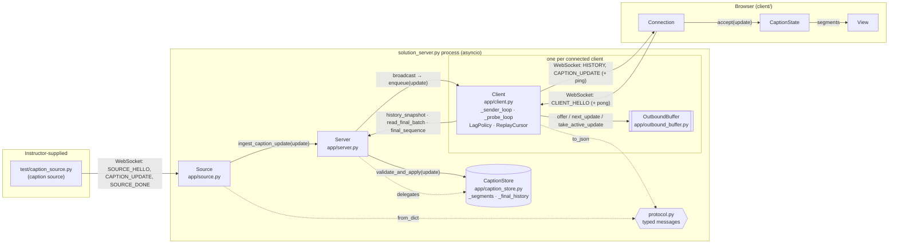
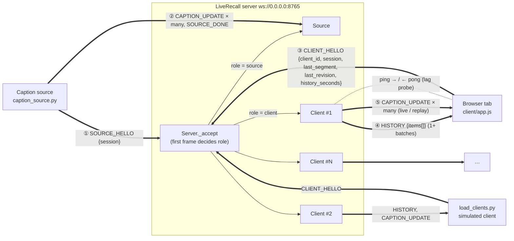
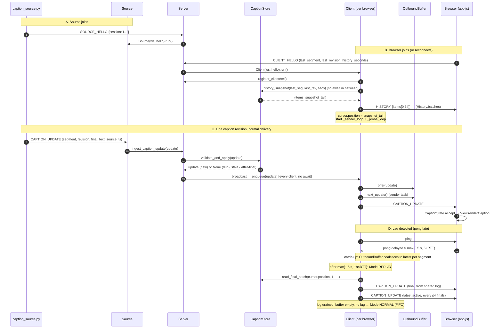
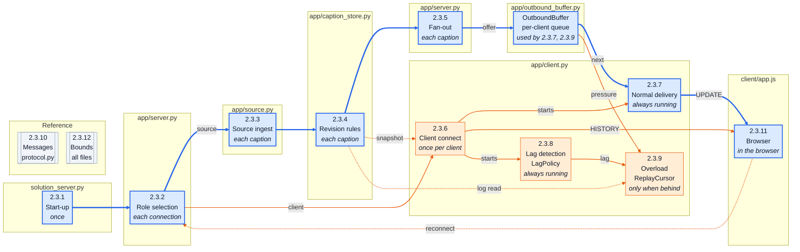

# LiveRecall: Backend Server ↔ Client Architecture and Protocol

This document describes the code on **`main`** (commit `6401e91`, after PR #9 "live caption catch-up" and PR #11 "bounded recovery history"), with **`app/client.py` and `app/outbound_buffer.py` taken from the reorganised copies in `reorganised/app/`**.

- **The reorganised copies are drop-in replacements.** They keep the same behaviour and pass the same test suite (`python -m unittest discover -s test -p 'test_*.py'`) when copied over the originals. They split the code into small classes (`Mode`, `LagPolicy`, `ReplayCursor`, `Usage`) and put the golden path first. `submission_root/app/` still holds the originals.
- Line numbers for `app/client.py` and `app/outbound_buffer.py` refer to `reorganised/app/`. All other line numbers refer to commit `6401e91`.
- Paths are relative to `submission_root/` unless stated otherwise.
- `experimentations-upgrade` has a different `client.py` delivery engine. `docs/CLIENT_AND_BUFFER_WALKTHROUGH.md` on that branch describes it; it does **not** match this document.

**Part 1** covers the components: the files, what each component owns, and how they talk.
**Part 2** covers the protocol: the network view, the forward flow of information, and a section-by-section explanation with the code and variables involved.

---

## Part 1: High-level components

### 1.1 Files

| File | Lines | Role |
|---|---|---|
| `solution_server.py` | 35 | **Required entry point** (`python solution_server.py --port 8765`, PDF §5). A thin launcher: puts its own folder on `sys.path` so it works from any working directory, then calls `Server.main()`. |
| `app/__init__.py` | 13 | Package docstring listing the module layout. |
| `app/server.py` | 172 | **`Server`**, the coordinator. Opens the WebSocket listener, routes each new connection to `Source` or `Client`, owns the single `CaptionStore` and the set of connected clients, and fans updates out. Also holds the `--port/--host` CLI. |
| `app/source.py` | 63 | **`Source`**, the one caption-source connection. Reads `CAPTION_UPDATE` / `SOURCE_DONE` and hands updates to the server. No revision logic of its own. |
| `app/caption_store.py` | 249 | **`CaptionStore`**: revision and dedup rules, plus the bounded **final log** (90 s), which serves reconnect HISTORY *and* connected catch-up replay. Pure logic: no sockets, no `await`. |
| `app/client.py` (reorganised) | 622 | **`Client`**, one browser or load-test connection: HISTORY on connect, a live sender task, a lag probe task, and replay from the shared final log when the client falls behind. Also holds three helpers used only by `Client`: **`Mode`** (the delivery modes), **`LagPolicy`** (lag decisions, pure) and **`ReplayCursor`** (position in the shared log, pure). |
| `app/outbound_buffer.py` (reorganised) | 283 | **`OutboundBuffer`**, the per-client bounded pending queue. FIFO (every revision) normally; coalesces to the latest state per segment under lag or pressure. **`Usage`** is its count/byte value used by the limit checks. |
| `app/protocol.py` | 266 | Typed wire messages: `SourceHello`, `ClientHello`, `CaptionUpdate`, `History` (with `batches()`), `SourceDone`. Validate on parse and serialise on send. |
| `client/index.html` | 159 | Browser UI: status pill, live caption list, "What did I miss?" recall panel with 15/30/60 s buttons, simulated-disconnect control. |
| `client/app.js` | 434 | Browser logic: `CaptionState` (local revision mirror and resume cursor), `View` (rendering), `Connection` (WebSocket, hello, reconnect). |
| `requirements.txt` | – | Python dependency: `websockets`. |

Outside `submission_root/` (instructor-supplied, not modified): `test/caption_source.py` (the caption source), `test/load_clients.py` (simulated clients), and `test/run_demo.py` (the harness).

### 1.2 Components

**Backend (one Python process, one asyncio event loop):**

| Component | Class / file | Owns | Talks to |
|---|---|---|---|
| Entry point | `solution_server.py` | CLI start-up | `Server.main()` |
| Coordinator | `Server` (`app/server.py:24`) | The listener, `_store` (one `CaptionStore`), `_clients` (set of `Client`), `_source_connected` flag | `Source`, `Client`, `CaptionStore` |
| Source handler | `Source` (`app/source.py:27`) | The source WebSocket | `Server.ingest_caption_update` |
| State and history | `CaptionStore` (`app/caption_store.py:59`) | `_segments` (current state per segment), `_final_history` (sequence → final), `_final_tail` | Called only by `Server` (and through it by `Client`) |
| Per-client connection | `Client` (`app/client.py:226`) | One client WebSocket, its current `Mode`, two tasks (sender, probe), and one each of `OutboundBuffer`, `LagPolicy`, `ReplayCursor` | `Server` (history, final log), its helpers, the socket |
| Delivery modes | `Mode` (`app/client.py:51`) | `NORMAL`, `COALESCING`, `REPLAY`, and the table of transitions | Read by `Client` |
| Lag decisions | `LagPolicy` (`app/client.py:85`) | RTT estimate, thresholds, catch-up window and back-off. Pure: no socket, no `await` | Fed by `Client._probe_loop` |
| Replay position | `ReplayCursor` (`app/client.py:176`) | `position` in the shared final log; picks the next replay message. Pure | Called by `Client._next_delivery` |
| Per-client queue | `OutboundBuffer` (`app/outbound_buffer.py:46`) | `_pending` updates for one client, plus limits | Called only by its `Client` |
| Wire format | `protocol.py` | Message classes | Used by everyone |

**Frontend (browser):**

| Component | In `client/app.js` | Owns |
|---|---|---|
| `CaptionState` | line 42 | `segments` (Map segment → caption), `lastFinalSegment` / `lastFinalRevision` (resume cursor), `suppressed` counter |
| `View` | line 130 | DOM rows (one per segment), recall panel, stats |
| `Connection` | line 266 | The `WebSocket`, the hello, message dispatch, reconnect with back-off |

### 1.3 How the components talk



**Reading the diagram:**
- **Solid arrows** are calls or messages on the live path.
- **Dotted arrows** are helper relationships: `Server` delegating to `CaptionStore`, and everyone using `protocol.py`.
- The only connection between the source side and the client side is `Server.broadcast`, which is **synchronous** (no `await`). A slow client therefore can't slow down the source or other clients (PDF #10).
- Each `Client` reads finals back from the **shared** `CaptionStore` log during catch-up. The finals are stored once, not copied into every client's buffer.

---

## Part 2: The current protocol

### 2.1 Network diagram

All connections are WebSockets to one port (default `8765`) on the server. The first message on each connection decides its role.



**Close codes the server uses:**

| Code | Name | When | Code location |
|---|---|---|---|
| 1008 | Policy Violation (`Server.BAD_HELLO`) | No valid hello within 5 s, non-JSON or non-object first frame, unknown first type, malformed hello, or a second source while one is connected | `server.py:55-100` |
| 1013 | Try Again Later (`Client.TOO_FAR_BEHIND`) | A client exceeds its buffer hard limits, a send or probe stalls past 75 s, or its replay cursor falls out of the 90 s log | `client.py:369, 372, 405, 470` |

**Transport settings** (`server.py:41-48`):
- `max_size = 2**20`: the largest frame accepted (1 MiB).
- `ping_interval = None`: the library's own heartbeat is **off**, because `Client._probe_loop` is the heartbeat. A second, independent heartbeat could kill a client in legitimate catch-up before the application's 75 s stall budget expires.

### 2.2 Forward flow of information

The sequence below follows one caption from the source to the screen, then shows the reconnect and catch-up paths.



**Information flows in one direction.** Captions only travel **source → server → client**. After its single `CLIENT_HELLO`, a client sends nothing except automatic pong replies. There is no client ACK, so the server learns about client progress only through ping/pong timing.

### 2.3 Section-by-section explanation

The subsections follow one caption from the source (left) to the browser (right). The map below shows how they connect. Each box is one subsection; its italic line says what activates it, and the frame around it names the file its code is in. The tables under the map explain the triggers and each arrow.



The **blue line** is the main path: one caption going from the source to the screen with nothing going wrong (2.3.1 → 2.3.2 → 2.3.3 → 2.3.4 → 2.3.5 → `OutboundBuffer` → 2.3.7 → 2.3.11). Everything **orange** branches off it: client setup, lag handling, and reconnect. The **grey** boxes are reference sections that never run.

The frames group subsections by the file that holds their code. `app/server.py` appears twice because the server is visited twice on the main path: once to route the connection (2.3.2) and again to fan the accepted caption out (2.3.5), with `source.py` and `caption_store.py` in between. `app/outbound_buffer.py` has its own frame holding the `OutboundBuffer` box. It isn't a subsection of its own: 2.3.5 puts updates into it, 2.3.7 takes them out, and 2.3.9 switches it into coalescing and replay.

The italic line in each box says **when** that code runs:

| Trigger | Activated by | Subsections |
|---|---|---|
| Once, at server start | `python solution_server.py` | 2.3.1 |
| Every new connection | Any WebSocket connecting, before its role is known | 2.3.2 |
| Every caption from the source | Each `CAPTION_UPDATE` frame the source sends | 2.3.3, 2.3.4, 2.3.5 |
| Once per client connect | A `CLIENT_HELLO` (first join or reconnect) | 2.3.6 |
| Always running while connected | Two tasks started by 2.3.6: the sender wakes whenever something is queued, the probe runs every 0.25 s | 2.3.7, 2.3.8 |
| Only when a client falls behind | A late pong, or the client's buffer hitting its pressure limit | 2.3.9 |
| In the browser | Page load, every received frame, and every disconnect | 2.3.11 |
| Reference | Never runs; describes formats and limits for every step | 2.3.10, 2.3.12 |

| Arrow | What it is |
|---|---|
| **Main path** | |
| 2.3.1 → 2.3.2 | Every new connection runs `Server._accept` |
| 2.3.2 → 2.3.3 (source) | A `SOURCE_HELLO` first frame makes the connection the source |
| 2.3.3 → 2.3.4 | A valid `CAPTION_UPDATE` goes to `CaptionStore.validate_and_apply` |
| 2.3.4 → 2.3.5 | Only genuinely new state is broadcast |
| 2.3.5 → `OutboundBuffer` (offer) | `Client.enqueue` calls `offer`, putting the update into the client's queue |
| `OutboundBuffer` → 2.3.7 (next) | The sender takes the oldest pending update with `next_update` |
| 2.3.7 → 2.3.11 (UPDATE) | The sender delivers a live `CAPTION_UPDATE` to the browser |
| **Branches** | |
| 2.3.2 → 2.3.6 (client) | A `CLIENT_HELLO` first frame makes the connection a client |
| 2.3.4 ⇢ 2.3.6 (snapshot) | `history_snapshot` builds HISTORY and sets the replay cursor |
| 2.3.6 → 2.3.7 and 2.3.8 (starts) | Connect starts the sender task and the probe task |
| 2.3.6 → 2.3.11 (HISTORY) | HISTORY batches are sent before any live update |
| 2.3.8 → 2.3.9 (lag) | A late pong opens the `LagPolicy` catch-up window, then `_enter_replay` if the lag persists |
| `OutboundBuffer` → 2.3.9 (pressure) | A pressured buffer (256 pending or 4 MiB) makes `enqueue` call `_escalate_to_replay` |
| 2.3.4 ⇢ 2.3.9 (log read) | `ReplayCursor.next_replay` reads finals from the shared log with `read_final_batch` |
| 2.3.11 ⇢ 2.3.2 (reconnect) | The browser reconnects with a `CLIENT_HELLO` carrying its last final |

Dotted arrows are reads from the shared log, plus the reconnect loop. 2.3.9 has no arrow back into the main path, to keep that path straight: while the client is in `Mode.REPLAY`, `_next_delivery` asks `ReplayCursor` instead of the buffer, and the sender still does the sending.

---

#### 2.3.1 Start-up: `solution_server.py` → `Server.run`

```python
# solution_server.py
sys.path.insert(0, str(Path(__file__).resolve().parent))   # works from any cwd
from app.server import Server
Server.main()
```

`Server.main` (`server.py:160`) parses `--port` (default 8765) and `--host` (default `0.0.0.0`, recommended by PDF §5), then runs `Server(host, port).run()` inside `asyncio.run`.

`Server.__init__` (`server.py:29`):

| Variable | Type | Meaning |
|---|---|---|
| `_host`, `_port` | str, int | Bind address |
| `_store` | `CaptionStore` | The **one** source of truth for caption state and history |
| `_clients` | `set[Client]` | Currently connected clients (broadcast targets) |
| `_source_connected` | bool | Enforces one active source (PDF §4.1) |

`Server.run` (`server.py:38`) starts `websockets.serve(self._accept, …)` and waits forever. Every new TCP/WebSocket connection runs `_accept` as its own task.

---

#### 2.3.2 Role selection: `Server._accept` (`server.py:55-100`)

```python
raw = await asyncio.wait_for(ws.recv(), timeout=HELLO_TIMEOUT_SECONDS)   # 5 s
payload = json.loads(raw)
kind = payload.get("type")
if kind == "SOURCE_HELLO":   ... Source(ws, hello, self).run()
elif kind == "CLIENT_HELLO": ... Client(ws, client_hello, self).run()
else: close 1008
```

**What and why:**
- The protocol is a JSON *tagged union*. `_accept` is the only place that looks at a raw dict (`payload["type"]`); everything downstream gets a typed object from `protocol.py`.
- **Timeout of 5 s:** a connection that never says hello can't hold a slot forever.
- **Source:** `SourceHello.from_dict` requires a non-empty `session`. A second source is refused while `_source_connected` is true, and a `try/finally` clears the flag when the source leaves.
- **Client:** `ClientHello.from_dict` is **lenient**. Missing or invalid fields get defaults, so a sloppy client still works (see §2.3.10).
- Malformed JSON, a non-object payload, or an unknown type all close with **1008**. They never crash the server.

---

#### 2.3.3 Source ingest: `Source.run` → `Server.ingest_caption_update`

`source.py:31-63`:

```python
async for raw in self.ws:
    payload = json.loads(raw)                    # bad JSON → skip, never crash
    kind = payload.get("type")
    if kind == "CAPTION_UPDATE":
        update = CaptionUpdate.from_dict(payload)          # strict validation
        if update is not None and update.session == self.hello.session:
            self.server.ingest_caption_update(update)
    elif kind == "SOURCE_DONE": print(...)                  # test control, not forwarded
    else: continue                                          # forward compatibility
```

- **`CaptionUpdate.from_dict` is strict** (`protocol.py:138`): `segment` and `revision` must be positive ints (bools rejected), `source_ts` a finite non-negative number, `final` a real bool, and `text` and `session` strings. A malformed caption is **dropped, not repaired**, because guessing a segment or revision would corrupt the revision state.
- **Extra fields are ignored** (PDF §4.1 says the source may add test-phase labels).
- **The session must match** the source's `SOURCE_HELLO`.

`Server.ingest_caption_update` (`server.py:139`):

```python
accepted = self._store.validate_and_apply(update)
if accepted is not None:
    self.broadcast(accepted)
```

Only *genuinely new* state is broadcast.

---

#### 2.3.4 Revision rules and the final log: `CaptionStore.validate_and_apply` (`caption_store.py:89`)

State:

| Variable | Meaning |
|---|---|
| `_segments: dict[int, SegmentState]` | Current winning revision per segment, with `received_at` (server monotonic time) and `final_sequence` |
| `_active_segments: set[int]` | Segments not yet final (count-bounded by `MAX_ACTIVE_SEGMENTS = 4000`) |
| `_final_history: dict[int, SegmentState]` | **The final log**: contiguous `final_sequence` → final, in acceptance order |
| `_final_tail` | Sequence number of the newest accepted final |
| `_evicted_final_sequence` | Highest sequence already dropped by the 90 s horizon |
| `_retired_before` | Segments below this were reclaimed; late revisions for them are rejected |

The rules, in order:

```python
if update.segment < self._retired_before: return None          # long-gone segment
existing = self._segments.get(update.segment)
if existing and existing.final:            return None          # 1. finals are durable
if existing and update.revision <= existing.revision: return None   # 2. only forward
if update.final: self._final_tail += 1                          # next log sequence
state = SegmentState(update, received_at=clock(), final_sequence=…)
self._segments[segment] = state
if update.final: self._final_history[state.final_sequence] = state   # append once
```

**Why these two invariants matter:**
1. **A final is durable.** Nothing overwrites it, so each segment enters `_final_history` **exactly once**. That is why HISTORY plus live delivery can never produce a duplicate final (PDF #7).
2. **Revisions only move forward.** One rule (`<=`) covers duplicates, replays and out-of-order arrivals (PDF §4.2: "never display an older revision after a newer one").

**Bounds** (`_trim_history`, `caption_store.py:219`): finals older than `HISTORY_HORIZON_SECONDS = 90` s are evicted *by age*. A burst can't push out finals still needed for a 60 s recovery request (PDF #8). The 30 s margin over 60 is what lets connected clients replay a little further back during catch-up.

---

#### 2.3.5 Fan-out: `Server.broadcast` → `Client.enqueue`

```python
def broadcast(self, update):                 # server.py:145
    for client in self._clients:
        client.enqueue(update)               # synchronous, in-memory only
```

- **There is no `await` in the loop**, so it can't be interrupted. No client can unregister halfway through, and no copy of the set is needed.
- **Slow-client isolation (PDF #10):** `enqueue` never touches the network, so the source's read loop and every other client are independent of the slowest reader.

`Client.enqueue` (`client.py:315-332`) branches on the client's stored mode (`Mode`, `client.py:51`):

```python
if self._mode is Mode.REPLAY:                         # finals come from the shared log
    if update.final: self._buffer.discard_segment(update.segment)   # log owns finals
    else:            self._buffer.offer(update)                      # keep latest active
else:                                                 # NORMAL (or COALESCING)
    self._buffer.set_coalescing(self._catchup)        # lag → coalescing; False on the golden path
    self._buffer.offer(update)
    if self._buffer.pressured or self._buffer.should_close:
        self._escalate_to_replay(update)              # switch finals to the shared log
self._wake.set()                                      # wake the sender
```

`_escalate_to_replay` (`client.py:424-431`) calls `_enter_replay`, then drops the update if it is a final (the log has it) or offers it again if the buffer had refused it (finals have now left the buffer).

**Why "the log owns finals" in replay:** a behind client doesn't need its own copy of every final; they are all in `CaptionStore._final_history`. The client only keeps a `ReplayCursor` and reads forward from `cursor.position`, which keeps per-client memory small however far behind it is.

---

#### 2.3.6 Client connect: HISTORY and the cursor (`Client.run`, `client.py:265-313`)

```python
self.server.register_client(self)                       # 1. receive broadcasts from now on
items, snapshot_tail = self.server.history_snapshot(    # 2. same tick, no await
    hello.last_segment, hello.last_revision, hello.history_seconds)
for history in History.batches(items):                  # 3. ≤64 items / 256 KiB per frame
    if not await self._send(history): return
self._cursor.position = snapshot_tail                   # 4. replay boundary
self._tasks = [create_task(self._sender_loop()), create_task(self._probe_loop())]
async for _ in self.ws: pass                            # 5. wait for disconnect
```

| Step | Variables | Why |
|---|---|---|
| 1 → 2 with no `await` between | `_clients`, `items`, `snapshot_tail` | A final produced at this instant is either already in `items` (sent via HISTORY) or arrives later through `enqueue`, **never neither and never both**. Explained in the comment at the top of `run`. |
| `history_snapshot` (`caption_store.py:150`) | `compute_history` plus `_final_tail` | Returns finals with `(segment, revision) > (last_segment, last_revision)` that the server accepted within `min(history_seconds, 60)` s, oldest first (PDF §4.2). It also returns the log position at that instant. |
| `History.batches` (`protocol.py:211`) | `max_items = 64`, `max_bytes = 256 KiB` | A long context is split into several valid HISTORY frames (PR #11), so no frame gets near `max_size`. **Empty context still yields one empty HISTORY**, preserving "on CLIENT_HELLO, the server returns a HISTORY". |
| Sending HISTORY *before* creating the sender task | – | No live update can precede HISTORY. |
| `_cursor.position = snapshot_tail` | `ReplayCursor.position` | If the client later enters replay, it reads finals **after** this point. Older finals were either in HISTORY or deliberately not requested. |

On disconnect (`finally`, `client.py:301-313`): cancel both tasks, `unregister_client`, and print the `coalesced / rejected / held` counters.

---

#### 2.3.7 Normal delivery: `_sender_loop` and `_next_delivery`

`_sender_loop` (`client.py:334-374`):

```python
while True:
    await self._wake.wait(); self._wake.clear()          # clear AFTER waking: no lost wake-ups
    sent_items = sent_bytes = 0
    while self._buffer.has_pending() or self._mode is Mode.REPLAY:
        if self._buffer.should_close: break
        if self._window_full(sent_items, sent_bytes):    # only true in catch-up
            await self._hold()                           # paced: one window per completed probe
            sent_items = sent_bytes = 0
        selected = self._next_delivery()
        if selected is None: break                       # only a young provisional waiting
        delivery, through_sequence = selected
        self._in_flight = delivery
        if not await self._send(delivery): return
        self._cursor.position = through_sequence         # commit cursor only AFTER the send
        self._in_flight = None
        sent_items += 1; sent_bytes += len(delivery.to_json())
```

- **One sender per client** owns the in-flight message. The cursor advances **only after** a successful send, so a final can't be skipped if the send fails.
- **Normal mode (`_next_delivery`, `client.py:376-396`, the last block):** `self._buffer.next_update()` takes the oldest pending entry in **strict FIFO order**. Every revision is sent, which gives full update coverage when there is no overload (PDF §10). For a final, `through_sequence = self.server.final_sequence(delivery)` records its log position, so the cursor stays correct even in normal mode.

`OutboundBuffer` on the golden path:
- `offer` (`outbound_buffer.py:82-94`) ends in `_store` (`outbound_buffer.py:126-137`), which appends under a new monotonic key (`_next_key`). **Several revisions of the same segment can be pending at once**, which preserves the full revision sequence.
- `next_update` (`outbound_buffer.py:96-100`) pops the oldest key.
- `_by_segment` (the per-segment index) is used only while coalescing.

---

#### 2.3.8 Lag detection: `_probe_loop` (`client.py:445-498`) and `LagPolicy` (`client.py:85-165`)

There is no ACK, so lag is inferred from ping/pong. The client library stops reading TCP when its own inbound queue is full, which delays its pong.

The work is split in two. `_probe_loop` does the async waiting (ping, timeouts, sleep). `LagPolicy` holds every number and decision, takes timestamps, and never awaits, so it can be tested without a socket.

```python
started  = loop.time()
deadline = started + MAX_STALL_SECONDS                  # 75 s terminal budget
replay_at = started + self._lag.replay_threshold()      # max(1.5 s, 18 × RTT)
self._pending_probe = create_task(self._round_trip())   # ping → await pong
try:
    latency = await _wait_task(pending_probe, min(self._lag.behind_threshold(), 75))  # max(0.5 s, 6 × RTT)
except TimeoutError:                                    # pong is LATE
    self._lag.lag_started(now)                          # adaptive back-off
    while True:
        if now >= deadline: close(1013, "probe exceeded stall budget"); return
        self._lag.still_lagging(now)                    # catchup_until = now + catchup_lease
        self._wake.set()
        if now >= replay_at: self._enter_replay()       # persistent lag → replay
        latency = await _wait_task(pending_probe, min(0.25, remaining)) … break on success
self._lag.probe_finished(started, now, latency, was_late)   # learn RTT, capped
self._probe_tick.set(); self._wake.set()
await asyncio.sleep(0.25)                               # PROBE_INTERVAL_SECONDS
```

| Name | Value | Meaning |
|---|---|---|
| `LagPolicy.behind_threshold()` | max(0.5 s, 6 × `rtt`) | When a pong counts as late. Scaled by the link's own RTT, so netem delay of 120 ms ± 30 ms isn't read as lag. |
| `LagPolicy.replay_threshold()` | max(1.5 s, 18 × `rtt`) | How long lag must persist before switching finals to log replay. |
| `Client.MAX_STALL_SECONDS` | 75 s | Terminal budget for one probe (and for one send in `_send`). It is below the log's 90 s retention, so a client that is closed can still recover by reconnecting. |
| `LagPolicy.catchup_until` | time | `Client._catchup` is true until this time. `still_lagging` renews it every 0.25 s while the pong is late. |
| `LagPolicy.catchup_lease` | 3 s → up to 30 s | How long catch-up lasts after lag ends (see `lag_started`). |
| `LagPolicy.rtt` | EWMA | Learns from late pongs too, but each sample is capped at the behind threshold, so one congestion spike can't inflate the baseline. |
| `Client._probe_tick` | Event | Set after each completed probe. `_hold()` waits on it, so catch-up sending is paced to one window (≤ 64 items / 256 KiB) per completed probe. |

**`LagPolicy.lag_started` (`client.py:122-141`), adaptive back-off.** If a client left replay (`start_normal_trial` recorded the time) and lags again soon after, within `probation` = min(30 s, max(12 s, 2 × last lag duration)), the catch-up lease **doubles** (up to 30 s). If the normal trial lasted longer than that, the lease resets to 3 s. A client that can't sustain full updates therefore stays in catch-up longer instead of oscillating.

---

#### 2.3.9 Overload handling: coalescing, then replay

The client is always in one of three modes (`Mode`, `client.py:51-77`). Only `NORMAL` and `REPLAY` are stored in `Client._mode`. `COALESCING` is reported by the `Client.mode` property when the stored mode is `NORMAL` and the `LagPolicy` catch-up window is open, because that window expires by time.

| Mode | Buffer | Finals come from | Entered when | Left when |
|---|---|---|---|---|
| `NORMAL` | FIFO, every revision | the buffer | start, or caught up after replay | a pong is late |
| `COALESCING` | latest entry per segment | the buffer | a pong is late | the window expires, or replay starts |
| `REPLAY` | latest active state only | the shared log via `ReplayCursor` | buffer pressured or full (`enqueue`); catch-up or pressure seen by the sender (`_next_delivery`); lag outlasts the replay threshold (`_probe_loop`) | log drained, buffer empty, no lag |

Every switch into replay goes through `_enter_replay` (`client.py:414-422`). The only way back is `_leave_replay_if_caught_up` (`client.py:433-439`).

**Stage 1, coalescing (`OutboundBuffer.set_coalescing`, `_compact`).**
- While `_catchup` is true, `enqueue` calls `set_coalescing(True)` (`outbound_buffer.py:190-204`).
- `_compact` (`outbound_buffer.py:210-228`) rebuilds the queue keeping only **the latest entry per segment, at the segment's original queue position**, and keeps its first enqueue time. From then on, `offer` replaces the segment's entry instead of appending.
- That entry is either the segment's final or its newest provisional, exactly what PDF §4.3 says must be preserved.
- The same compaction triggers automatically on **pressure**: `_apply_soft_limit` (`outbound_buffer.py:164-176`) turns it on at 256 pending updates or projected bytes over 4 MiB.

**Stage 2, replay from the shared log.** Lag persists past `replay_threshold()`, or the buffer is pressured.

```python
# OutboundBuffer.drop_finals_keep_latest_active (outbound_buffer.py:234-246), called by _enter_replay
self._lag_coalescing = True; self._compact()
drop all pending finals from the buffer            # they are in CaptionStore._final_history
self._pressure_active = False; self._should_close = False

# ReplayCursor.next_replay (client.py:194-218), called by _next_delivery in REPLAY
if self.finals_since_active >= MAX_FINALS_BEFORE_ACTIVE (4):
    send latest active segment (with 1 s provisional grace)      # don't starve live text
items, through = read_final_batch(self.position, 1, 256 KiB)     # next final after the cursor
if items: self.finals_since_active += 1; return items[0], through
else send latest active, if any; else return None

# Client._leave_replay_if_caught_up (client.py:433-439), when next_replay returns None
if not self._catchup and buffer empty:                            # caught up → leave replay
    self._mode = Mode.NORMAL; set_coalescing(False); self._lag.start_normal_trial(now)
```

| Design point | Why |
|---|---|
| Finals come from `read_final_batch(position, 1, …)` (`caption_store.py:181`) | Every final is delivered **exactly once and in order**, and the client holds only a cursor. If the cursor falls behind `_evicted_final_sequence` (older than 90 s), `ReplayExpired` is raised and the client is closed (1013) to reconnect, rather than finals being **silently skipped**. |
| Replay finals are sent as **individual `CAPTION_UPDATE`s**, not HISTORY | HISTORY stays the reply to `CLIENT_HELLO` (PDF §4.2). Mid-connection catch-up uses ordinary live messages. |
| An active segment is sent after at most 4 finals (`ReplayCursor.MAX_FINALS_BEFORE_ACTIVE`) | Catching up on old finals must not freeze the live line on screen. |
| `ReplayCursor.PROVISIONAL_GRACE_SECONDS = 1.0` for active segments | A provisional queued for under 1 s is likely to be replaced by its final, which saves a message. |
| Leaving replay requires no lag **and** an empty buffer, with no `await` between the check and the switch | No update can arrive between "caught up" and "back to normal FIFO". |
| `ReplayCursor` and `LagPolicy` never await | All replay and lag decisions are plain method calls, so the ordering guarantees above can't be broken by an interleaving task. |

---

#### 2.3.10 Message reference (all JSON text frames)

| Message | Direction | Fields | Validation (`protocol.py`) |
|---|---|---|---|
| `SOURCE_HELLO` | source → server, first frame | `type`, `session` | `session`: non-empty string, else 1008 |
| `CAPTION_UPDATE` | source → server; server → client | `type`, `session`, `segment`, `revision`, `source_ts`, `final`, `text` | **Strict:** positive ints, finite `source_ts ≥ 0`, real bool, strings. Invalid → dropped. Extra fields ignored. |
| `SOURCE_DONE` | source → server | `type`, `session`, optional `segments` | Logged only; not forwarded (PDF §4.1). |
| `CLIENT_HELLO` | client → server, first frame | `type`, `client_id`, `session`, `last_segment`, `last_revision`, `history_seconds` | **Lenient:** bad or missing values default to `client_id=0`, `session="L1"`, `last_*=0`, `history_seconds=30`, capped at 60. |
| `HISTORY` | server → client, reply to hello (1+ frames) | `type`, `items: [CAPTION_UPDATE…]` | Finals only, oldest first, excluding finals the client already reported. |
| ping / pong | server → client / automatic reply | WebSocket control frames | Answered by the client library. Used for lag detection only. |

**Why strict for captions and lenient for hellos:** a wrong segment or revision corrupts shared state for everyone, while a defaulted hello only affects that one client's context request.

**`CaptionUpdate.to_json()` is cached** on the (frozen) object (`protocol.py:179`). One update fanned out to N clients is serialised once, not N times.

---

#### 2.3.11 Browser side: `client/app.js`

**Connect and hello (`Connection.connect`, lines 286-345):**

```js
ws = new WebSocket(serverUrl());                    // ws://<page host>:8765, or ?ws= override
ws.onopen → ws.send(JSON.stringify({
    type: "CLIENT_HELLO", client_id: this.clientId(), session: "L1",
    last_segment: state.lastFinalSegment,           // resume cursor = latest FINAL held
    last_revision: state.lastFinalRevision,
    history_seconds: 60 }));
ws.onmessage → CAPTION_UPDATE → applyUpdates([msg], false)
               HISTORY        → applyUpdates(msg.items, true)
               anything else  → ignored
ws.onclose → scheduleReconnect()
```

| Variable | Meaning | Why |
|---|---|---|
| `clientId()` | Random 6-digit id in `sessionStorage` | Stable per tab across reconnects, new for a new tab |
| `lastFinalSegment/Revision` | Latest **final** accepted | The reconnect asks for exactly what is missing. A provisional is never used as the cursor, because it may still change. |
| `history_seconds: 60` | Ask for the full recovery window | Gives the 60 s recall view context after a late join |

**The single acceptance gate (`CaptionState.accept`, lines 55-84):**

```js
if (held && (held.final || update.revision <= held.revision)) { suppressed++; return false; }
segments.set(segment, {...});  if final: advance lastFinal cursor;  prune();
```

This mirrors the server's two invariants exactly, so live and HISTORY items pass the same rule. Even if HISTORY and live updates overlapped, a final could never be shown twice (PDF #7).

**Rendering (`View.renderCaption`, lines 171-181):** one DOM row per segment, rewritten in place. A newer revision **replaces** the line rather than adding one (PDF #2). The CSS classes `is-final` and `is-live` make the two visually distinct (PDF #1).

**"What did I miss?" (`CaptionState.recall`, lines 111-116):** filters *local* finals by `sourceTs ≥ now − seconds`, using the 15/30/60 s buttons (default 30). **No server request** is made; PDF #3 requires local state under normal operation.

**Local bounds (`prune`, lines 86-103):** finals older than `RETENTION_SECONDS = 150` are deleted, and at most `MAX_ACTIVE_SEGMENTS = 400` unfinished segments are kept. The DOM is capped at `MAX_ROWS = 80`.

**Reconnect (`scheduleReconnect`, lines 371-385):** exponential back-off of 0.5 s, 1 s, 2 s … capped at 5 s, shown in the status pill ("reconnecting in 2.0s"). That satisfies PDF #4, automatic reconnect with the state reported to the user. `dropNow` (the "Simulate disconnect" button) closes the socket and enforces a minimum offline time for the demo.

---

#### 2.3.12 Bounds and failure handling (summary)

| Resource | Bound | Where | What happens when it is hit |
|---|---|---|---|
| Shared final log | 90 s by age | `CaptionStore._trim_history` | Oldest finals evicted. A replay cursor behind them raises `ReplayExpired` → 1013 → client reconnects with HISTORY. |
| Active segments (server) | 4000 | `CaptionStore._trim_segments` | Lowest active segment retired |
| Per-client pending | 256 updates (soft) / 4096 finals, 4000 active, 4 MiB (hard) | `OutboundBuffer` | Soft: compact and replay. Hard: refuse, `should_close` → replay, or close 1013 if latest active state alone doesn't fit. |
| One send | 75 s | `Client._send` | Close 1013 |
| One probe (pong) | 75 s | `Client._probe_loop` | Close 1013 |
| Closing handshake | 2 s | `Client._close` | `transport.abort()`: a dead peer can't hold the socket |
| Hello | 5 s | `Server._accept` | Close 1008 |
| Browser state | 150 s finals, 400 active, 80 rows | `app.js` | Pruned |

---

### 2.4 Code walkthrough: `reorganised/app/client.py` and `reorganised/app/outbound_buffer.py`

These two files are the right-hand side of the §2.3 diagram: the `OutboundBuffer` box and the `app/client.py` frame. Both are laid out the same way: a docstring that explains the layout, small helper classes first, then the main class with its **golden path** first, then each extra feature in its own banner section, and finally a labelled **test compatibility** block.

The last column of each table says where the code sits on the diagram:

- **Main:** on the blue path (a caption delivered with nothing going wrong).
- **Branch:** on an orange arrow or box (client setup, lag, overload).
- **Support:** a helper used inside a box, not an arrow of its own.

#### 2.4.1 How a caption crosses the two files

On the blue path, one caption goes through these steps:

1. `Server.broadcast` calls `Client.enqueue` (`client.py:315`). This is the end of box **2.3.5 Fan-out**.
2. `enqueue` calls `OutboundBuffer.offer` (`outbound_buffer.py:82`), which ends in `_store`. This is the blue **offer** arrow into the `OutboundBuffer` box.
3. `enqueue` sets `_wake`. Nothing has touched the network yet.
4. `_sender_loop` wakes (`client.py:334`) and calls `_next_delivery`, which calls `OutboundBuffer.next_update` (`outbound_buffer.py:96`). This is the blue **next** arrow into box **2.3.7**.
5. `_send` writes the frame to the socket (`client.py:398`), then the sender sets `_cursor.position`. This is the blue **UPDATE** arrow to **2.3.11**.

The orange branches leave this path at three points:

- **pressure:** in step 2, `_apply_soft_limit` finds 256 pending updates or 4 MiB queued and sets `_pressure_active`. `enqueue` then sees `pressured` and calls `_escalate_to_replay` → `_enter_replay` → **2.3.9**.
- **lag:** `_probe_loop` (**2.3.8**) gets a late pong and calls `LagPolicy.still_lagging`, opening the catch-up window. From then on, step 2 passes `set_coalescing(True)`, so the buffer coalesces, and step 4 calls `_enter_replay`. If the lag lasts past `replay_threshold()`, the probe also calls `_enter_replay`.
- **log read:** in `Mode.REPLAY`, step 4 asks `ReplayCursor.next_replay`, which reads finals from `server.read_final_batch` instead of the buffer.

The return to the blue path is `_leave_replay_if_caught_up` (`client.py:433`). When there is no lag and the buffer is empty, it sets `Mode.NORMAL` and plain FIFO resumes.

#### 2.4.2 `outbound_buffer.py`

| Lines | Section | What it does | On the diagram |
|---|---|---|---|
| 1-24 | Module docstring | Describes the layout (golden path, limits, coalescing, latest-active) and the rules: never drop a segment's latest state, and taking an update out is not an acknowledgement. | `OutboundBuffer` box |
| 34-43 | `Usage` | A small value: `active`, `pending`, `bytes`, plus `finals`. Both limit checks use it. | **Support** |
| 51-57 | Limits | `MAX_PENDING_UPDATES = 256` and `MAX_PENDING_BYTES = 4 MiB` turn on pressure. 4096 finals, 4000 active segments and 4 MiB are the hard limits. `MAX_BATCH_ITEMS/BYTES` (64 / 256 KiB) are read by `client.py` for pacing. Class attributes, so they can be overridden per instance. | **Branch:** the pressure arrow. The hard limits are listed in 2.3.12. |
| 59-76 | `__init__` | `_pending` is a dict of key → update; insertion order is queue order. `_queued_at` records enqueue times. Then the limit flags (`_pressure_active`, `_should_close`), the coalescing state (`_by_segment`, `_lag_coalescing`) and the counters. | `OutboundBuffer` box |
| 82-94 | `offer` | 1. Refuse if a hard limit was already hit. 2. `_key_to_replace`: this segment's entry, if coalescing. 3. `_apply_soft_limit`. 4. `_usage_after` and `_within_hard_limits`: refuse and set `should_close` if over. 5. `_store`. | **Main:** the blue **offer** arrow. Steps 3–4 start the orange **pressure** arrow. |
| 96-100 | `next_update` | Pops the oldest entry (strict FIFO). The unused "final first" option from the original is gone. | **Main:** the blue **next** arrow |
| 102-111 | `has_pending`, `pending`, `pending_bytes` | Queue state read by `Client` and the tests. | **Support** |
| 113-124 | `_usage_after` | The `Usage` the buffer would have after storing an update, replacing an existing entry if given. | **Support** for both limit checks |
| 126-137 | `_store` | Replaces the entry in place (coalescing, counted) or appends under a new key with its enqueue time (golden path). | **Main** |
| 139-148 | `_take` | The single removal path. It keeps the counters correct and clears pressure when the queue empties. | **Support:** clearing pressure lets 2.3.9 hand back to the blue path. |
| 155-162 | `pressured`, `should_close` | The two flags `Client.enqueue` checks after each offer. | **Branch:** pressure arrow |
| 164-176 | `_apply_soft_limit` | At 256 entries or over 4 MiB: turn pressure on, compact, and return the segment's key in the compacted queue. | **Branch:** start of the pressure arrow |
| 178-183 | `_within_hard_limits` | 4000 active, 4096 finals, 4 MiB. | **Branch** (2.3.12) |
| 190-204 | `_coalescing`, `set_coalescing` | Coalescing is on under lag *or* pressure. `set_coalescing(True)` compacts once when it turns on; `False` drops the segment index. Called before every normal-mode offer; `False` on the golden path. | **Branch:** the 2.3.8 lag verdict reaches the buffer here |
| 206-208 | `_key_to_replace` | This segment's pending entry, if coalescing. | **Branch:** 2.3.9 stage 1 |
| 210-228 | `_compact` | Keeps each segment's *last* update at that segment's *first* position, with its first enqueue time, then recounts. | **Branch:** 2.3.9 stage 1 |
| 234-246 | `drop_finals_keep_latest_active` | Called by `Client._enter_replay`. Compacts, removes every pending final (the shared log delivers them now), and clears both limit flags. Was `begin_replay`. | **Branch:** 2.3.9 stage 2 |
| 248-252 | `discard_segment` | Removes a segment's active entry once its final is in the log. | **Branch:** 2.3.9 (`enqueue` in replay) |
| 254-263 | `take_active_update` | The oldest provisional, unless it is younger than the grace. | **Branch:** 2.3.9, via `ReplayCursor` |
| 270-276 | `coalesced`, `rejected` | Printed when the client disconnects. | **Support** |
| 279-283 | Test compatibility | `begin_replay = drop_finals_keep_latest_active`, the name the tests use. | – |

#### 2.4.3 `client.py`

| Lines | Section | What it does | On the diagram |
|---|---|---|---|
| 1-27 | Module docstring | The layout of the file, what "pure" means, and the four ordering rules that make delivery correct, with the method each one lives in. | `app/client.py` frame |
| 51-77 | `Mode` | `NORMAL`, `COALESCING`, `REPLAY`. The docstring is the full transition table, including when the client is closed (1013). | **Branch:** the modes behind 2.3.8 and 2.3.9 |
| 85-165 | `LagPolicy` (pure) | Constants (0.5 s / 6×RTT, 1.5 s / 18×RTT, 3–30 s lease) and state (`rtt`, `catchup_until`, `catchup_lease`, `last_lag_delay`, `normal_trial_started`). Methods: `behind_threshold`, `replay_threshold`, `in_catchup`, `lag_started` (back-off), `still_lagging`, `probe_finished` (learn RTT), `start_normal_trial`, `stop`. | **Branch:** box 2.3.8 and the **lag** arrow |
| 173-218 | `ReplayCursor` (pure) | `position` (last final sent) and `finals_since_active`. `next_replay` picks the next message while replaying: the latest active after every 4 finals, else the next final from the log, else the latest active, else nothing. | **Branch:** box 2.3.9 and the **log read** arrow |
| 226-233 | `Client` constants | `TOO_FAR_BEHIND = 1013`, `MAX_STALL_SECONDS = 75`, `CLOSE_TIMEOUT_SECONDS = 2`, `PROBE_INTERVAL_SECONDS = 0.25`. | Limits listed in 2.3.12 |
| 235-248 | `__init__` | Creates the `OutboundBuffer`, `LagPolicy` and `ReplayCursor`; `_mode = NORMAL`; the `_wake` and `_probe_tick` events. | Whole frame |
| 251-259 | `mode`, `_catchup` | `mode` reports `COALESCING` when stored `NORMAL` meets an open catch-up window. `_catchup` asks `LagPolicy.in_catchup(now)`. | **Branch:** 2.3.8 |
| 265-313 | `run` | Register, `history_snapshot` with no `await` in between, HISTORY in batches, `cursor.position = snapshot_tail`, start the sender and probe tasks, wait for disconnect, clean up. | **Branch:** box 2.3.6, with the **client**, **snapshot**, **HISTORY** and both **starts** arrows |
| 315-332 | `enqueue` | Never awaits. `REPLAY`: drop finals, offer provisionals. Otherwise: `set_coalescing(_catchup)`, `offer`, and `_escalate_to_replay` if pressured or full. Always sets `_wake`. | **Main:** the 2.3.5 end of the **offer** arrow. **Branch:** where pressure is acted on. |
| 334-374 | `_sender_loop` | Waits for `_wake`, drains, paces with `_window_full` / `_hold` in catch-up, sends, and sets `cursor.position` only after a successful send. Closes with 1013 on `should_close` or `ReplayExpired`. | **Main:** box 2.3.7 and the blue **UPDATE** arrow |
| 376-396 | `_next_delivery` | Enters replay if the sender sees catch-up or pressure. `REPLAY`: `cursor.next_replay(...)`, and `_leave_replay_if_caught_up` when it returns nothing. Otherwise (golden path): `buffer.next_update()`, recording a final's log position. | **Main** (last block): the blue **next** arrow. **Branch:** 2.3.9 |
| 398-408 | `_send` | One socket write, bounded by 75 s. | **Main** (2.3.12 for the limit) |
| 414-422 | `_enter_replay` | The one place that sets `Mode.REPLAY`; calls `drop_finals_keep_latest_active`. | **Branch:** entry to 2.3.9 from **pressure** and **lag** |
| 424-431 | `_escalate_to_replay` | `enqueue`'s pressure path: enter replay, then drop the final or re-offer a refused provisional. | **Branch:** the **pressure** arrow |
| 433-439 | `_leave_replay_if_caught_up` | The one place that returns to `Mode.NORMAL`, with no `await` between the check and the switch. Records the start of a normal trial for the back-off. | **Branch → Main:** the return to the blue path |
| 445-498 | `_probe_loop` | Pings every 0.25 s. If late: `lag_started`, `still_lagging` every 0.25 s, enter replay after `replay_at`, close at 75 s. On the pong: `probe_finished`, set `_probe_tick` and `_wake`. | **Branch:** box 2.3.8 and the **lag** arrow |
| 500-502 | `_round_trip` | One ping and its pong. | **Branch:** 2.3.8 |
| 504-510 | `_window_full` | In catch-up, true before each window of 64 items / 256 KiB. | **Support:** inside 2.3.7, driven by 2.3.8 |
| 512-516 | `_hold` | Waits for the next completed probe. | **Support:** inside 2.3.7, driven by 2.3.8 |
| 522-534 | `_close` | Close with 1013; abort the transport if the handshake takes over 2 s. | **Support** (2.3.12) |
| 537-596 | Test compatibility | Old private names the tests use (`_replaying`, `_last_sent_final_sequence`, `_catchup_until`, `_start_lag`, the lag constants, …), mapped onto `Mode`, `ReplayCursor` and `LagPolicy`. | – |
| 604-622 | `_wait_task`, `_stop_task` | Module functions: wait with a deadline without cancelling the task, and cancel-and-reap. Used by `_send`, `_close` and `_probe_loop`. | **Support** (2.3.12) |

---

### Appendix: notes found while documenting

- `client/index.html:151` contains a malformed attribute, `min="1"q"`. Browsers tolerate it, but it should be `min="1"`.
- The reorganised files end with a **test compatibility** block, because `test/test_delivery.py` and `test/test_live_delivery.py` read and set about a dozen private names (`_last_sent_final_sequence`, `_catchup_until`, `begin_replay`, `client.REPLAY_AFTER_SECONDS`, …). Once the tests use `ReplayCursor`, `LagPolicy`, `Mode` and `drop_finals_keep_latest_active` directly, those blocks can be deleted.
- The original `OutboundBuffer.next_update(prefer_final=…)` had a "final first" mode that `client.py` never used. The reorganised copy removes it.
- `main` doesn't include the work on `experimentations-upgrade`: GitHub Actions tc sharding, `TCP_INFO` network/reader attribution, the probe budget, and OBSERVE.md §13. The two branches change `client.py` and `outbound_buffer.py` in different directions, so merging them needs a deliberate design choice, not a mechanical merge.
