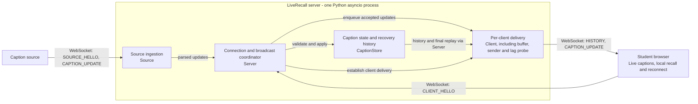

# LiveRecall Technical Report

Team: TODO | Members: TODO | Implementation commit: TODO

## 1. Architecture and protocol

LiveRecall streams captions from the supplied deterministic source to student
browsers over WebSockets. Figure 1 shows four logical components within one
Python asyncio server process.

*Figure 1. Server components and caption flow. Each receiver has its own delivery
component; history and final replay are accessed through the coordinator.*

`Source` validates producer messages and forwards session-matching updates to
`Server`, which coordinates connections and broadcasts accepted state.
`CaptionStore` enforces revision rules and retains recent finals for recovery.
Each `Client` owns an outbound buffer, sender and lag probe, separating delivery
from ingestion. Fan-out only enqueues in memory, so a blocked socket send does
not directly block other clients; fan-out work still grows with client count.
The browser replaces caption revisions, stores local recall history and
reconnects automatically.

The opening `SOURCE_HELLO` or `CLIENT_HELLO` selects the connection role. The
server supports one active source and session. A client hello reports its latest
finalized `(last_segment, last_revision)` and requests up to 60 seconds of recent
context. The server sends `HISTORY` before live `CAPTION_UPDATE` messages.

Typed protocol messages validate caption fields and serialize JSON, caching
caption serialization for reuse across clients. Malformed caption updates are
skipped, unknown fields are ignored, and invalid optional client-hello fields
are defaulted or clamped. Revision/recovery rules and overload handling are
detailed in Sections 2 and 3.

## 2. Revision and recovery semantics

`CaptionStore.validate_and_apply()` keeps one winning update per segment. An
update must increase the held revision; duplicates and stale revisions are
rejected before broadcast. Once final, a segment rejects all further updates,
including higher revisions. Each final therefore enters history once. A retirement
watermark rejects reclaimed segment IDs, relying on the source's increasing IDs.

Each accepted final receives a contiguous internal sequence number and enters
an insertion-ordered shared log, retained for 90 seconds using a monotonic clock.
The final-tail and evicted-final watermarks remain meaningful when the log is
empty. Expiry removes the corresponding segment state; a separate retirement
watermark rejects obsolete source IDs. The server retires the lowest unfinished
segment IDs when their count exceeds 4,000. Final-state memory depends on
caption rate and size within retention, not total lecture duration at a bounded
input rate. The shared final log has no fixed count or byte cap; a time window
alone is not a workload-independent memory bound. Reconnect context remains limited to the requested
0--60 seconds; connected replay can deliver older outstanding finals while
they remain in the shared log. It raises `ReplayExpired` rather than silently
skipping a prefix that has expired.

`CLIENT_HELLO` carries the latest finalized `(last_segment, last_revision)`.
Recovery returns only finals with a greater tuple, oldest first under the supplied
sequential source. A late join uses `(0, 0)`. Registration and
`history_snapshot()` execute without an intervening `await`, capturing requested
items and the final-log tail together. Recovery is split into ordered `HISTORY`
messages targeting at most 64 captions and 256 KiB of complete JSON per message.
A caption exceeding the byte target travels alone and must still fit the peer's
message limit; empty context produces one empty `HISTORY`. Only after all
snapshot messages are sent successfully does the connection initialize its
delivery cursor to that captured tail and start its sender. Finals arriving
during the send lie after the boundary; empty or zero-second context does not
replay older unrequested finals. The
cursor advances only after successful sends and is not an application ACK.
Persistent reconnect delivery sessions and application acknowledgements are
not implemented; a genuine reconnect still uses the client's recent-context
request.

The browser applies live and recovered updates through the same revision gate
and rewrites one row per segment, with distinct live/final badges. It retains
finals for 150 seconds using `source_ts`, independently of the 80-row display
limit, and caps unfinished state at 400 segments. Recall filters local finals
to 15/30/60 seconds, defaulting to 30, without a server request. Automatic
reconnect retries begin at 500 ms and double to five seconds; the browser sends
its finalized cursor and requests 60 seconds. State survives disconnection in
memory; reload becomes a late join. Browser recall assumes sufficiently aligned
source/client wall clocks.

## 3. Backpressure and overload policy

Normal delivery preserves every revision in a per-client FIFO. Lag or queue
pressure switches the existing connection to shared-log replay: pending finals
leave the local buffer, and the sender reads finals after its committed cursor.
Subsequent finals only wake the sender and remove any corresponding active
entry. Locally retained active state is coalesced without resetting its original
enqueue age. The soft threshold is 256 updates; final/byte admission overflow
also attempts replay instead of routinely disconnecting. The buffer additionally
caps locally pending finals at 4,096 before switching to shared-log replay. Latest active state
must still fit within 4,000 entries and 4 MiB of pending JSON. One in-flight
message and transport buffers lie outside these limits.

All live replay uses individual `CAPTION_UPDATE` messages; `HISTORY` is reserved
for the response to `CLIENT_HELLO`. Four consecutive finals allow a ready active
update a turn. Active updates have a one-second grace period. During lag,
sending waits for a completed probe before each window of up to 64 updates,
or until sent bytes reach 256 KiB; a single caption can cross the byte threshold.
The next window waits for another completed probe instead of feeding a stalled
transport periodically. The probe's terminal deadline and cleanup bound that wait.
The sender resolves a message's sequence before sending and commits progress
after success. Once replay catches up, active work drains and lag clears, a
non-yielding transition restores normal FIFO delivery.

One probe task times ping initiation plus its matching pong, so a ping blocked
by write backpressure is covered too. A round trip overdue by
`max(0.5 s, 6 * RTT)` starts catch-up with an initial three-second lease;
it can already trigger replay through the sender. If a normal-mode trial
quickly overloads the receiver again, the lease doubles up to 30 seconds. A
sustained healthy full-rate trial resets it; an isolated long probe does not
by itself extend the lease. This reduces repeated full-stream flooding, at
the cost of slower provisional-coverage restoration after recurring lag.
At `max(1.5 s, 18 * RTT)`, the probe also forces replay.
Successful late pongs update smoothed RTT with weight 0.25, capping each sample
at the current behind threshold. Pong timing remains an indirect lag signal.
`asyncio.wait` bounds waits without cancelling the shared probe; cleanup cancels
and joins owned tasks. The server's built-in heartbeat is disabled.

Each complete probe or socket send has a 75-second terminal stall budget,
below the 90-second log horizon. A closing handshake is bounded to two seconds,
then the transport is aborted. Expired outstanding finals, exhausted active
capacity, or terminal stalls are explicit failure conditions, not lossless
recovery claims. Genuine reconnect still retrieves only requested recent
context. Section 4 must validate this policy on the submitted implementation;
measurements from an earlier reconnect-based overload policy do not establish
its performance.

## 4. Public experiments and results

### 4.1 Reproducible setup

TODO: Record Ubuntu version, CPU/RAM, Python and dependency versions, implementation commit, server configuration, caption-source parameters, freshness threshold and exact commands/output paths. Run the server and simulated clients in the same Ubuntu environment for the required networking experiments. For T5, record the actual interface and qdisc configuration; the supplied `delay_loss.sh` uses 120 ms delay, 30 ms jitter (normal distribution), and 3% packet loss.

Use the supplied harness without changing its measurement logic. Run each required test at least three independent times and report the median. Follow [PUBLIC_TESTS.md](PUBLIC_TESTS.md) for commands; record the exact `tc/netem` settings for T5 and reset the impairment afterwards.

| Test | Required scenario | Configuration / evidence path |
|---|---|---|
| T1 | Basic correctness, 20 clients, normal local network | TODO |
| T2 | Public scale, 100 clients, normal local network | TODO |
| T3 | 100 clients, 10% slow readers | TODO |
| T4 | 100 clients, 20% temporarily disconnected | TODO |
| T5 | Ubuntu `tc/netem` delay, jitter and loss | TODO |

### 4.2 Measured results

Caption Age is client receive time minus `source_ts`, excluding browser rendering.
The supplied analyser computes P50/P95/P99 and Fresh Caption Ratio from accepted
live `CAPTION_UPDATE` events, excluding `HISTORY_ITEM` events. Fresh Caption Ratio
uses threshold T (public default: 500 ms). Final completeness counts unique
`(client, segment)` finals received live or through history, divided by generated
finals times client count. Fresh Final Caption Ratio uses the same denominator
and counts each pair's earliest correct delivery within T. Report Normal Update
Coverage on unconstrained T1/T2: unique live `(segment, revision)` deliveries per
client divided by generated updates times client count. Coverage during overload
or disconnection is useful context, but is not unconstrained coverage.

Recovery time means successful reconnect to receipt of all required recent state.
The harness reports time to the `HISTORY` response, which alone cannot establish
complete recovery. Validate its items against the expected missed finals and
report completeness and duplicate/stale counts alongside it. Compute each metric
per run, then take its median across at least three independent runs; do not pool
all events before computing percentiles.

| Test / client group | P50 age (ms) | P95 age (ms) | P99 age (ms) | Final completeness (%) |
|---|---:|---:|---:|---:|
| T1 | TODO | TODO | TODO | TODO |
| T2 | TODO | TODO | TODO | TODO |
| T3 normal | TODO | TODO | TODO | TODO |
| T3 slow | TODO | TODO | TODO | TODO |
| T4 | TODO | TODO | TODO | TODO |
| T5 | TODO | TODO | TODO | TODO |

| Test / client group | Fresh Caption Ratio (%) | Fresh Final Caption Ratio (%) | Normal Update Coverage (%) |
|---|---:|---:|---:|
| T1 | TODO | TODO | TODO |
| T2 | TODO | TODO | TODO |
| T3 normal | TODO | TODO | TODO |
| T3 slow | TODO | TODO | TODO |
| T4 | TODO | TODO | TODO |
| T5 | TODO | TODO | TODO |

| Recovery / robustness evidence | Median across runs / evidence path |
|---|---|
| T4 HISTORY response P50 / P95 (ms); complete missed-final recovery verified | TODO |
| T1-T5 duplicate / stale / invalid-history counts; connection errors | TODO |
| T3 peak server RSS (MiB), observation duration, and memory trend | TODO |
| T3 normal-client P95 / freshness compared with T2 | TODO |

The standard JSON summaries provide overall metrics and normal/slow P50, P95,
and freshness, but not every group-specific cell above. Derive missing group
metrics from the existing CSV logs using the same definitions and denominators;
retain that calculation with the evidence without modifying harness measurement
logic. Do not fill group cells with overall values. RSS observations support
boundedness for the measured workload; they do not prove a fixed global bound.

TODO: Interpret the results: correctness under T1, scaling under T2, normal-versus-slow isolation under T3, recovery under T4, and TCP retransmission/head-of-line effects on tail latency under T5. Explain unexpected observations and any failed runs.

## 5. Before/after optimization comparison

TODO: Select at least one public stress test and compare the final design with an earlier/basic configuration or a major optimization disabled. Identify both configurations and hold workload, environment and measurement settings constant. Use at least three independent runs per configuration and report medians.

| Metric (include unit) | Baseline / optimization disabled | Final / optimization enabled | Change |
|---|---:|---:|---:|
| TODO: primary performance metric | TODO | TODO | TODO |
| TODO: final completeness | TODO | TODO | TODO |
| TODO: coverage or resource metric | TODO | TODO | TODO |

TODO: Explain the mechanism behind the measured difference and its cost. Quantify the improvement or regression without sacrificing correctness or concealing reduced coverage.

## 6. Discussion, limitations and future work

TODO: Discuss failures and engineering trade-offs, including any tuning that did not help. Relate claims to the measurements and distinguish observed behavior from untested expectations.

Current limits are explicit. Recovery is recent-context-only and there are no
application ACKs: successful WebSocket sends do not prove client application
receipt. The shared final log has a 90-second age limit but no fixed byte/count
cap; per-client history snapshots also scale with that retained traffic. Active
state has count limits, and per-client pending JSON has a 4 MiB cap, excluding
in-flight messages and transport buffers. Retiring unfinished source segments
beyond 4,000 sacrifices their state. Thus the current implementation does not
establish a fixed overall memory ceiling independent of source rate and size.
It supports one lecture at a time and needs a server restart and browser reload
for a new lecture. Browser recall uses source/client wall clocks, whereas server
recovery windows use monotonic acceptance time; delayed ingestion or clock skew
can make their windows differ. Ping/pong is an indirect lag signal, and longer
catch-up leases trade provisional coverage for stability after repeated lag.

TODO: Relate these limits to the tested workloads, measured failures, and Ubuntu
environment. Do not claim unmeasured scale, boundedness, or recovery performance.

A future FYP direction is application-acknowledged adaptive delivery: measure
which final sequence the browser has actually applied, then use that feedback
to tune provisional suppression and catch-up pacing. This would address the
uncertainty of ping-based lag detection. Evaluate it against the present policy
using final freshness, normal revision coverage, recovery time, and memory cost.

## References

- CS3103 Assignment 4 specification, Sections 8-12 (experiments, metrics, environment, report requirements).
- TODO: Cite external technical sources actually used.

## Appendices

### Appendix A. Client-server message exchange

*Figure A1. Example initial connection, revision replacement and incremental
recovery. Time flows downward; after reconnect, the browser reports its latest
finalized cursor and receives recent missed finals before live updates resume.*

Each caption update, including each `HISTORY` item, also carries `session` and
`source_ts`, omitted from the diagram for clarity. WebSocket setup and control
frames are omitted. Normal recall uses local browser state without a request.

TODO: Put exact commands, per-run outputs, detailed configurations, and any code
walkthrough here or link to repository evidence. Keep the required design,
aggregate results, comparison, and analysis in the main 4-5 pages.

## Draft completion checklist (remove before export)

The assignment specifies **4-5 main pages, excluding references/appendices**;
it does not prescribe font size or margins. Use a readable export (for example,
A4, 11 pt text, 20 mm margins) and verify the rendered PDF after completing all
TODOs. Do not add a separate cover page. The following budgets are drafting
targets, not assignment rules; they include space for headings and tables.

| Main section | Page allowance | Prose target |
|---|---:|---:|
| 1. Architecture and protocol | 0.90 | 350 words |
| 2. Revision and recovery | 0.65 | 300 words |
| 3. Backpressure and overload | 0.65 | 300 words |
| 4. Experiments and results | 1.50 | 550 words plus the compact results tables |
| 5. Optimization comparison | 0.55 | 225 words plus one comparison table |
| 6. Discussion and future work | 0.50 | 175 words |
| Total | 4.75 | About 1,900 words plus tables |

Replace TODO instructions with final prose and measurements within these budgets.
Keep architecture concise; a method-by-method walkthrough belongs in an appendix.
Leave the remaining 0.25 page for the title, team line, and layout variation.
The current draft has not been verified at these page allowances. Condense
Sections 1-3 before filling in results; move implementation-level probe details
to an appendix if needed. Verify the final export after replacing placeholders
and adding any figures. Replace a table with a figure where useful instead of
continually adding material.

- [ ] All required sections are supported by the submitted implementation and evidence; no TODOs remain.
- [ ] Sections 2-3 explain actual rules, numeric bounds, and failure/recovery limits.
- [ ] Results cover all required metrics, recovery time, isolation, and bounded resource usage.
- [ ] Fixed-bound limitations are disclosed; time-based retention is not presented as a fixed byte/count cap.
- [ ] The separate deterministic browser demo covers revision replacement, local recall, reconnect, and late join.
- [ ] T1–T5 each have at least three independent runs; medians and units are clear.
- [ ] At least one stress-test before/after comparison is quantified and reproducible.
- [ ] The main report is 4–5 pages after PDF export, excluding references/appendices.
- [ ] The reviewed PDF is saved as `submission_root/report.pdf`.
- [ ] README, AI usage, contributions and the separate 5–7-minute demo video are completed.
