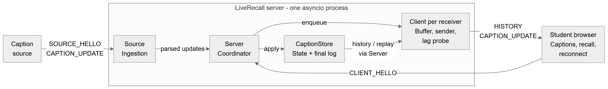
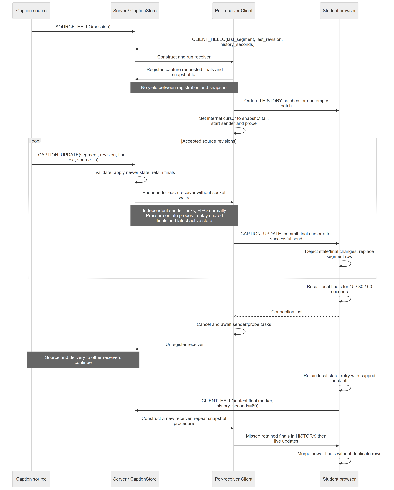

# LiveRecall Technical Report

Members: David Goh, Ng Kheng Yang, Wang Yanxiang, Qin Haichen

## 1. Architecture and protocol

LiveRecall distributes a changing caption stream from one source to many
browsers over WebSockets. The server validates revisions and manages each
receiver's delivery independently.



*Figure 1. Source ingestion, shared caption state and independent per-receiver
delivery inside one asyncio server.*

`CaptionStore` is the shared authority for revision acceptance and recent finals.
Each `Client` owns an `OutboundBuffer`, one sender, a final-log cursor, and a
probe task. Accepting and enqueueing an update never waits for a receiver's
socket, so a blocked sender does not directly block delivery to other clients.
Broadcast still requires work proportional to the number of clients.

`SOURCE_HELLO` and `CLIENT_HELLO` establish the connection role. Sources send
`CAPTION_UPDATE` messages; receivers get `HISTORY` on initial connection or
reconnect, followed by live `CAPTION_UPDATE` messages. Malformed source updates are ignored before
state changes or broadcast, and `SOURCE_DONE` is not forwarded. Only one source
is active at a time. The implementation assumes the supplied source's increasing
segment and finalization order. State survives source disconnection in one shared
namespace; starting a new lecture requires a server restart and browser reload.

## 2. Revision and recovery semantics

**Revision replacement.** A segment is one caption whose text may change through
several provisional revisions. While unfinished, it accepts only a higher
revision; equal or lower revisions are duplicates or stale state. Once final,
it rejects every further update, including higher revisions.

Revision numbers may skip values. The browser applies this same gate to live
and recovered captions, rewriting one row per segment and distinguishing drafts
from finals visually. Repeated messages therefore cannot overwrite newer held
state or append duplicate final rows.

**Incremental recovery.** `CLIENT_HELLO` reports the latest finalized
`(last_segment, last_revision)` already held by the browser. A provisional
revision does not advance this marker: its final may still be missing. The
server returns only finals beyond the marker and within the requested recent
window, capped at 60 seconds. A late join uses `(0, 0)`. Ordering these finals
by acceptance gives oldest-first recovery under the sequential source. This
marker assumes ordered completion; it cannot represent holes below a later final.

Registration and snapshot capture happen without yielding, recording both the
requested history and the current end of the final log. `HISTORY` message is broken down into batches to avoid exceeding the websocket message size limit, all `HISTORY` batches
are sent before live delivery starts at that boundary. Finals accepted during
history transmission lie after the boundary and remain owed. Batches target
64 captions and 256 KiB; an oversized caption travels alone and must fit the
peer's message limit. Existing unfinished captions are absent from the snapshot
and appear only on their next update.

Appendix A shows history before live delivery and the reconnect sequence.

**Recovery limits and local recall.** Finals enter a shared log once, with
internal sequence numbers marking delivery progress for each client using an internal cursor recording the last delivered final message. They are retained for
90 seconds after server acceptance and pruned during store operations. Connected clients under
replay mode can use that full window for consuming final messages in the shared log based on their cursor position, whereas reconnect creates a fresh cursor after
its requested context: older excluded finals are not replayed later. Retired
segment IDs are rejected to prevent stale state returning after pruning. Server
unfinished state is capped at 4,000 segments by retiring the lowest IDs.

During an automatic reconnect, the browser keeps its in-memory caption state and sends its latest finalized position with a request for up to 60 seconds of recent history. The server returns finalized captions in that window that are newer than the position; reloading instead becomes a late join. Its local 15/30/60-second recall, defaulting to 30, filters already-held finals without a
server request. On accepted updates it prunes finals older than 150 seconds and
caps unfinished state at 400 segments. The 80-row live display limit does not
limit recall storage.

## 3. Backpressure and overload policy

**Normal delivery preserves every accepted revision.** Each receiver has a FIFO,
so a healthy browser sees drafts develop into their final text. Keeping every
revision indefinitely when a receiver falls behind would instead accumulate
obsolete text, memory use, and delivery delay. That slow receiver switches to replay mode
on the same connection, while healthy receivers keep their own delivery policy.

```text
NORMAL -- queue pressure / late probe --> REPLAY
   ^                                       |
   +--------- caught up; lease expired -----+
capacity / retention / stall failure --> close affected receiver (1013)
```

**Replay preserves useful state.** Reaching 256 pending updates or exceeding
4 MiB triggers compaction and replay. Queued finals leave the local buffer and
are read in order from the shared log after the receiver's cursor.
Each unfinished segment keeps only its newest queued revision, preserving its
original queue age; a final removes its queued draft. Thus pending drafts r1,
r2, and r3 for one segment collapse to r3, and none remains queued once the
final arrives. Intermediate drafts are sacrificed, while outstanding finals
remain available within retention. Replay sends individual `CAPTION_UPDATE`
messages; `HISTORY` is reserved for hello recovery.

Finals normally take priority. After at least four consecutive finals, a draft
queued for one second gets a turn; eligible drafts can also be sent when no
final remains. This grace period allows rapidly superseded drafts to disappear
while giving longer-lived unfinished captions an opportunity to progress. The
final cursor advances only after a successful send.

**Lag controls pacing and return to normal.** Each client has one ping probe. Its measured time runs from ping initiation to pong receipt, so a blocked write can make the probe late. If the delay exceeds max(0.5 s, 6 × smoothed round-trip time), the client enters replay mode and starts a three-second catch-up lease. While the pong is overdue, the lease is repeatedly extended. This keeps the client in replay even if its backlog briefly drains.

During lag-driven replay, the sender sends bursts of up to 64 updates or 256 KiB, then waits for a probe completed after that burst before sending another. A single caption may take a burst past the byte target. Queue pressure can also trigger replay, but pressure alone does not enable probe pacing. A pong or successful socket write shows transport progress; it does not show that the browser accepted or rendered the caption.

After the pong arrives, replay continues until the lease has expired and no replay final or eligible provisional update remains. The client then stops coalescing and resumes FIFO delivery, including any queued drafts that were not yet eligible during replay. If lag returns before the normal-mode probation period ends, the next lease doubles, up to 30 seconds. If the client remains in normal mode through probation, the next lease resets to three seconds.

**Finite capacity has an explicit failure policy.** Normal admission failure
first attempts replay. Remaining unfinished work must fit within 4,000 entries
and 4 MiB of pending JSON. Exceeding that capacity, losing an outstanding final
to 90-second retention (`ReplayExpired`), or stalling an individual send or
complete probe for 75 seconds initiates a 1013 close for that receiver. Closing
gets two seconds before transport abort. Queue bounds exclude in-flight work,
recovery snapshots, and transport buffers; shared-log memory depends on caption
rate and size within retention. Sustained overload can therefore prevent final
completeness, and reconnect restores only the requested recent context.

## 4. Public experiments and results

### 4.1 Reproducible setup

T1-T5 use the complete Ubuntu run added in commit `e0f7fd9`, archived in
`results/prob_ab_david/probe_ab/`. The recorded environment on 4 November 2026
was Ubuntu 26.04.1 LTS, Linux 7.0.0-42-generic x86_64, one vCPU, approximately
3.32 GiB RAM, Python 3.14.4 and websockets 16.1.1. All recorded source hashes
match the current application, public harness and experiment scripts. This
replaces the earlier ARM64 VM evidence; differences between the evidence sets
do not measure an implementation change.

The source uses nominal 200-ms revision delays and 350-ms segment gaps; other
settings are seed 3103, a one-second source start delay, 30-second history,
500-ms freshness threshold and port 8811. No extra drain interval was added.
The supplied measurement logic was unchanged. Each test used three independent
runs per configuration, restarting the server each time and reporting the median
of per-run metrics. **Section 4 uses with-probe results only; Section 5 compares
with and without probes.** Server, source and simulated clients ran in the same
Ubuntu VM. Loopback was initially `noqueue`; T5 applied 120 ms delay, 30 ms
normal-distribution jitter and 3% loss, with a verified reset afterwards.

| Test | Required scenario | Configuration / evidence path |
|---|---|---|
| T1 | 20 clients, 20 s; 22 expected segments | `results/prob_ab_david/probe_ab/` |
| T2 | 100 clients, 40 s; 49 expected segments | Same directory |
| T3 | 100 clients, 60 s, 10% slow; 500 ms sleep/message; 76 expected segments | Same directory |
| T4 | 100 clients, 60 s, 20% disconnect at 15 s for 5 s; 76 expected segments | Same directory |
| T5 | 100 clients, 40 s; 49 expected segments; loopback netem | Same directory |

### 4.2 Measured results

Caption Age is client receive time minus `source_ts`, excluding browser rendering;
the public analyser computes its percentiles over accepted live updates. Final
completeness counts correctly received unique finals, including recovered history,
against expected finals across clients. The following table gives **with-probe
three-run medians**. T3 group metrics are derived from the CSV role flags;
all 30 raw CSV files reproduce their saved JSON summaries exactly.

| Test / client group | P50 age (ms) | P95 age (ms) | P99 age (ms) | Final completeness (%) |
|---|---:|---:|---:|---:|
| T1 | 3.28 | 6.67 | 8.11 | 100.00 |
| T2 | 15.82 | 27.85 | 36.93 | 100.00 |
| T3 overall | 11.99 | 2,248.88 | 7,786.01 | 99.38 |
| T3 normal readers | 11.45 | 23.88 | 30.44 | 100.00 |
| T3 slow readers | 6,250.78 | 8,490.87 | 8,811.84 | 93.82 |
| T4 | 5.29 | 8.80 | 12.55 | 100.00 |
| T5 | 258.43 | 660.66 | 801.68 | 100.00 |

Fresh Caption Ratio is the fraction of accepted live updates within threshold T
(public default: 500 ms). Fresh Final Caption Ratio counts unique finals received
within T against expected finals, including finals recovered through history.
The analyser's Normal Update Coverage includes all client roles; the table labels
this live revision coverage and separately shows the T3 reader groups.

| Test / client group | Fresh Caption Ratio (%) | Fresh Final Caption Ratio (%) | Live revision coverage (%) |
|---|---:|---:|---:|
| T1 | 100.00 | 100.00 | 100.00 |
| T2 | 100.00 | 100.00 | 100.00 |
| T3 overall | 94.65 | 90.00 | 95.18 |
| T3 normal readers | 100.00 | 100.00 | 100.00 |
| T3 slow readers | 1.69 | 0.00 | 51.75 |
| T4 | 100.00 | 98.42 | 98.33 |
| T5 | 91.28 | 87.39 | 98.86 |

All 15 with-probe runs recorded zero duplicate/stale captions, invalid non-final
HISTORY items and connection errors. T4's 20 forced-disconnect clients reconnected
and received HISTORY in every run. Median HISTORY-response P95 was 3.31 ms;
this is not a separate measurement of complete-state recovery time. No RSS/CPU
or queue-high-water trace was collected.

### 4.3 Interpretation

**Deadline and source timing.** Clients stop at a fixed deadline, and absent
deliveries do not enter live-age percentiles. Unlike the earlier ARM64 runs,
all T3 normal readers received every expected final in both configurations.
The CSV `source_ts` for final segment 76 was 57.84-58.12 s after the first
recorded connection across the six T3 runs, within the 60-s window. The remaining
T3 completeness deficit is confined to slow readers; source generation beyond
the deadline does not explain it in this evidence set.

**T1-T2: normal delivery and scale.** Every expected final and revision arrived
in all runs. T1 P99 age was 8.11 ms; at 100 clients, T2 P95/P99 was
27.85/36.93 ms. Both tests had 100% fresh captions and fresh finals at 500 ms.

**T3: normal readers stay responsive, but slow readers lag.** Normal-reader
P95/P99 was 23.88/30.44 ms, compared with T2's 27.85/36.93 ms, and final
completeness was 100%. Slow readers received 720, 710 and 713 of 760 expected
final/client pairs, giving 93.82% median completeness and P95 age 8.49 s.
Overall completeness was 99.38%. Normal readers retained every revision while
slow-reader live revision coverage was 51.75%, consistent with coalescing and
backlog under the imposed 500-ms processing delay.

**T4: reconnect restores all expected finals by the deadline.** Every
forced-disconnect client reconnected and received HISTORY in each run; all
7,600 expected final/client pairs arrived. Median HISTORY-response P95 was
3.31 ms and live-update P99 was 12.55 ms. Live revision coverage was 98.33%
because recovery supplies finals rather than every missed draft. Fresh-final
ratio was 98.42%; HISTORY-response timing does not measure complete recovery time.

**T5: impairment increases age while all expected finals arrive.** Each run
received 4,900/4,900 final/client pairs. P50 was 258.43 ms and P95/P99
660.66/801.68 ms; fresh-final ratio was 87.39% at 500 ms. This is consistent
with delay/jitter and TCP retransmission/ordered-delivery effects, without
isolating their contributions. Loopback netem affects both source and receiver
traffic. Live revision coverage was 98.86%.

## 5. Before/after optimization comparison

The final with-probe design is compared with a copied client whose probe task
is not started. Queue-pressure coalescing and the send timeout remain. Disabling
the probe removes lag detection, probe-driven wakeups/pacing and probe stall
detection together. Both configurations use the same public parameters and
three independent runs from the same evidence set; changes below are with-probe
minus no-probe, using unrounded medians.

| Metric (include unit) | Baseline / probe disabled | Final / probe enabled | Change |
|---|---:|---:|---:|
| T3 final completeness (%) | 95.13 | 99.38 | +4.25 pp |
| T3 P99 age (ms) | 24,035.07 | 7,786.01 | -16,249.06 |
| T3 slow-reader P95 age (ms) | 28,093.65 | 8,490.87 | -19,602.78 |
| T3 normal-reader P95 age (ms) | 17.26 | 23.88 | +6.62 |
| T3 live revision coverage (%) | 95.18 | 95.18 | +0.00 pp |
| T5 final completeness (%) | 99.98 | 100.00 | +0.02 pp |
| T5 live revision coverage (%) | 99.97 | 98.86 | -1.12 pp |
| T5 P95 age (ms) | 905.82 | 660.66 | -245.16 |
| T5 P99 age (ms) | 1,270.90 | 801.68 | -469.22 |

With probes, T3 median slow-reader P95 was 69.8% lower and overall P99 67.6%
lower, while normal-reader P95 was 6.62 ms higher. Normal readers received every
final in both configurations; median slow-reader completeness increased from
51.32% to 93.82%. Earlier lag detection and coalescing are consistent with
reduced backlog. Both configurations had identical 95.18% overall live revision
coverage, so coverage alone does not capture the improvement in final delivery.
All with-probe runs preceded no-probe runs.

T5 received 4,900 finals per with-probe run versus 4,899, 4,899 and 4,900 without
probes. The trade-off was 1.12 pp lower live revision coverage. Median P95/P99
was lower by 245.16/469.22 ms, but network loss sequences differed and fixed
arm order limits attribution to probing. Eventual delivery beyond the observation
deadline was not measured.

## 6. Discussion, limitations and future work

**Failures and trade-offs.** T3 normal-reader P95 was 23.88 ms with 100%
final completeness, while slow readers had 93.82% median completeness and
8.49-s P95 age. Normal readers stayed responsive, but slow readers still
missed finals generated within the measurement window. T5 received all expected
finals but exceeded the 500-ms freshness threshold at P95. Coalescing reduces
obsolete draft traffic at the cost of intermediate revision coverage. Longer
catch-up leases discourage repeated overload but can postpone the return to
full revisions after a receiver improves. Delivery traces are needed to locate
where slow-reader finals remain pending at the measurement deadline.

**Limitations.** Lag detection measures transport responsiveness without
measuring the receiver's caption-processing rate. Healthy pongs can therefore
coexist with an application backlog, and fixed bursts may supply updates faster
than the receiver consumes them. Coalescing affects only the server's pending
buffer: obsolete drafts already handed to socket or receiver buffers cannot be
withdrawn and can delay newer finals. Recovery after a bottleneck consequently
depends on how much data was sent before replay began. Memory use also remains
workload-dependent: the shared final log has an age limit but no byte cap, so
caption bursts or large texts can increase memory consumption despite the
per-client queue limits.

**Future work.** Our objective is 100% final completeness in T3 and a faster
return to full revision delivery after a temporary slowdown, within the existing
queue bounds. We will first trace unreceived finals, then compare burst limits
and catch-up lease policies in repeated, matched T3 and slowdown/recovery tests.
Completeness and caption age will be compared at the same observation deadline.
After restoring normal reading speed, we will measure the time until all newly
generated revisions are received consistently. Normal-client latency, peak queue
usage, and process memory will be monitored to check that improved slow-client
delivery preserves isolation and bounded resource use.

## References

- CS3103 Assignment 4 specification, Sections 8-12 (experiments, metrics, environment, report requirements).
- [Latest Ubuntu T1-T5 comparison](../results/prob_ab_david/probe_ab/SUMMARY.md) and [recorded configuration](../results/prob_ab_david/probe_ab/configuration.json), including source hashes, environment and both arms' CSV/JSON files.
- TODO: Cite external technical sources actually used.

<div style="page-break-before: always;"></div>

## Appendices

### Appendix A. Communication sequence



*Figure A1. Connection setup, live revisions, local recall and reconnect recovery.
Shared state access is grouped under Server; the [detailed component
sequence](../diagrams/sequence.md) expands sender, buffer and probe interactions.*

### Appendix B. Experiment evidence and reproduction

Per-run CSV/JSON files and logs are stored alongside the
[latest full comparison](../results/prob_ab_david/probe_ab/SUMMARY.md), under
`with_probe/output/` and `no_probe/output/`. The [configuration](../results/prob_ab_david/probe_ab/configuration.json)
records the environment, source hashes, test arguments and successful runner
exits for all ten test/configuration combinations. T5's `qdisc_*.json` files and
`t5_network_status.json` record impairment application, traffic counters and reset.
All 30 summaries were recomputed from their CSVs with the public analyser; T3
reader-group metrics use the same definitions restricted by the CSV `slow` flag.

To reproduce from the repository root inside Ubuntu with the recorded dependencies
and sudo/netem available, use a fresh output directory:

```sh
venv/bin/python -u experiments/probe_ab.py --tests t1,t2,t3,t4,t5 --runs 3 \
  --port 8811 --venv "$PWD/venv" --require-t5 --out output/probe_ab_fresh
```

[Earlier ARM64 results and run caveats](../results/TEST_RESULTS_20261104.md)
remain available for comparison; their values are not used in Sections 4-5.
