# LiveRecall: project structure and execution guide

This document explains the implementation checked at commit `02170c4` on 3 November 2026. It describes the **current code**, including individual `CAPTION_UPDATE` delivery during connected catch-up. Historical versions used live `HISTORY` batching; that is not the path documented here. Examples illustrate existing behavior unless explicitly marked as a proposed improvement. This is an implementation guide, not a claim that every hidden workload has been verified.

Paths are relative to the repository root unless stated otherwise. Source links are relative to this document; `#L123` links identify lines in repository viewers that support line anchors. Names and branches are more reliable than line numbers after future edits.

## Contents

1. [How to read this guide and navigate the repository](#section-1)
2. [Vocabulary, clocks, and concurrency](#section-2)
3. [Protocol and wire messages](#section-3)
4. [Server startup and source ingestion](#section-4)
5. [CaptionStore: revision state and shared final log](#section-5)
6. [Server-side Client: lifecycle, state, and enqueue decisions](#section-6)
7. [OutboundBuffer: admission, coalescing, and ownership](#section-7)
8. [Sender selection, pacing, and WebSocket delivery](#section-8)
9. [Probes, RTT, catch-up leases, and recovery timing](#section-9)
10. [Browser state, rendering, recall, and reconnect](#section-10)
11. [Optional ASR adapter](#section-11)
12. [Deterministic source, experiments, and measurement](#section-12)
13. [Requirements, design purposes, and implementation limits](#section-13)
14. [Practical traces, inspection, and learning exercises](#section-14)

<a id="section-1"></a>

## 1. How to read this guide and navigate the repository

For an initial pass, read Sections 1–2, the connection sequence in Section 6, the buffer traces in Section 7, and the sender decision tree in Section 8. Then read Section 9 to understand when overload handling activates. Sections 10–12 connect the server to the browser, ASR adapter, and experiments. Section 13 distinguishes actual guarantees, assumptions, and current limitations. Section 14 provides practical tracing exercises.

The project transports **revision-based caption text**. A source can send several drafts for one caption segment, then mark its last revision final. Receivers should see every revision when capacity permits. During overload, obsolete drafts can be suppressed, but final captions and the newest useful active state need protection. A short rolling history supports reconnect and late join.

### 1.1 Repository map

```text
LiveRecall/
├── submission_root/
│   ├── solution_server.py       Python server entry point
│   ├── requirements.txt         Mandatory dependency: websockets
│   ├── app/
│   │   ├── __init__.py          Package marker/documentation
│   │   ├── protocol.py          Typed message parsing and JSON serialization
│   │   ├── server.py            Listener, connection routing, shared coordinator
│   │   ├── source.py            One caption-source connection
│   │   ├── caption_store.py     Accepted revision state and rolling final log
│   │   ├── outbound_buffer.py   One receiver's pending/coalesced state
│   │   └── client.py            One receiver's sender, probes, and replay cursor
│   └── client/
│       ├── index.html          Browser interface and styling
│       └── app.js              Browser caption state, recall, and reconnect
├── test/
│   ├── caption_source.py       Deterministic text/revision generator
│   ├── load_clients.py         Concurrent simulated receivers and CSV logger
│   ├── run_demo.py             Starts independent experiments and analysis
│   ├── analyse_results.py      Computes metrics from reception logs
│   ├── monitor_server.py       Linux process RSS sampling
│   ├── submission_check.py     Entry-point/submission checks
│   ├── test_delivery.py        Store, buffer, client, and optional stall tests
│   ├── test_live_delivery.py   Individual-live-frame protocol regressions
│   └── check_missing_finals.py Read-only inspection of completed CSVs
├── bonus_asr/
│   ├── asr_source.py           Local media → recognized captions → same server
│   └── requirements.txt        Optional recognition dependencies
├── network_profiles/          Linux tc/netem profiles and reset scripts
├── config/                    Development formatter/pre-commit configuration
├── diagrams/                  Existing architecture diagrams
├── docs/                      Assignment, guides, and report draft
├── output/                    Generated experiment results/model cache
└── Makefile                   Shortcuts for setup, demo, and public tests
```

The runtime server does not import the ASR adapter or test runner. Browser JavaScript executes in a browser process, not inside `app/client.py`. The HTTP server used to serve HTML is separate from the WebSocket caption server.

### 1.2 Processes and ownership

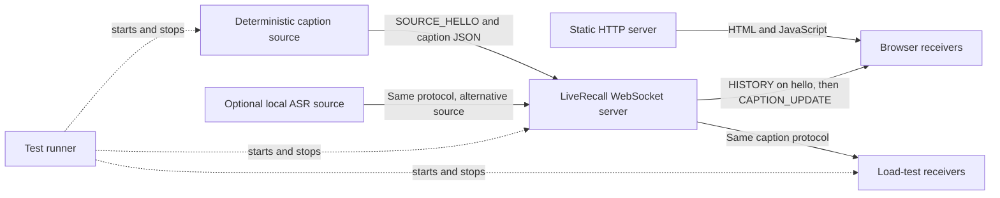

Only one caption source is accepted at a time. The deterministic and ASR sources are alternatives. The mandatory assignment permits one active source/session; the current store is one segment namespace for the server lifetime.

| Owner | Lifetime and contents |
|---|---|
| `Server` | One listener/coordinator; owns the store, client registry, and source-connected flag |
| `CaptionStore` | Shared latest segment state and retained final log |
| `Source` | One active source WebSocket and its hello/session |
| Server-side `Client` | One receiver connection; owns its sender/probe tasks, local buffer, cursor, and lag state |
| `OutboundBuffer` | One server-side client's unsent queued state |
| Browser `CaptionState` | One page's local caption collection and final resume marker |
| Browser `Connection` | One page's socket and reconnect timers |

<a id="section-2"></a>

## 2. Vocabulary, clocks, and concurrency

### 2.1 The identifiers are different quantities

Use the notation `s20/r3/F` for segment 20, revision 3, final; `P` means provisional. This is shorthand for documentation, not a wire format.

| Identifier | Assigned by | Meaning | Example |
|---|---|---|---|
| `segment` | Caption source | Caption identity | Segment 20 |
| `revision` | Caption source | Version within that segment | Revisions 1, 2, then 3 final |
| Queue `key` | A receiver's `OutboundBuffer` | Local FIFO entry identity | Keys 100, 101, 102 can all hold revisions of segment 20 |
| `final_sequence` | Shared `CaptionStore` | Contiguous acceptance order across finals | Segment 20's final might have sequence 57 |
| `_last_sent_final_sequence` | Server-side `Client` | Position committed after successful final sends, initially set from the hello snapshot | Cursor 57 |
| `last_segment/last_revision` | Receiver's hello | Latest finalized source state the receiver says it already holds | Segment 20, revision 3 |
| `client_id` | Receiver | Logging/demo identifier; not a persistent server-side acknowledgement session | Receiver 17 |

Do not use a queue key as a segment ID, or a final sequence as a history length. Expiry reduces retained history length but never rewinds `_final_tail`.

### 2.2 Provisional, final, queued, in flight, and received

- **Provisional:** source state that can be replaced by a newer revision.
- **Final:** source state declared complete. The store rejects every subsequent update to that retained segment.
- **Queued:** still owned by the server's pending state; coalescing can replace it.
- **In flight:** selected by the sender and passed to an asynchronous send. A newer arrival cannot retract it from the socket/library pipeline.
- **Sent successfully:** `ws.send()` completed. This is transport/library progress, not a browser application acknowledgement.
- **Received/accepted:** the receiver read the message and accepted its revision into local state.
- **Rendered:** the browser updated the DOM. This happens after reception and is not reported back to the server.

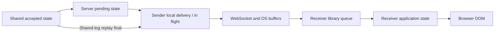

Coalescing operates before the network boundary. The current protocol has no per-caption application ACK. A ping/pong is a separate control exchange and is not an ACK for all rendered captions.

### 2.3 Clocks and units

| Quantity | Clock/unit | Used for |
|---|---|---|
| `source_ts` | Source Unix epoch seconds, `time.time()` | Carried on the wire; network age and browser recall |
| Store `received_at` | Server monotonic seconds | Recovery-window and final-log expiry |
| Buffer `_queued_at` | Server monotonic seconds | Age of pending active state |
| `loop.time()` | Event-loop monotonic seconds | Probe deadlines, leases, and normal trials |
| Browser `nowSeconds()` | Browser Unix epoch seconds | Local retention/recall against `sourceTs` |
| `_rtt`, `latency`, `remaining`, lease durations | Seconds | Never milliseconds internally in Python client policy |
| CSV `latency_ms`, `recovery_ms` | Milliseconds | Human-facing experiment metrics |
| Pending/burst byte counts | Serialized JSON bytes | Logical wire-data accounting, not total process RSS |

Monotonic values are durations/deadlines within their clock domain; they are not Unix timestamps. Do not subtract `source_ts` from `loop.time()`. Wall-clock age measurements assume sufficiently synchronized clocks; server retention deliberately does not depend on source wall time.

### 2.4 One asyncio loop, independent tasks

`Server.main()` starts one event loop. Each connection handler is a coroutine. Each receiver adds a sender task and a probe task. `_send()` temporarily owns another task for the current send; the probe loop owns one pending round-trip task.

A synchronous function such as `validate_and_apply()`, `broadcast()`, or `enqueue()` does not yield to another asyncio task. Source processing can therefore validate, store, and enqueue one update without another handler interleaving midway through that chain. A network `await` may let other tasks run.

```text
Source.run
  → Server.ingest_caption_update
      → CaptionStore.validate_and_apply
      → Server.broadcast
          → Client A.enqueue
          → Client B.enqueue
          → ...
```

No receiver socket is awaited inside that broadcast chain. A blocked socket belongs to its own sender. This prevents direct slow-socket blocking of peers, but does not eliminate shared CPU, event-loop, memory, or bandwidth limits.

`asyncio.Event` is a Boolean notification, not a counting semaphore or a message queue. Ten calls to `_wake.set()` need not produce ten separate wakeups; the sender checks actual pending state after waking.

<a id="section-3"></a>

## 3. Protocol and wire messages

[app/protocol.py](../submission_root/app/protocol.py) defines the data passed between the source, server, and clients. JSON dictionaries are converted into frozen dataclasses. A caption object then passes through validation, storage, buffering, and sending without each component needing to interpret raw JSON again. Freezing prevents normal field reassignment; it does not itself validate values. Network input is validated through `from_dict()`, whereas direct construction in tests bypasses those checks.

### 3.1 Message schemas and directions

| Message | Direction and purpose | Fields held by its dataclass |
|---|---|---|
| `SOURCE_HELLO` | Source → server; identify the source connection | `session` |
| `CLIENT_HELLO` | Client → server; establish a connection and request recent recovery | `client_id`, `session`, `last_segment`, `last_revision`, `history_seconds` |
| `CAPTION_UPDATE` | Source → server → clients; one revision of one segment | `session`, `segment`, `revision`, `source_ts`, `final`, `text` |
| `HISTORY` | Server → client following `CLIENT_HELLO` | `items`: a list of finalized `CaptionUpdate` objects |
| `SOURCE_DONE` | Source → server; optional test-control notification | `session`, optional `segments` |

An example caption on the wire is:

```json
{
  "type": "CAPTION_UPDATE",
  "session": "L1",
  "segment": 42,
  "revision": 5,
  "source_ts": 1760000000.123,
  "final": true,
  "text": "TCP uses cumulative acknowledgements."
}
```

`segment` identifies a caption; `revision` identifies a version of that caption. Neither is the server's internal final-log sequence number. `final` declares completion; the server does not infer completion from a revision count. `source_ts` is a Unix timestamp retained for the receiver's age calculations. Server retention instead uses a separately recorded monotonic acceptance time.

The current [live sender](#section-8) sends individual `CAPTION_UPDATE` messages even during catch-up. Its internal log-fetch method still has “batch” in its name, but it does not create unsolicited wire `HISTORY` messages. Initial recovery can contain many captions in one `HISTORY`.

### 3.2 Parsing branches and defaults

[Numeric helpers](../submission_root/app/protocol.py#L21) distinguish integer identifiers from general numbers:

| Function | Locals | Accepted input | Failure result |
|---|---|---|---|
| `_as_int(value)` | `value` | A Python `int`, excluding `bool` | `None` |
| `_as_number(value)` | `value`, converted `number` | Finite `int`/`float`, excluding `bool` | `None` for wrong type, float-conversion overflow, infinity, or NaN |

[SourceHello.from_dict(raw)](../submission_root/app/protocol.py#L45) reads local `session`. A missing, empty, or non-string session returns `None`; otherwise it constructs `SourceHello`. It does not check the `type` tag: the caller already selected the message parser.

[ClientHello.from_dict(raw)](../submission_root/app/protocol.py#L75) is deliberately forgiving:

| Field/local | Default or correction | Effect on delivery |
|---|---|---|
| `client_id` | Missing → `0`; non-integer/bool → `0`; negative integers are not rejected | Logging identity; not the lookup key for a persistent server-side delivery session |
| `session` | Missing/empty/wrong type → `"L1"` | Stored as a label; current server does not use it to filter client subscriptions |
| `last_segment` | Missing, invalid, or negative → `0` | Lower recovery boundary |
| `last_revision` | Missing, invalid, or negative → `0` | Second component of that recovery boundary |
| `history_seconds` | Missing/invalid/negative → `30`; values above `60` → `60`; zero remains zero | Amount of recent finalized context requested |

Despite its optional return annotation, this parser currently always returns a repaired `ClientHello`; it has no explicit `None` return path. Consequently, the server's subsequent malformed-client-hello check is defensive rather than a currently reachable parsing failure.

[CaptionUpdate.from_dict(raw)](../submission_root/app/protocol.py#L138) reads locals `segment`, `revision`, `source_ts`, `final`, `text`, and `session`, then rejects in this order:

1. Segment is not a strict positive integer.
2. Revision is not a strict positive integer.
3. Timestamp is not finite/nonnegative.
4. `final` is not a JSON/Python boolean.
5. `text` is not a string; an empty string is accepted.
6. Session is not a nonempty string.

Failure returns `None`; success constructs a `CaptionUpdate`. Extra JSON fields are ignored. These checks establish field validity; the store separately checks whether this revision advances accepted state.

[SourceDone.from_dict(raw)](../submission_root/app/protocol.py#L219) defaults invalid session labels to `L1`. `segments` is parsed with `_as_int`; invalid/missing becomes `None`. A negative integer count is not rejected. The handler only logs this value.

### 3.3 Serialization and shared object ownership

Each `to_dict()` adds the appropriate `type` tag; `to_json()` calls `json.dumps()`. [CaptionUpdate.to_json()](../submission_root/app/protocol.py#L179) additionally uses local `cached`: the first call serializes and writes `_json_cache` using `object.__setattr__`; later calls reuse the string. This intentionally bypasses freezing for an implementation cache, without changing caption fields or dataclass equality.

The same accepted caption can therefore be referenced by the store and many client queues without copying its text or repeating serialization per client. Default `json.dumps()` escapes non-ASCII characters, so cached JSON string length equals its UTF-8 byte length. This explains buffer expressions such as `len(update.to_json())`. `History.to_json()` serializes its `items` through their dictionaries and does not have the same cached whole-message serialization.

<a id="section-4"></a>

## 4. Server startup and source ingestion

### 4.1 Entry point and server-owned state

[solution_server.py](../submission_root/solution_server.py#L23) inserts its own containing directory into `sys.path`, imports `Server`, and calls `Server.main()` when executed as a script. This permits startup from either the repository root or `submission_root/`.

[Server.main(argv)](../submission_root/app/server.py#L160) creates local argument `parser`, parses `args`, and runs `cls(args.host, args.port).run()` with `asyncio.run()`. Defaults are host `0.0.0.0` and port `8765`. `KeyboardInterrupt` exits without an additional traceback.

| Server field/constant | Value or contents | Responsibility |
|---|---|---|
| `_host`, `_port` | Parsed address/port | Listener configuration |
| `_store` | One `CaptionStore` | Shared revision state and recovery/final log |
| `_clients` | Set of connection-specific `Client` objects | Current broadcast recipients |
| `_source_connected` | Boolean, initially false | Refuse a second simultaneous source |
| `HELLO_TIMEOUT_SECONDS` | `5` | Deadline for the first message |
| `BAD_HELLO` | WebSocket close code `1008` | Invalid opening message/policy failure |

[Server.run()](../submission_root/app/server.py#L38) opens `websockets.serve()` with `_accept` as connection handler. `max_size=2**20` limits incoming WebSocket messages to 1 MiB; it does not bound outgoing history messages or total server memory. `ping_interval=None` disables the library's automatic server heartbeat because each receiver has its own bounded probe. The unresolved `asyncio.Future()` keeps the listener alive; it is not a pending caption queue.

### 4.2 Connection classification

[_accept(ws)](../submission_root/app/server.py#L55) uses local `raw` for the first WebSocket payload, `payload` for decoded JSON, and `kind` for its `type` field.

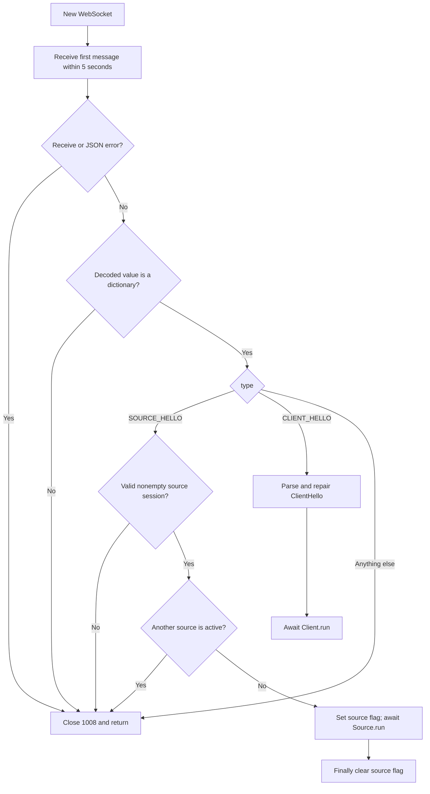

The first error branch catches `asyncio.TimeoutError`, JSON decode errors, Unicode decode errors, and `ConnectionClosed`. After successful decoding, a non-dictionary is also refused. Local `hello` holds the parsed `SourceHello`; local `client_hello` holds the parsed `ClientHello`. The source flag is set before awaiting its handler and cleared in `finally`, including on source failure.

The server does not create a persistent delivery record keyed by `client_id`: each WebSocket gets a new `Client` object. `register_client(client)` adds that object; `unregister_client(client)` discards it safely; `client_count` returns the set size. Receiver connection/recovery and its background tasks are described in the [client lifecycle](#section-6).

### 4.3 Source input and broadcast branches

[Source](../submission_root/app/source.py#L27) holds three fields: `ws` is the source socket, `hello` is its opening source declaration, and `server` is the coordinator. Its `run()` loop consumes source frames:

| Condition | Behavior |
|---|---|
| Invalid JSON/Unicode | Ignore this frame and continue |
| Decoded value is not a dictionary | Ignore and continue |
| `kind == "CAPTION_UPDATE"` | Parse local `update`; ingest only if non-`None` and `update.session == hello.session` |
| `kind == "SOURCE_DONE"` | Parse local `done`, obtain local `segments`, print completion information |
| Unknown type | Ignore for compatibility with additional source messages |
| Connection closes | Catch `ConnectionClosed`, then log source disconnection |

`SOURCE_DONE` does not close clients, wait for pending sends, stop the event loop, or initiate a server flush. The source loop can continue receiving after it. This matters when interpreting a test runner's independent end deadline.

The caption path is:

```text
Source.run()
  -> Server.ingest_caption_update(update)
     -> CaptionStore.validate_and_apply(update)
        -> None: stop processing this caption
        -> accepted update:
           Server.broadcast(accepted)
             -> Client A.enqueue(accepted)
             -> Client B.enqueue(accepted)
             -> ...
```

[ingest_caption_update()](../submission_root/app/server.py#L139) holds local `accepted`. Only non-`None` results reach [broadcast()](../submission_root/app/server.py#L145), whose loop variable `client` visits the current registry. Everything from ingestion through enqueue is synchronous: no client socket send is awaited here. A stalled client's network send therefore does not directly block another client's sender. All these objects still share one event loop, so CPU-heavy parsing, encoding, compaction, or a large broadcast can consume time needed by other connections.

The coordinator's `compute_history()`, `history_snapshot()`, `final_tail`, `final_sequence()`, and `read_final_batch()` delegate to its one store; they do not maintain separate histories. The current client uses snapshot and sequence/replay methods; some other delegates remain convenience API surface.

### 4.4 Scope boundaries

The assignment permits one active source and session `L1`; the code implements that scope. A source caption must match its source connection's session. Client `session` labels are not used to partition broadcasts or history, and changing source session does not clear the existing store. Multi-session routing is consequently unsupported, but is not a missing mandatory feature.

<a id="section-5"></a>

## 5. CaptionStore: revision state and shared final log

[app/caption_store.py](../submission_root/app/caption_store.py) contains synchronous state logic: it does no socket I/O and has no `await`. Its two main rules are that accepted revisions move forward and an accepted final cannot be overwritten.

### 5.1 Stored state and identifiers

[SegmentState](../submission_root/app/caption_store.py#L33) wraps `update`, monotonic `received_at`, and internal `final_sequence` (zero for a provisional). Properties `segment`, `revision`, and `final` delegate to the caption rather than duplicating those fields.

| Store member | Meaning |
|---|---|
| `_clock` | Injected time function, normally `time.monotonic`; tests can supply a fake clock |
| `_segments` | Source segment ID → latest accepted `SegmentState`, including retained finals |
| `_active_segments` | Set of unfinished source segment IDs |
| `_final_history` | Internal final sequence → finalized `SegmentState`, in acceptance order |
| `_final_tail` | Sequence of the latest accepted final, initially zero; does not decrease on expiry |
| `_evicted_final_sequence` | Last sequence in the expired log prefix, initially zero |
| `_retired_before` | Reject all incoming source segment IDs below this watermark |
| `HISTORY_HORIZON_SECONDS` | `90.0`: shared final-history retention interval |
| `MAX_ACTIVE_SEGMENTS` | `4000`: count backstop for unfinished segments |

`_segments` and `_final_history` can refer to the same `SegmentState`; these are indexes, not duplicate caption text copies. `tracked_segments` and `history_size` report dictionary lengths without triggering trimming.

For example, final segment 42 might have revision 5 and internal final sequence 17. Those numbers answer different questions: *which caption? which version? which accepted final in the server log?* Retained-history length might meanwhile be only 12 because earlier finals expired. Neither tail 17 nor length 12 is a source segment ID. The contiguous final sequence permits independent client cursors even when source segment IDs have gaps.

### 5.2 Acceptance branch tree

[validate_and_apply(update)](../submission_root/app/caption_store.py#L89) returns the original accepted `CaptionUpdate`, or `None` if no broadcast should occur.

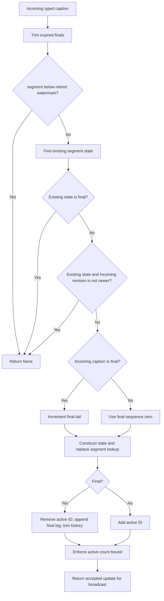

Local `existing` is the previous winning state; local `state` is the replacement wrapper. Rejected updates do not refresh acceptance time, append history, advance `_final_tail`, or reach clients. A final is rejected after a final even if its revision is higher. No branch assumes exactly three revisions.

Worked trace, starting with an empty store:

| Incoming `(segment, revision, final)` | Result | Final tail |
|---|---|---:|
| `(7, 1, false)` | Keep active revision 1 | 0 |
| `(7, 2, false)` | Replace active revision 1 | 0 |
| `(7, 1, false)` | Reject older revision | 0 |
| `(7, 2, false)` | Reject duplicate | 0 |
| `(7, 5, true)` | Finalize; remove active ID; append sequence 1 | 1 |
| `(7, 6, true)` | Reject overwrite of a final | 1 |
| `(8, 9, true)` | Accept a directly final caption; append sequence 2 | 2 |

The example uses source IDs starting at 7 to show that source IDs and internal sequence counters are distinct; the supplied source normally starts at 1.

### 5.3 Requested history and the subscription snapshot

[compute_history(last_segment, last_revision, history_seconds)](../submission_root/app/caption_store.py#L126) first trims. Nonpositive requested context returns an empty list. Otherwise local `cutoff` is:

```python
clock_now - min(history_seconds, 60.0)
```

Local `marker` is `(last_segment, last_revision)`. Iteration variable `state` visits retained finals in acceptance order. A final is returned only if both conditions hold:

```python
state.received_at >= cutoff
(state.segment, state.revision) > marker
```

Thus “within the last 60 seconds” and “newer than the client's resume position” are separate filters. The 90-second storage margin does not enlarge a request for 15, 30, or 60 seconds.

Assume current monotonic time is 200:

| Internal sequence | Final segment/revision | Accepted at | Age |
|---|---|---:|---:|
| 8 | `(38, 5)` | 125 | 75 s |
| 9 | `(39, 2)` | 145 | 55 s |
| 10 | `(40, 7)` | 175 | 25 s |
| 11 | `(41, 3)` | 195 | 5 s |

All four remain within shared retention. A 60-second request from `(0,0)` returns segments 39–41. The same request resuming after `(39,2)` returns 40–41. A 30-second request from `(0,0)` also returns 40–41.

[history_snapshot()](../submission_root/app/caption_store.py#L150) stores that list in local `items` and returns `(items, _final_tail)` synchronously. In this example the snapshot tail is **11**, even when only two items are returned. That boundary excludes older, intentionally unrequested finals from subsequent live work. If segment 42 final arrives during the network send, it gets sequence 12 and remains later live work. Registering the client immediately before taking this snapshot, without an intervening `await`, closes the history/subscription gap.

### 5.4 Connected final-log reads

[final_sequence(update)](../submission_root/app/caption_store.py#L168) trims, reads local `state` from `_segments`, and requires a retained final whose complete caption equals `update`. Missing state, non-final state, or unequal content raises `ReplayExpired`. Looking up this sequence before a send lets the client retain it if history expires while that send is waiting.

[read_final_batch(after_sequence, max_items, max_bytes)](../submission_root/app/caption_store.py#L181) reads without deleting shared entries or advancing a client cursor:

1. Nonpositive item/byte limits raise `ValueError`.
2. Trim expired history.
3. If `after_sequence < _evicted_final_sequence`, raise `ReplayExpired`; an owed expired prefix cannot be silently skipped, even if the log is now empty.
4. Start local `items=[]`, `next_sequence=after_sequence`, and `size` with the serialized empty-HISTORY wrapper size.
5. Set `stop=min(_final_tail, after_sequence+max_items)`.
6. For each local `sequence`, retrieve local `update`; calculate `item_size` including a two-character separator after the first item.
7. If a nonempty result would exceed `max_bytes`, stop before adding that item. Otherwise append, increase `size`, and record `next_sequence`.
8. Permit one oversized first item alone, then stop. This prevents an unusually large final from being postponed forever by the smaller batch budget.
9. Return `(items, next_sequence)`; an empty result preserves the supplied cursor.

The current client requests `max_items=1` and emits that caption individually. `History` framing in this helper is residual conservative accounting from its generalized batch API; it does not dictate a wire message type. Its single-item exception also means `max_bytes` is not an absolute maximum caption size.

Using the earlier table, an already-connected client owing sequence 8 can still obtain segment 38 at age 75 seconds, even though a new 60-second recovery request would exclude it. Connected delivery tracks its cursor against the shared 90-second log; reconnect context uses the separate requested-window filter.

### 5.5 Expiry, active retirement, and limits

[_trim_history()](../submission_root/app/caption_store.py#L219) computes local `cutoff=clock_now-90`. It repeatedly looks at `sequence=_evicted_final_sequence+1` and local `evicted` state. If that state is at or after the cutoff, it stops. Otherwise it deletes the log entry, advances `_evicted_final_sequence`, and retires the corresponding source segment. Entries exactly 90 seconds old are retained because removal uses a strict older-than check.

Trimming is **access-triggered**, not a background timer. Ingestion, requested-history computation, final-sequence lookup, and replay reads trigger it. During complete inactivity, old objects can remain physically stored until another such operation; they are filtered/expired when used again. Idle time does not itself append more state.

If time advances to 216 in the worked table, sequence 8 is 91 seconds old and expires. A replay cursor 7 now raises `ReplayExpired`; cursor 8 can continue with retained sequence 9. The log boundary is distinct from source retirement.

[_trim_segments()](../submission_root/app/caption_store.py#L230) bounds only unfinished states. While the active set exceeds 4,000, it retires its minimum source segment ID. [_retire(segment)](../submission_root/app/caption_store.py#L236) removes the segment lookup and active marker, then sets `_retired_before=max(old_watermark, segment+1)`. The watermark rejects every lower segment ID, not only the particular ID just removed.

These policies have explicit scope limits; see also the [combined limitations](#section-13):

- History is age-bounded; it has no separate fixed byte/count cap. Memory within 90 seconds depends on accepted caption rate and size. A hard memory guarantee needs corresponding workload/admission assumptions; blindly evicting still-required recent finals would compromise recovery.
- Active retirement can lose the latest state of a segment if the source exceeds 4,000 simultaneous unfinished segments. Also, retiring a later segment can prevent a much older still-active segment from finalizing. The starter generator finishes one segment before starting the next, so it does not trigger this case; the assignment's monotonic IDs alone do not prove every possible hidden workload is sequential.
- The dictionaries and resume marker implement one source/session namespace. They are appropriate to the required L1 scope, without providing arbitrary multi-session routing.
- Requested recovery is collected as one full list. Its eventual `HISTORY` serialization has no separate message-size cap. Several individually valid captions can collectively exceed a receiver's per-message limit; this differs from shared-log expiry and per-client queue capacity.

<a id="section-6"></a>

## 6. Server-side Client: lifecycle, state, and enqueue decisions

Source: [client.py](../submission_root/app/client.py). This class represents one connected receiver on the server. It does not choose browser recall rows; it chooses which live caption to send and when.

### 6.1 Every persistent field

| Field | Initial value | Exact role |
|---|---|---|
| `ws` | Accepted WebSocket | Socket used by this receiver's handler, sender, and probes |
| `hello` | Parsed `ClientHello` | Initial resume/context settings and logging identity |
| `server` | Shared coordinator | Registry and shared final-log access |
| `_buffer` | New `OutboundBuffer` | This receiver's normal FIFO or latest active state during replay |
| `_wake` | Unset event | Notify sender that data or policy may have changed |
| `_probe_tick` | Unset event | Notify a held sender of completed probe progress; also released in probe cleanup |
| `_catchup_until` | `0.0` | Monotonic expiry of the current conservative-delivery lease |
| `_rtt` | `0.0` | Smoothed ping/pong round-trip estimate in seconds |
| `_held` | `0` | Number of `_hold()` calls, for logging |
| `_finals_since_active` | `0` | Consecutive replay final selections since an active update; normal provisional selection also resets it |
| `_in_flight` | `None` | Caption selected by the live sender during its send; explanatory/debug state |
| `_tasks` | Empty list | Sender and probe tasks cancelled on disconnection |
| `_pending_probe` | `None` | One owned task covering ping initiation and pong completion |
| `_last_sent_final_sequence` | `0` | Committed final-log position; set to the snapshot boundary after initial recovery succeeds |
| `_replaying` | `False` | Whether live finals come from the shared log instead of the local FIFO |
| `_catchup_lease` | `3.0` | Current sticky catch-up duration, adaptively capped at 30 seconds |
| `_last_lag_delay` | `0.0` | Total duration of the most recently completed late probe |
| `_normal_trial_started` | `None` | Monotonic time replay most recently ended, used to detect rapid relapse |

`_in_flight` is assigned and cleared but is not read by current selection logic. The live sender's local `delivery` reference and cursor commit enforce ownership; the field makes the state visible if inspected. It does not implement acknowledgements.

### 6.2 Connection and recovery sequence

[Client.run()](../submission_root/app/client.py#L93) executes these operations in this order:

1. Register this `Client` in `Server._clients`.
2. Synchronously obtain `(items, snapshot_tail)` from `history_snapshot()`.
3. Send exactly one initial `History(items)` through bounded `_send()`.
4. If that succeeds, commit `_last_sent_final_sequence = snapshot_tail`.
5. Start `_sender_loop()` and `_probe_loop()`.
6. Keep a receive loop open to observe closure. Later client application messages are ignored by this loop; recall requests are not implemented here.
7. In `finally`, cancel and await both tasks, unregister, and log counters.

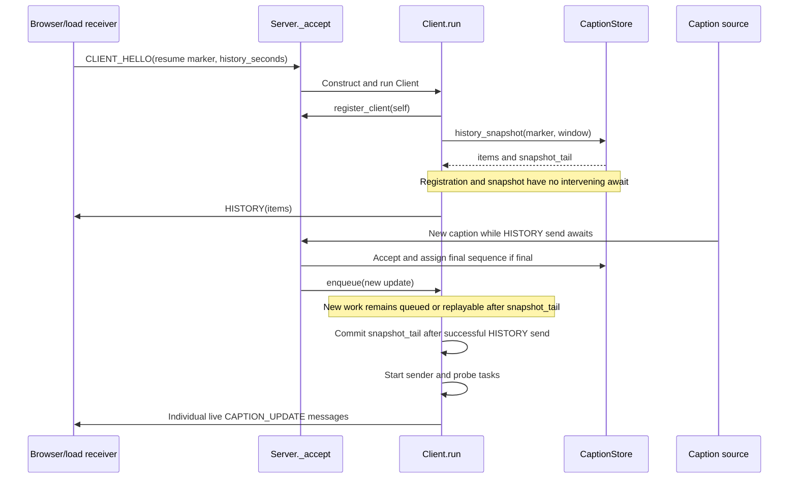

The initial `HISTORY` is the first application message because the live sender does not exist until it completes. Control frames such as ping/pong are separate WebSocket protocol messages.

**Why registration precedes snapshot:** if the snapshot came first and the coroutine yielded before registration, a final could be absent from the snapshot and broadcast before the client subscribed. The actual synchronous ordering closes that gap.

**Why capture a tail even for empty history:** a zero-second context request intentionally asks for no old finals. Advancing to the captured tail ensures that later connected replay does not unexpectedly send those intentionally unrequested older captions.

Example: log tail is 50 when a zero-context client joins. Its initial history is empty. Final 51 arrives while history is sent. After initial success, the cursor is 50, so final 51 remains owed; finals 1–50 do not become live replay work.

### 6.3 Three related conditions, not one mode flag

| Condition | Definition | Consequence |
|---|---|---|
| `_catchup` | `loop.time() < _catchup_until` | Conservative pacing and provisional coalescing are warranted |
| `_buffer.pressured` | Buffer's latched pressure flag | Compaction/replay warranted by queued work even without a late pong |
| `_replaying` | Explicit Client Boolean | Finals are selected from shared log using the committed cursor |

The buffer also has `_coalescing = _overloaded or _pressure_active`. `_overloaded` is supplied by the Client; `begin_replay()` sets it true. Replay keeps only latest local active state even after the lag lease expires, until its exit condition succeeds.

Typical combinations:

| Situation | Catch-up | Replay | Meaning |
|---|---|---|---|
| Healthy FIFO | False | False | Keep and send every accepted revision |
| A probe just became late | True | May still be false briefly | Enqueue compacts; next selection enters replay |
| A synchronous source burst fills queue | False | True | Replay triggered by pressure, without transport lag |
| Pongs recovered but finals remain owed | False | True | Continue from cursor until work is caught up |
| Shared log caught up but young active state remains | False | True in current code | Exit currently waits for an empty active buffer; see Section 13 |

### 6.4 Exact enqueue branches

[enqueue()](../submission_root/app/client.py#L161) is synchronous. The store has already accepted the update, and any final is already present in shared history before this method runs.

```python
if self._replaying:
    if update.final:
        self._buffer.discard_segment(update.segment)
    else:
        self._buffer.offer(update)
else:
    self._buffer.set_overloaded(self._catchup)
    self._buffer.offer(update)
    if self._buffer.pressured or self._buffer.should_close:
        refused = self._buffer.should_close
        self._enter_replay()
        if update.final:
            self._buffer.discard_segment(update.segment)
        elif refused:
            self._buffer.offer(update)
self._wake.set()
```

`refused` captures whether admission failed **before** `_enter_replay()` clears the buffer's failure flag. Without that saved value the code would not know to retry a provisional that was not inserted.

Why the branches differ:

- A final during replay needs no local queue entry: it is already in the shared log. Removing its queued draft prevents selecting that draft later. It does not retract a provisional already owned by an in-flight send or queued downstream.
- A provisional still needs a local entry because it is not in final history.
- Pressure first switches to replay and releases redundant local final entries. A refused provisional may now fit and is offered again.
- If the latest active state alone remains too large, its retry can set the failure flag again. The sender then closes explicitly.

`_enter_replay()` is idempotent: it sets `_replaying`, calls `begin_replay()` once for the transition, logs the transition, and wakes the sender. It does not reconnect or immediately send a history response.

### 6.5 Trace: replay begins during an in-flight final

Assume cursor 56 and the normal sender has selected final sequence 57.

| Step | Cursor | In-flight local value | New queue/log behavior |
|---|---:|---|---|
| Select normal final | 56 | Final 57 and `through_sequence=57` | It leaves the FIFO |
| `await _send()` yields | 56 | Final 57 remains owned by sender | Source can continue |
| Pressure starts replay | 56 | Same final 57 | `begin_replay()` removes redundant **queued** finals, not this local message |
| Final 58 arrives | 56 | Same final 57 | Stored in shared log; wake sender |
| Send 57 succeeds | 57 | Cleared | Commit occurs before another selection |
| Next replay read | 57 | Select final 58 | Sequence 57 is not selected again |

A send failure does not commit the cursor. The existing connection is cleaned up; a new connection uses the receiver's reported final marker, not this old Client object's cursor.

<a id="section-7"></a>

## 7. OutboundBuffer: admission, coalescing, and ownership

`OutboundBuffer` is one receiver's unsent local state. It decides whether an update fits, preserves arrival order while the receiver is healthy, and replaces superseded revisions when coalescing is enabled. It does not perform socket operations, validate source revisions, acknowledge receipt, or own the shared final history. Its caller, `Client`, decides when to replay and when a connection must close.

Read [outbound_buffer.py](../submission_root/app/outbound_buffer.py) alongside the enqueue path in [chapter 6](#section-6), the sender in [chapter 8](#section-8), and lag detection in [chapter 9](#section-9).

### 7.1 Queue keys, segment IDs, and shared final sequences

Three integers have different jobs:

| Integer | Allocated by | What it identifies |
|---|---|---|
| Local queue `key` | This buffer's `_next_key` | One FIFO position. Different revisions of one segment have different keys in normal mode. |
| `update.segment` | Caption source | The caption whose text is being revised. |
| Shared `final_sequence` | `CaptionStore` | One accepted final's position in the shared final log. |

The buffer dictionary uses queue keys so that normal delivery can retain `segment 10/r1`, `10/r2`, and `10/r3` simultaneously. A dictionary keyed only by segment would immediately overwrite earlier revisions, even when no overload exists. `_by_segment` provides the additional segment lookup needed during coalescing without changing the normal FIFO representation.

`offer()` assumes that `CaptionStore` already accepted the update. The buffer does not independently reject lower revisions or attempts to change a final. Calling it directly with unvalidated, out-of-order data breaks that caller contract.

### 7.2 Every field and property

| Field/property | Quantity, units, and purpose |
|---|---|
| `_clock` | Callable returning monotonic seconds; injectable for deterministic queue-age tests. |
| `_pending` | Insertion-ordered `queue key → CaptionUpdate` dictionary. Contains local unsent entries, excluding the sender's current in-flight item. |
| `_queued_at` | `queue key → first enqueue time`, in monotonic seconds. Determines whether an active update has passed its grace period. |
| `_next_key` | Next unused local queue key. Taking entries does not reset it. |
| `_by_segment` | `segment ID → retained queue key`, maintained while coalescing. Empty in normal mode. |
| `_overloaded` | Boolean supplied by the owning client through `set_overloaded()` or `begin_replay()`. |
| `_pressure_active` | Boolean latched when local count/byte pressure activates compaction. Can remain true even after compaction makes the queue small. |
| `_coalescing` | Computed Boolean: `_overloaded or _pressure_active`. This controls replacement instead of ordinary appending. |
| `_active_count` | Number of **nonfinal queued entries**. In normal mode several entries can belong to one segment. After compaction there is at most one entry per active segment. |
| `_pending_bytes` / `pending_bytes` | Sum of serialized JSON sizes for local queued entries, in bytes. Excludes in-flight data, transport/library queues, and Python container overhead. |
| `_should_close` / `should_close` | Latched admission-failure flag. The buffer does not close a socket. `Client` first attempts to rescue admission by entering replay. |
| `_coalesced` / `coalesced` | Number of queued entries removed by compaction plus successful in-place replacements. A diagnostic counter, not a delivery count. |
| `_rejected` / `rejected` | Refused `offer()` attempts. Includes attempts later retried successfully; it does not directly count permanently lost captions. |
| `pending` | `len(_pending)`: all local queued entries, including finals and provisionals. |
| `pressured` | Public view of `_pressure_active`. |
| `has_pending()` | Whether `_pending` is nonempty. Finals owed only through shared-log replay are not included. |

A useful invariant is:

```text
queued final entries = pending - _active_count
```

The byte counter is a logical delivery budget. Multiple clients can reference the same immutable `CaptionUpdate` and cached JSON, so summing their counters is not a measurement of actual allocated RAM.

### 7.3 Limits and the difference between pressure and refusal

| Constant | Value | Exact role |
|---|---:|---|
| `MAX_PENDING_UPDATES` | 256 | Soft pressure threshold. A prospective count **greater than or equal to** 256 activates compaction. |
| `MAX_PENDING_FINALS` | 4096 | Hard maximum final entries in the local buffer. The prospective count must **exceed** it to be refused. |
| `MAX_PENDING_ACTIVE_SEGMENTS` | 4000 | Hard maximum nonfinal entries after any required compaction. The prospective count must **exceed** it to fail. |
| `MAX_PENDING_BYTES` | 4 MiB = 4,194,304 bytes | Byte pressure trigger and hard post-compaction admission limit. Exactly 4 MiB is permitted. |
| `MAX_BATCH_ITEMS` | 64 | Used by the client's sender to pace a burst of individual live messages; not an `offer()` admission limit. |
| `MAX_BATCH_BYTES` | 256 KiB | Sender burst budget and shared-log read parameter; not the local buffer's 4 MiB budget. |

The last two names retain “batch,” but the current live protocol sends individual `CAPTION_UPDATE` messages. See [chapter 8](#section-8) for the burst pacing branches.

The 256 threshold does not mean the buffer rejects its 256th entry. It first changes policy and compacts. In production, `Client.enqueue()` then enters shared-log replay as soon as it observes pressure. With these defaults the 4096-final backstop is normally dominated by the much earlier replay transition. It remains part of the generic buffer API and is exercised with reduced limits in tests.

### 7.4 `offer(update)`: each decision and local variable

The method returns `None` for both admission and refusal. Its caller observes `pressured` and `should_close` afterwards.

1. **A prior failure is still latched.** If `_should_close` is true, increment `_rejected` and return immediately. A later small update does not automatically clear the failure.
2. **Find the proposed replacement.** Compute the incoming serialized size. Only when `_coalescing` is true, look up this segment in `_by_segment`. Queue key `0` is valid, which is why the code tests `key is not None`.
3. **Check soft pressure before committing the new update.** If count would reach 256, or projected bytes exceed 4 MiB, set `_pressure_active`, compact the existing queue, and look up the segment again.
4. **Recalculate the actual post-compaction candidate state.** Compute its nonfinal count, total count, and bytes using the possibly changed existing entry.
5. **Check hard limits.** If any candidate limit is exceeded, latch `_should_close`, increment `_rejected`, and return. The incoming update is not installed. Earlier compaction remains in effect.
6. **Commit.** Replace an existing same-segment entry or allocate a new key, record its first enqueue time, update the segment index if coalescing, and store the candidate counters.

| Local | Meaning |
|---|---|
| `update` | Incoming accepted `CaptionUpdate`, not yet necessarily buffered. |
| `update_bytes` | `len(update.to_json())`, incoming serialized bytes. JSON defaults to ASCII escaping, so this string length equals its UTF-8 size. |
| `key` | Existing same-segment queue key during coalescing, otherwise `None`; later reused for a newly allocated queue key. |
| `existing` | Entry currently being replaced, or `None`. It can change after compaction. |
| `replaced_bytes` | Old entry's size, or zero; used for the initial pressure estimate only. |
| `projected_bytes` | Initial `_pending_bytes + update_bytes - replaced_bytes`. It is not reused as the final candidate total after compaction. |
| `active_count` | Candidate nonfinal count: subtract one if replacing a provisional, then add one if the incoming update is provisional. |
| `pending_count` | Candidate total count: current `pending + int(existing is None)`. Replacement adds no entry. |
| `pending_bytes` | Candidate byte total, recomputed from the current post-compaction queue and replacement. |

`int(condition)` contributes either `1` or `0`. For example, replacing a provisional with a final changes the active count by `-1 + 0`, whereas replacing one provisional with another changes it by `-1 + 1`.

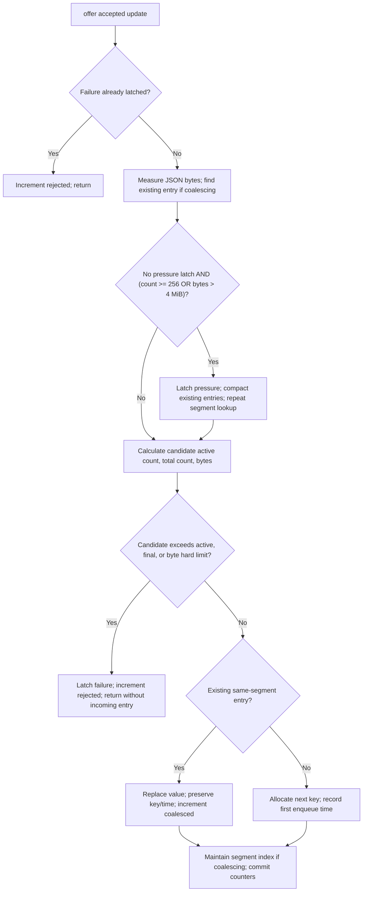

The diagram's pressure condition means `not pressure AND (count condition OR byte condition)`, matching Python's parentheses in the implementation.

### 7.5 Normal FIFO trace

For the next three traces, use actual `CaptionUpdate` JSON sizes with `session="L1"`, `source_ts=1000.0`, and the segment/revision/text shown. `P` means provisional; `F` means final. Times are seconds on an injected monotonic clock.

| Time | Offered update and JSON size | Queue after offer | `pending` | `_active_count` | Bytes |
|---:|---|---|---:|---:|---:|
| 0.0 | `10/r1/P`, text `A`, 123 bytes | `0→10/r1/P` | 1 | 1 | 123 |
| 0.1 | `10/r2/P`, text `AB`, 124 bytes | `0→10/r1/P, 1→10/r2/P` | 2 | 2 | 247 |
| 0.2 | `10/r3/F`, text `ABC`, 124 bytes | `0→10/r1/P, 1→10/r2/P, 2→10/r3/F` | 3 | 2 | 371 |

No pressure or lag is present. `_by_segment` stays empty. Three calls to `next_update()` return r1, r2, then r3. Even though one segment is already final in the global store, this healthy receiver's unsent earlier revisions remain in the FIFO.

### 7.6 Interleaving and `_compact()`

Suppose two segments are interleaved:

| Original key | First enqueue time | Queued value | Bytes |
|---:|---:|---|---:|
| 0 | 0.0 | `10/r1/P`, text `A` | 123 |
| 1 | 0.1 | `20/r1/P`, text `XY` | 124 |
| 2 | 0.2 | `10/r2/P`, text `ABC` | 125 |
| 3 | 0.3 | `20/r2/F`, text `XYZ` | 124 |

Calling `set_overloaded(True)` changes `_coalescing` from false to true and calls `_compact()`. Its temporary `pending` and `by_segment` dictionaries start empty. For each old `key, update`, `setdefault(segment, key)` selects the first queue position; every later revision assigns its newer value to that retained position.

| Retained key | Preserved time | Retained latest value | Bytes |
|---:|---:|---|---:|
| 0 | 0.0 | `10/r2/P`, text `ABC` | 125 |
| 1 | 0.1 | `20/r2/F`, text `XYZ` | 124 |

The resulting index is `{10: 0, 20: 1}`. `pending` changes `4→2`; active entries `3→1`; bytes `496→249`; `_coalesced` increases by two; `_next_key` remains four. First queue positions determine local order, not the latest update times. Final replay separately follows final acceptance order in the shared log.

Preserving the first time matters: repeated revisions must not reset a segment's provisional grace indefinitely. Calling `set_overloaded(False)` disables coalescing only if pressure is also false; then it clears the index. It cannot reconstruct discarded revisions.

### 7.7 Replacement byte/count trace

Continue the compacted state above:

| Action at key 0 | Byte calculation | Active-count calculation | Final state |
|---|---|---|---|
| Replace `10/r2/P` (`ABC`, 125 bytes) with `10/r3/P` (`ABCDE`, 127 bytes) | `249 + 127 - 125 = 251` | `1 - 1 + 1 = 1` | Two entries, one provisional, one final. |
| Replace that with `10/r4/F` (`ABCDEF`, 127 bytes) | `251 + 127 - 127 = 251` | `1 - 1 + 0 = 0` | Two final entries. |

Both replacements retain key `0` and time `0.0`; each increments `_coalesced` once. The final's extra text byte is offset by JSON `true` being one character shorter than `false`. Serialized size depends on the whole message, not text alone.

### 7.8 Reaching the soft threshold

Assume 255 provisional revisions of one segment are waiting in normal FIFO mode. The incoming revision is r256.

| Stage | Pending entries | Active entries | Retained state / flags |
|---|---:|---:|---|
| Before offer | 255 | 255 | Keys `0…254`; no segment index. |
| Initial estimate | Would be 256 | Would be 256 | `>=256` triggers pressure before insertion. |
| After compaction | 1 | 1 | Key0 contains r255; first enqueue time retained; 254 entries coalesced. |
| Incoming replacement committed | 1 | 1 | Key0 contains r256; one more coalescing counted; pressure remains true. |
| Owner enters replay | 1 | 1 | Latest active retained; pressure false; overloaded and replaying true. |

The segment lookup is repeated after compaction because it changed from “no existing keyed segment” to “replace key0.” Without that second lookup and candidate recomputation, the method would use incorrect counts and bytes.

### 7.9 Refusal, retry, and actual connection failure

The following budgets are **illustrative complete serialized sizes**, rather than the small JSON messages above. They show the exact admission arithmetic; `1 MiB` means 1,048,576 bytes, including JSON fields.

Four different finals of 1 MiB each fill the 4 MiB local budget. A new segment's provisional is 512 KiB:

| Step | Local pending state | Failure / rejection state |
|---|---|---|
| Before incoming update | Four finals; 4 MiB | No failure. |
| Initial pressure check | Projected 4.5 MiB; compaction finds no obsolete entries | Pressure latched. |
| Hard check | Incoming provisional not installed; four finals remain | Failure true; rejected becomes1. |
| `Client._enter_replay()` | Finals removed locally; still present in shared history | Failure and pressure cleared; overloaded true. |
| Client retries provisional | One active entry; 512 KiB | Admission succeeds; rejected remains1. |

This retry is implemented in `Client.enqueue()`: remember `refused`, enter replay, and re-offer a refused provisional. If the incoming update is final, it needs no retry: the store already recorded it before broadcasting. The client removes any queued provisional predecessor and replays the final from the store. See [chapter 6](#section-6).

Now replace the original four finals with four distinct active entries of 1 MiB each. The fifth active entry is again 512 KiB:

| Step | Result |
|---|---|
| Compact | Still four necessary latest-active entries; none can be removed as obsolete. |
| First admission | Refused because 4.5 MiB exceeds4 MiB. |
| Begin replay | No local finals exist to remove; latest active entries remain. |
| Retry | Refused again; `_rejected` becomes2. |
| Sender observes failure | Client closes1013 with `latest active state exceeds delivery capacity`. |

Similarly, a candidate count4001 exceeds the active-entry limit4000 even if its JSON fits the byte budget. The global store also has an active-segment backstop; see [chapter 13](#section-13). The implementation does not promise to admit an arbitrarily large set of active states. It preserves existing latest entries and reports explicit failure when they cannot fit. If already replaying, `Client.enqueue()` offers provisionals directly; a hard failure there is not rescued by another replay transition.

### 7.10 Removal helpers and ownership

`begin_replay()` sets `_overloaded=True`, compacts, removes every local final using `_take()`, and clears pressure/failure flags. Finals disappear from this queue because the shared log owns their remaining delivery. This transition neither sends them nor advances the client's final cursor.

`discard_segment(segment)` uses `_by_segment` to remove an active entry whose final is now in that log. It does not scan normal FIFO state; production invokes it as part of replay handling, where the index exists.

`_take(key)` removes the queued object, its timestamp, and any segment-index entry; subtracts its active contribution and JSON bytes; clears pressure if the queue becomes empty; and returns the object. It does not clear `_overloaded`, reset `_next_key`, or clear a previously latched failure.

| In-flight trace | Local queue / cursor consequence |
|---|---|
| Sender selects a normal final and calls `_take()` | That final is no longer pending locally; the sender's `delivery` variable owns it. |
| Sender awaits its socket send | Cursor remains at the previous final; the in-flight object is also recorded in `_in_flight`. |
| Probe starts replay during this await | Other local finals move to shared-log ownership; the in-flight send continues. |
| Send succeeds | Sender commits that final's sequence before selecting another replay final. |
| Next replay lookup | Starts after the committed sequence, preventing a repeat of the in-flight final. |

`_in_flight` is currently observational bookkeeping; no buffer branch reads it. Correct ownership also exists through the sender's local variable and cursor ordering. A completed send still is not an application acknowledgement. See [chapter 8](#section-8).

### 7.11 Selection helpers: used and generic branches

`take_active_update(provisional_grace)` scans local insertion order for the first nonfinal entry. If its age is less than the grace, it returns `None`; otherwise it takes that entry. Finals are skipped. The buffer's default grace is zero; the current client's replay path supplies one second. It measures time since the retained first enqueue, not since the latest text revision or source timestamp.

`next_update()` returns the oldest queue entry with default arguments. That is the production normal-FIFO path. Its optional `prefer_final=True` branch can choose a final ahead of an active entry while coalescing, falling back to `take_active_update(grace)` if there are no finals. This generic branch remains implemented but the current client does not use it: replay finals are selected from the shared store. Keeping that distinction clear avoids reading an available helper branch as the actual live delivery policy.

<a id="section-8"></a>

## 8. Sender selection, pacing, and WebSocket delivery

Source: [client.py, sender loop](../submission_root/app/client.py#L196) and [selection](../submission_root/app/client.py#L246).

There are three separate decisions:

1. **Admission:** can the buffer retain the update, or should state move to replay? Sections 6–7.
2. **Selection:** which caption should go next? `_next_delivery()`.
3. **Pacing:** may another burst start now? `_sender_loop()` and `_hold()`.

Selecting a final does not transmit it. `_send()` performs the asynchronous socket operation, and the caller commits progress afterwards.

### 8.1 The complete selection tree

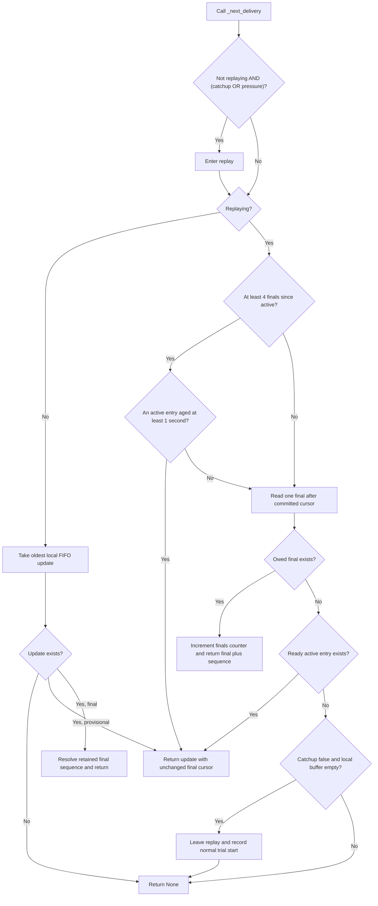

For active/provisional returns in replay, `_finals_since_active` resets to zero. When no active update is eligible after four finals, finals continue; the counter is not a hard stop at four.

### 8.2 Normal FIFO path

`delivery = _buffer.next_update()` takes the oldest queue entry. A provisional returns with the existing `_last_sent_final_sequence`. A final first calls `server.final_sequence(delivery)` and returns that internal sequence alongside the message.

Resolving the sequence **before** awaiting the send matters: the retained store entry might expire while a long send is in progress. Keeping the small sequence locally allows a successful send to commit correctly even if the original store entry expires meanwhile.

If the final was already unavailable when selection tries to resolve it, `ReplayExpired` is raised and the sender closes the connection explicitly.

### 8.3 Replay path and active fairness

The production read is:

```python
items, through_sequence = self.server.read_final_batch(
    self._last_sent_final_sequence,
    1,
    self._buffer.MAX_BATCH_BYTES,
)
```

Despite the generic helper name, `max_items=1`. The returned `items[0]` is a normal `CaptionUpdate`. No live `History(items)` is constructed.

The order is: try a ready active entry after four finals; otherwise read one owed final; when no final is owed, try a ready active entry; finally consider leaving replay.

`PROVISIONAL_GRACE_SECONDS=1.0` uses time since the first queued entry for that retained segment. If `s20/r1/P` arrived at time 100.0 and `r2/P` replaces it at 100.8, it can be selected at 101.0, not 101.8. This avoids keeping a long-lived segment young forever by repeatedly replacing it.

If a segment finalizes after 0.4 seconds, its draft can disappear before this grace elapses, reducing three messages to one final for that receiver. The constant is a policy choice; the code does not assume exactly three source revisions.

Example with final-log sequences 57–62 owed and an active entry already old enough (these are sequence numbers, not source segment IDs):

```text
select final57 → commit57
select final58 → commit58
select final59 → commit59
select final60 → commit60
select latest active → cursor remains60; finals counter resets
select final61 → commit61
select final62 → commit62
```

The current exit condition requires both `_catchup == False` and no local pending entries, after a read finds no owed final. The query and state transition contain no `await`, so a new update cannot interleave between that caught-up check and switching to FIFO. Continuous young active state can nevertheless prevent exit; Section 13 explains this limitation.

### 8.4 Outer wake, drain loop, and local variables

The sender waits on `_wake`, clears it, initializes burst counters, and drains while either local state exists or replay remains active. The replay flag keeps the loop meaningful even when there are no locally queued finals: owed finals may exist only in shared history.

| Local/field | Quantity and lifetime |
|---|---|
| `sent_items` | Number of individual live messages successfully sent since this drain/burst began; reset at outer wake and after each hold |
| `sent_bytes` | Sum of those messages' serialized JSON lengths; excludes WebSocket headers and other traffic |
| `selected` | Either `None` or `(delivery, through_sequence)` |
| `delivery` | One selected live `CaptionUpdate`, kept locally across send await |
| `through_sequence` | Cursor value to commit if that delivery succeeds |
| `_in_flight` | Same live caption exposed as a field while sending |
| `_last_sent_final_sequence` | Committed progress, unchanged until successful send returns |

The sender checks for a terminal active-state admission failure before sending. During catch-up it calls `_hold()` when any of these is true:

```python
sent_items == 0
sent_items >= 64
sent_bytes >= 256 * 1024
```

The first condition requires probe progress before a burst begins. After a hold, both counters reset. Outside catch-up the sender does not impose this probe gate, even if it is still replaying a pressure backlog.

### 8.5 A burst is not a combined message

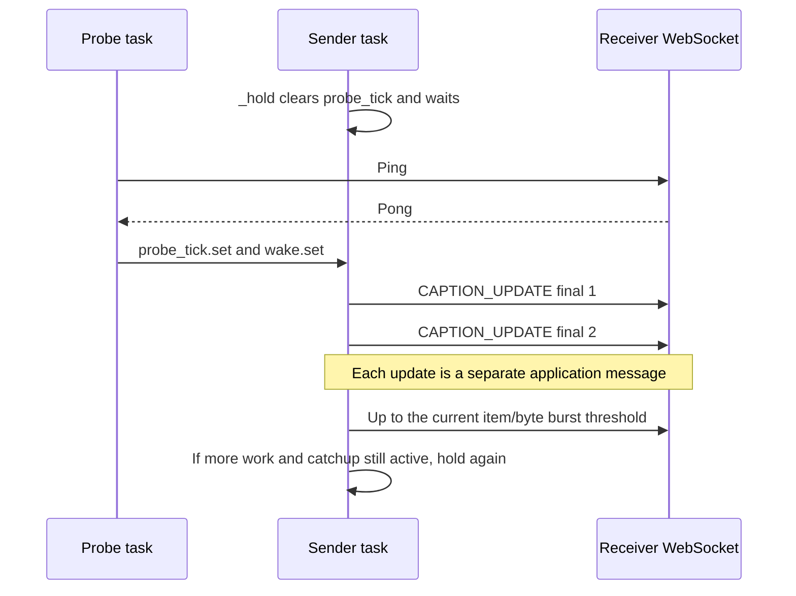

`MAX_BATCH_ITEMS=64` and `MAX_BATCH_BYTES=256 KiB` are historical names now used for a burst of individual messages. The item threshold bounds the count before the next hold. The byte threshold is checked before the next selection, after prior sends are counted; a burst can exceed its byte threshold by one message. A single large valid caption is not split by this logic.

A pong does not grant 64 application-processing credits. This burst size is a tuning heuristic, not a receiver-advertised capacity guarantee.

### 8.6 None is a wait decision, not necessarily an empty workload

`_next_delivery()` can return `None` because:

- Normal FIFO is empty.
- Replay has no owed final but an active entry is younger than its grace period.
- Replay just completed and switched back to normal.
- Replay has no current work but catch-up has not expired.

The sender breaks its inner loop, rather than spinning. New arrivals and completed probes set `_wake`; the probe cadence supplies later opportunities to recheck age even without another source update. Events coalesce, so the real queue/log state is always consulted again.

### 8.7 Bounded send, ownership, and commit

`_send()` creates a task for `ws.send(delivery.to_json())` and waits up to 75 seconds through `_wait_task()`. It also serves initial `History`, although `_in_flight` is only maintained by the live sender.

On success, the live sender performs:

```python
self._last_sent_final_sequence = through_sequence
self._in_flight = None
sent_items += 1
sent_bytes += len(delivery.to_json())
```

On send timeout, `_send()` invokes `_close("socket send exceeded stall budget")` and returns false; the live sender exits without committing. `finally` always cancels/awaits any remaining send task.

`_wait_task()` uses `asyncio.wait()` without automatically cancelling the child on an early timeout. That is important for probes: the same pending ping/pong continues across its behind, replay, and terminal deadlines. The task's owner eventually stops it. This helper also avoids a supported Python 3.10 `wait_for` cancellation race that motivated the current ownership pattern.

`_stop_task()` cancels if necessary and awaits completion, suppressing expected cancellation and connection-closed exceptions. It does not make arbitrary application work forcibly cancellable; the current use is limited to owned WebSocket operations.

### 8.8 Explicit close and cleanup branches

| Trigger | Action/reason |
|---|---|
| Active state still exceeds local capacity after replay rescue | Close 1013: `latest active state exceeds delivery capacity` |
| Needed final prefix expired | Close 1013: `outstanding finals exceeded shared history retention` |
| Individual send stalls 75 seconds | Close 1013: `socket send exceeded stall budget` |
| Whole probe stalls 75 seconds | Close 1013: `probe exceeded stall budget` |
| Receiver closes or transport fails | Receive/sender/probe paths observe closure; `run()` unregisters and cancels tasks |

`_close()` gives the close handshake two seconds. If it times out and the transport is available, it aborts that transport. The 75-second budgets are terminal resource policies, not promised normal latency or a permitted evaluator grace period.

<a id="section-9"></a>

## 9. Probes, RTT, catch-up leases, and recovery timing

Source: [probe loop](../submission_root/app/client.py#L335), [lag adaptation](../submission_root/app/client.py#L398), and [threshold helpers](../submission_root/app/client.py#L82).

### 9.1 What a probe observes

The server periodically sends a WebSocket ping and waits for a pong. A sufficiently backpressured receiver library may stop draining its transport, delaying control-frame handling as well as caption traffic. Network delay/loss, event-loop scheduling, and other transport conditions can also delay a pong.

Thus the probe is an indirect lag signal. A prompt pong does not prove that the application consumed every queued caption; a late pong does not prove that the receiver application alone caused the delay. The current protocol does not expose application credits or per-caption ACKs.

The WebSocket listener sets `ping_interval=None`, disabling its own periodic server keepalive pings. The custom Client probe owns the receiver-side heartbeat policy. Source and load-client libraries may have their own client-side keepalive settings; those do not add a second application-caption sender.

### 9.2 Constants and thresholds

| Constant | Value | Actual effect |
|---|---:|---|
| `PROBE_INTERVAL_SECONDS` | 0.25 s | Sleep after each completed probe; also maximum repeated waiting slice for a late probe |
| `BEHIND_AFTER_SECONDS` | 0.5 s | Floor on first lag verdict |
| `BEHIND_RTT_MULTIPLIER` | 6 | Scale first lag deadline against smoothed RTT |
| `REPLAY_AFTER_SECONDS` | 1.5 s | Floor on persistent-probe-lag replay threshold |
| `REPLAY_RTT_MULTIPLIER` | 18 | Scale persistent-lag threshold against RTT |
| `RTT_SMOOTHING` | 0.25 | Fraction of difference incorporated into each RTT estimate |
| `CATCHUP_STICKY_SECONDS` | 3 s | Initial/reset catch-up lease |
| `MAX_CATCHUP_SECONDS` | 30 s | Maximum adaptive lease, not a lifetime bound on replay mode |
| `MAX_STALL_SECONDS` | 75 s | Terminal deadline for one whole probe; also used for each send |
| `CLOSE_TIMEOUT_SECONDS` | 2 s | Closing-handshake wait before transport abort |

```python
behind_threshold = max(0.5, 6 * self._rtt)
replay_threshold = max(1.5, 18 * self._rtt)
```

| Current RTT estimate | Behind threshold | Persistent-lag replay threshold |
|---:|---:|---:|
| 0 ms initially | 500 ms | 1,500 ms |
| 50 ms | 500 ms | 1,500 ms |
| 200 ms | 1,200 ms | 3,600 ms |

The replay threshold is not the only replay trigger. Queue pressure or the sender observing `_catchup` can enter replay sooner. The persistent-probe threshold provides another path even when no pending local selection occurs.

The probe cadence is not exactly four pings per second: a probe takes time to complete, followed by a 0.25-second sleep. Only one round-trip task remains outstanding.

### 9.3 The complete late-probe flow

Each iteration captures:

```python
started = loop.time()
deadline = started + 75.0
replay_at = started + self._replay_threshold()
self._pending_probe = asyncio.create_task(self._round_trip())
was_late = False
```

`_round_trip()` includes both `await ws.ping()` and `await pong`. The first operation can itself wait for transport progress, so timing only the pong future would leave a coverage gap.

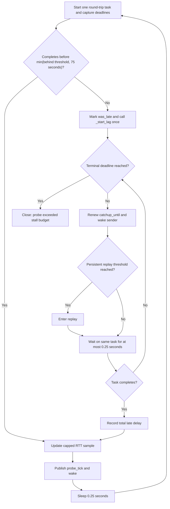

Relevant locals:

| Name | Quantity |
|---|---|
| `loop` | Current asyncio event loop |
| `started` | Monotonic beginning of this probe, not caption emission |
| `deadline` | Absolute monotonic terminal deadline |
| `replay_at` | Absolute persistent-lag threshold captured at probe start |
| `was_late` | Whether the first wait timed out; controls recording `_last_lag_delay` |
| `remaining` | `deadline - loop.time()`, terminal time budget left |
| `latency` | Numeric round-trip result provided by the WebSocket pong waiter |
| `sample` | RTT sample after clipping a single extreme result |

Early `_wait_task()` timeouts leave the same probe alive. The loop does not add another ping behind the overdue one. On close/cancellation its `finally` stops that task, clears the lease, and sets `_probe_tick` so the sender is not stranded waiting for progress from a task that no longer exists.

The initial wait is clipped to `min(_behind_threshold(), MAX_STALL_SECONDS)`. If an unusually large RTT estimate makes the adaptive threshold exceed 75 seconds, the terminal budget still takes precedence. Likewise, a persistent-replay threshold beyond that deadline does not extend the terminal budget.

### 9.4 RTT update, with numbers

After a probe completes:

```python
sample = min(latency, self._behind_threshold())
self._rtt += 0.25 * (sample - self._rtt)
```

Suppose `_rtt=0.100` seconds and the new latency is 0.180 seconds. The current behind threshold is `max(0.5,0.6)=0.6`, so no clipping occurs:

```text
new RTT = 0.100 + 0.25 × (0.180 − 0.100) = 0.120 seconds
new behind threshold = max(0.5, 6 × 0.120) = 0.720 seconds
```

If instead that probe takes 10 seconds, its sample is capped at the old 0.6-second threshold. The estimate becomes 0.225 seconds, not 2.575 seconds. This lets late successes influence the baseline without immediately treating a severe congestion event as normal link RTT.

### 9.5 Sticky mode does not freeze finals

While a probe remains overdue the loop repeatedly executes:

```python
self._catchup_until = loop.time() + self._catchup_lease
self._wake.set()
```

A completed late probe stops renewal, but does not immediately erase the existing lease. This avoids resuming all provisional revisions after a single pong when the receiver still cannot sustain the full stream.

Example, using illustrative times with an existing RTT estimate near 0.05 seconds:

| Time | Event | Policy state |
|---:|---|---|
| 10.0 | Probe starts | Behind threshold is 0.5 s |
| 10.5 | First wait expires | Catch-up lease renewed to roughly 13.5; sender can enter replay |
| 11.0 | Same probe still waiting | Lease renewed again; no second outstanding probe |
| 11.2 | Pong completes | Tick releases a held sender; current lease remains active |
| 11.45 onward | Later probes complete promptly | Replay finals can continue through bursts |
| After latest lease expiry | Lag verdict becomes false | Replay can exit if finals and local active work also clear |

A three- or thirty-second lease means "continue coalescing/pacing under this policy," not "send nothing for this many seconds." Renewals can keep catch-up active for longer than 30 seconds while repeated lag continues. The 30-second constant caps each adaptive lease value, not total mode duration.

### 9.6 Adaptive backoff after failed normal trials

When replay ends, the code records `_normal_trial_started`. On the next initial behind timeout, `_start_lag(now)` checks whether the full-update trial failed quickly:

```python
probation = min(30, max(12, 2 * self._last_lag_delay))
if now - self._normal_trial_started < probation:
    self._catchup_lease = min(30, 2 * self._catchup_lease)
else:
    self._catchup_lease = 3
self._normal_trial_started = None
```

That branch runs only if a previous normal-trial timestamp exists and a previous late delay was recorded. It is called once for the current overdue probe, not every 0.25-second waiting slice. An isolated long stall does not alone double the lease.

Example with previous lag delay 2 seconds: probation is `min(30,max(12,4))=12` seconds. A relapse 4 seconds after returning to normal doubles a 3-second lease to 6. Repeated quick failed trials can produce 12, 24, then 30 seconds. A later trial lasting at least its probation resets the lease to 3 on the next lag verdict.

This mechanism has a valid anti-oscillation purpose, but can also retain conservative behavior after a bottleneck is removed. Its interaction with full-update coverage needs validation; Section 13 records the current policy limits.

<a id="section-10"></a>

## 10. Browser state, rendering, recall, and reconnect

The browser implementation is [app.js](../submission_root/client/app.js), loaded by [index.html](../submission_root/client/index.html#L157). The browser's `Connection` is a WebSocket receiver. The Python `Client` from [chapter 6](#section-6) lives on the server and sends to that receiver. They are different objects in different processes.

### 10.1 Object ownership and configuration

The [wiring code](../submission_root/client/app.js#L399) constructs one `CaptionState`, one `View`, and one `Connection`:

```text
Connection receives JSON
    -> CaptionState accepts/rejects caption state
    -> View updates accepted segments
    -> recall reads that same CaptionState locally
```

| Constant | Value/unit | Actual effect |
|---|---:|---|
| `RETENTION_SECONDS` | 150 seconds | Final age cutoff when state pruning runs |
| `MAX_ACTIVE_SEGMENTS` | 400 unfinished segments | Drop lowest-ID active entries above this browser-side backstop |
| `MAX_ROWS` | 80 DOM rows | Limit live display independently of retained state |
| `RECONNECT_BASE_MS` | 500 milliseconds | Initial automatic reconnect delay |
| `RECONNECT_MAX_MS` | 5,000 milliseconds | Cap exponential reconnect backoff |
| `DEFAULT_RECALL_SECONDS` | 30 seconds | Initially selected local recall window |

`serverUrl()` uses the `ws` query parameter if supplied. Otherwise it returns `ws://<page-hostname>:8765`, falling back to `127.0.0.1` for an empty hostname. HTTP page hosting and WebSocket caption delivery are separate services. For example, `http://127.0.0.1:8000/?ws=ws://127.0.0.1:9000` serves the page on 8000 but connects captions on 9000.

### 10.2 CaptionState: one accepted value per segment

[CaptionState](../submission_root/client/app.js#L42) owns:

| Field/local | Meaning |
|---|---|
| `segments` | `Map<source segment ID, latest caption>` |
| `lastFinalSegment`, `lastFinalRevision` | Highest accepted finalized resume marker; unrelated to Python final-log sequence |
| `suppressed` | Count of stale, duplicate, or post-final updates rejected |
| `held` in `accept` | Previously retained caption for the same segment |
| `sourceTs` in a stored caption | Source event Unix timestamp copied from wire `source_ts` |

Live and recovered captions share [accept(update)](../submission_root/client/app.js#L55):

```text
held = segments.get(update.segment)
If held exists and (held.final OR update.revision <= held.revision):
    increment suppressed
    reject
Otherwise:
    replace segments[segment] with newest caption
    if final and (segment, revision) exceeds finalized resume marker:
        advance marker
    prune state
    report acceptance
```

| Arrival | Result for segment 10 |
|---|---|
| `10r1 provisional: "TCP"` | Accept; create row |
| `10r2 provisional: "TCP uses"` | Accept; replace row text |
| `10r1` again | Reject older revision |
| `10r3 final` | Accept; advance finalized marker |
| `10r3 final` again | Reject duplicate |
| `10r4` after final | Reject because held state is final |

A browser holding final `38r3` and provisional `39r2` reconnects with marker `38/3`, allowing recovery of final `39`. It does not claim that the provisional was finalized.

[prune()](../submission_root/client/app.js#L86) computes `Date.now()/1000 - 150`, removes older finals according to `sourceTs`, sorts unfinished IDs, and deletes the lowest IDs above 400 active segments. Finals are not subject to the 400-entry active cap.

Pruning runs on accepted updates, not on a separate timer. Without new traffic, old Map entries can remain until another acceptance. Recall still filters by current age. Pruning does not rewind the finalized resume marker: progress and retained display history are different quantities. A recovered old final can advance the marker and be immediately pruned; processing continues through the rest of the history.

`ordered()` sorts captions by segment ID; `recall(seconds)` filters ordered finals by source age; `finalCount()` counts retained finals. None sends a server request. The browser only checks `typeof update.segment === "number"` before accepting an update, relying on the server's stronger [protocol validation](#section-3).

### 10.3 View and local recall

[View](../submission_root/client/app.js#L130) stores `state`, references to `statusEl/liveEl/recallEl/statsEl`, a `rows` Map from segment ID to live DOM element, and `recallSeconds`. Its statistics mean:

- `attempts`: connection attempts.
- `historyItems`: items in the latest `HISTORY`.
- `recovered`: newly accepted updates processed through the history path; duplicates do not increment it.

`buildRow` creates a segment label, live/final badge, and text element. [renderCaption](../submission_root/client/app.js#L171) reuses a row for a known segment or creates one in segment order. `textContent` displays caption text without interpreting it as HTML.

`trimRows` removes rows whose state was pruned, then removes oldest visible rows above 80. Removing a row does not delete its retained caption. A caption absent from the live pane can therefore still appear in recall.

`isFollowingLatest` tests whether the pane is within **80 pixels** of the bottom; this is distinct from the 80-row cap. `applyUpdates` captures this condition before rendering, then scrolls after rendering only if it was already following. Reading older captions does not force the viewer back to the bottom.

`renderRecall` rebuilds the recall pane from locally held finals and adds source-age labels. The 15/30/60 buttons set `recallSeconds` and redraw. Refresh also redraws locally. A one-second timer updates recall ages even with no incoming traffic; it does not fetch history or prune the state Map.

### 10.4 Connection variables and message branches

[Connection](../submission_root/client/app.js#L266) owns:

| Field/local | Role |
|---|---|
| `state`, `view` | References to caption state/display |
| `ws` | Current browser WebSocket |
| `retries` | Reconnect backoff exponent |
| `timer` | Reconnect timeout handle |
| `reconnectNotBefore` | Unix time in milliseconds for simulated-offline deadline |
| `manualClose` | Initialized but unused in current code |
| `clientId()`'s `key/value` | A six-digit numeric ID saved in `sessionStorage` |
| `delay` | Calculated reconnect wait in milliseconds |
| `followingLatest` | Scroll condition captured before rendering |
| `changed` | Whether any caption in the current batch was accepted |

`connect()` clears an existing timer, increments attempts, and constructs a WebSocket. A construction exception schedules reconnect. On `open` it resets `retries=0`, shows connected status, and sends:

```json
{
  "type": "CLIENT_HELLO",
  "client_id": 123456,
  "session": "L1",
  "last_segment": 38,
  "last_revision": 3,
  "history_seconds": 60
}
```

The browser requests **60 seconds of recovery**, even when its recall pane displays 30 seconds. Coverage and display selection serve different purposes.

The `message` handler's branches are:

```text
Invalid JSON       -> ignore
CAPTION_UPDATE     -> applyUpdates([message], false)
HISTORY            -> record item count; applyUpdates(items, true)
Unknown type       -> ignore
```

`applyUpdates` calls `accept`, renders accepted retained captions, counts recovered acceptances, trims rows, conditionally follows the bottom, and redraws recall/stats. The browser can parse history at any time, but that does not authorize unsolicited live history; the current server sends `HISTORY` only for hello recovery.

`close` schedules reconnect. `error` changes status and relies on the following close event for reconnect. The application sends no acknowledgement per caption. Browser-level WebSocket ping/pong processing is separate from these JavaScript handlers.

[Reconnect scheduling](../submission_root/client/app.js#L371) calculates:

```javascript
delay = Math.min(5000, 500 * Math.pow(2, retries));
delay = Math.max(delay, reconnectNotBefore - Date.now());
retries += 1;
```

Failed attempts before opening produce waits `500,1000,2000,4000,5000,...` ms. Because opening resets the exponent, repeated connections that open and immediately close can keep using 500 ms.

### 10.5 Worked disconnect and recovery

```mermaid
sequenceDiagram
    participant B as Browser Connection
    participant S as LiveRecall Server
    participant C as Browser CaptionState
    participant V as Browser View
    B->>S: CLIENT_HELLO marker 0/0, context 60s
    S-->>B: HISTORY with recent finals
    B->>C: accept recovered captions
    B->>V: render accepted state
    S-->>B: CAPTION_UPDATE 39r1
    B->>C: retain provisional 39r1
    Note over B,S: Disconnect; browser state remains in memory
    Note over S: Source finalizes segment 39
    B->>B: Backoff timer
    B->>S: CLIENT_HELLO latest held final 38r3
    S-->>B: HISTORY with final 39
    B->>C: replace provisional and advance final marker
    B->>V: update row 39
    S-->>B: Later live CAPTION_UPDATEs
```

The Simulate disconnect button validates its numeric input and calls [dropNow(durationMs)](../submission_root/client/app.js#L387). An open socket gets `reconnectNotBefore=Date.now()+durationMs` and is closed. Normal reconnect handling respects both this deadline and minimum backoff. If no open socket exists, `dropNow` does nothing.

Only the client ID survives via `sessionStorage`. Caption state is not persisted to localStorage/IndexedDB: reloading the page starts at marker `0/0` even with the same client ID.

Browser recall uses wall-clock source timestamps; server retention uses monotonic acceptance timestamps. Browser/source clock alignment is therefore an assumption. For a new lecture, reset both server state and browser state. The current HTML is a thin presentation layer for these objects; the transport and state decisions above are in `app.js`.

<a id="section-11"></a>

## 11. Optional ASR adapter

[bonus_asr/asr_source.py](../bonus_asr/asr_source.py) replaces the deterministic caption source with local speech recognition while reusing the same server/browser and standard protocol classes. It is a separate optional process, not a mandatory server import.

### 11.1 Audio pipeline and defaults

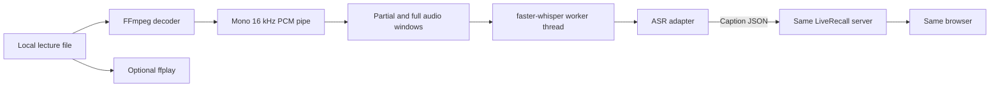

Decoder and player independently read the file. This code does not capture microphone or speaker output.

[parse_args](../bonus_asr/asr_source.py#L249) controls:

| Setting | Default | Purpose |
|---|---|---|
| `media` | Required local path | Existing lecture video/audio |
| `--uri` / `--session` | `ws://127.0.0.1:8765` / `L1` | Server and source label |
| `--start-segment` | 1 | First emitted caption ID |
| `--model` | `base.en` | Model name/local model directory |
| `--model-cache` | `output/asr-models` | Cached model files |
| `--local-files-only` | False | Require previously downloaded weights when enabled |
| `--device` | `cpu` | CPU/CUDA/automatic selection |
| `--compute-type` / `--cpu-threads` | `int8` / 4 | Model inference settings |
| `--language` | `en` | Language; `auto` passes `None` |
| `--chunk-seconds` | 5.0 seconds | Full recognition window |
| `--partial-seconds` | 2.5 seconds | Prefix recognition; 0 disables provisional pass |
| `--start-seconds` | 0.0 seconds | Media seek offset |
| `--duration` | None | Optional excerpt length |
| `--play` | False | Launch `ffplay` |
| `--ffmpeg` | None | Optional decoder executable override |
| `SAMPLE_RATE` | 16,000 samples/s | Decoded audio sample rate |
| `BYTES_PER_SECOND` | 32,000 bytes/s | Mono × 16,000 samples/s × 2 bytes/sample |

Validation rejects missing media, non-finite duration values, chunks outside 0.1–30 s, partials outside `0 <= partial < chunk`, negative seek, nonpositive supplied duration, invalid segment/thread settings, and blank session. A YouTube page URL is not accepted directly.

### 11.2 Startup, decoding, and recognition

`main` loads the model synchronously before entering `asyncio.run`, so playback starts after model loading. [run](../bonus_asr/asr_source.py#L190) connects, sends `SOURCE_HELLO`, records monotonic `playback_started`, optionally starts the player, and starts the decoder.

[build_decoder_command](../bonus_asr/asr_source.py#L110) selects the first audio stream, discards video, seeks to the chosen offset, optionally limits duration, and writes mono signed 16-bit little-endian PCM at 16 kHz to stdout. FFmpeg's `-re` paces input approximately in real time. The Python stream reader has a 64 KiB buffering limit, which provides backpressure rather than guaranteed playback synchronization.

`build_player_command` uses the same seek and duration with `ffplay`, disables embedded subtitles, and exits at playback end. Decoder and player have no shared frame-accurate clock.

[load_recognizer](../bonus_asr/asr_source.py#L161) returns a synchronous `recognize(pcm)` function holding the model. Conversion is:

```python
audio = np.frombuffer(pcm, dtype="<i2").astype(np.float32) / 32768.0
```

Each two-byte pair becomes a signed little-endian integer, then floating-point amplitude approximately in `[-1,1)`. The model receives `beam_size=1`, `vad_filter=True`, and `condition_on_previous_text=False`. Returned text pieces are joined into one LiveRecall caption.

Recognition includes iterating the returned model segments. Both operations happen inside `await asyncio.to_thread(recognize, audio)`, keeping this adapter's event loop available for WebSocket processing. Windows are nevertheless handled sequentially, not recognized concurrently.

### 11.3 Chunk variables and exact branches

[stream_captions](../bonus_asr/asr_source.py#L40) tracks:

| Variable | Quantity |
|---|---|
| `chunk_bytes` | `int(chunk_seconds*16000)*2` bytes |
| `partial_bytes` | `int(partial_seconds*16000)*2` bytes |
| `segment` | Caption ID; increments only after an emitted final |
| `revision` | Version within a window; resets to 0 per window |
| `processed_bytes` | All consumed audio, including silence |
| `completed` | Emitted final count |
| `audio` | Current window's PCM bytes |
| `audio_start` | `start_offset + processed_bytes/32000` media seconds |
| `audio_end` | `audio_start + len(audio)/32000` at publication |
| `started` | Monotonic inference start |
| `inference_seconds` | Duration of this recognition pass |
| `reader/recognize/emit` | Audio input, synchronous inference, asynchronous publication callbacks |

`read_pcm` uses `readexactly` to combine short reads. At EOF it returns the available partial chunk. An odd byte count raises an error because one sample requires two bytes.

Default full/prefix sizes are 160,000/80,000 bytes. The loop is:

```text
Read prefix, or entire window if provisional recognition is disabled.
No bytes at EOF -> finish.
Calculate audio_start; reset revision.
If a complete prefix was read:
    recognize prefix
    nonempty text -> publish provisional
    read and append remainder of window
Recognize entire available window again.
If final text is nonempty OR a provisional was already emitted:
    publish final
    increment completed and segment
Advance processed_bytes by all consumed audio.
Repeat.
```

The final pass revisits the prefix and can correct it. It does not append independently recognized second-half text.

| Outcome | Emission |
|---|---|
| Prefix/full text nonempty | Revision 1 provisional; revision 2 final |
| Prefix empty, full nonempty | Revision 1 final |
| Prefix nonempty, full empty | Provisional then empty final clearing incorrect text |
| Both empty | No caption; audio position still advances |
| Partials disabled | One full-window inference; final if nonempty |
| EOF before complete prefix | Recognize remaining short audio as final candidate |
| EOF exactly after prefix | Prefix can be provisional, then recognized again as short final |

### 11.4 Worked ASR-to-browser trace

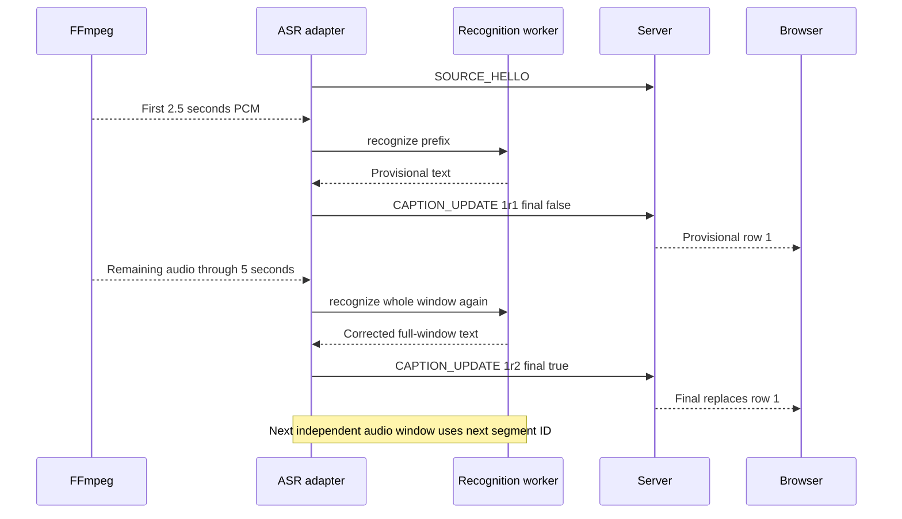

The nested `publish` increments revision, constructs `CaptionUpdate`, and sets `source_ts=time.time()` at emission. It adds `audio_start`, `audio_end`, `recognition_seconds`, and approximate playback lag:

```python
max(0, monotonic_now - playback_started - (audio_end - start_offset))
```

The nested `emit` checks nonzero player exit status, serializes with `allow_nan=False`, sends JSON, and prints it. Extra timing fields appear in adapter logs. The server reconstructs the standard caption type and does not forward this extra metadata to browsers.

### 11.5 Completion, cleanup, and practical limits

At EOF, `run` checks decoder/player failures, sends `SOURCE_DONE(completed)`, and prints the count. Its `finally` stops decoder and player. `stop_process` terminates a live subprocess, drains its output via `communicate`, waits up to three seconds, then kills it if necessary. Ctrl+C exits through this cleanup path.

Dependencies are isolated in [bonus_asr/requirements.txt](../bonus_asr/requirements.txt); setup is in the [submitted README](../submission_root/README.md#L95). After preparing the separate environment and cache:

```bash
.venv-asr/bin/python -m bonus_asr.asr_source lecture.mp4 \
  --play --duration 180 --local-files-only
```

Recognition runs locally; initial model download can need Internet. Without `--play` the adapter recognizes audio but displays no lecture. New lectures require resetting server and browser state; disconnecting a source does not erase accepted captions. `--start-segment N` can continue the same lecture with unused higher IDs.

Distinguish three delays: audio accumulation, recognition/backlog, and caption emission-to-reception. Network Caption Age measures the last because `source_ts` is assigned after recognition. It excludes the default 2.5/5-second audio buffering and inference time. Slow inference backpressures decoding while video continues, so caption lag can grow. Disabling partials reduces repeated inference but changes the revision stream. Fixed non-overlapping windows can split words/sentences, and recognition accuracy or exact video synchronization is not guaranteed.

<a id="section-12"></a>

## 12. Deterministic source, experiments, and measurement

These tools exercise the same submitted server. They are not part of the server's scheduling policy. A server cannot assume every source uses the starter generator's exact timing or three revisions.

### 12.1 Deterministic caption generation

[test/caption_source.py](../test/caption_source.py#L49) splits a sentence into approximately one-third, two-thirds, and full text. Sentences shorter than four words produce one final revision. Its defaults are `revision_delay=0.20` seconds and `segment_gap=0.35` seconds. For the standard longer sentences, nominal generation is:

```text
t=0.00  segment1 revision1 provisional
t=0.20  segment1 revision2 provisional
t=0.40  segment1 revision3 final
t=0.75  segment2 revision1 provisional
```

Those are requested delays, not exact deadlines. Python processing, task scheduling, connection setup, and network stalls add time. The script waits on each send, creates a new `source_ts` at event creation, and sleeps between revisions and segments. It completes a segment before starting the next. On completion it sends `SOURCE_DONE` with its emitted segment count.

| Source setting/state | Meaning |
|---|---|
| `--uri`, `--session` | WebSocket destination and source declaration |
| `--segments` | Exact number of segments to emit |
| `--duration` | Optional approximate media-free generation duration; checked between segments |
| `--transcript`, `--repeat` | Sentence input and repetition when no other stopping limit is given |
| `emitted_segments`, `segment` | Completed count and next source ID |
| `revision`, `revs` | Current sentence's generated versions |
| `start_mono` | Monotonic start for optional duration checking |

### 12.2 How run_demo starts and stops a run

[test/run_demo.py](../test/run_demo.py#L62) starts a fresh server for each independent experiment, waits for its port, starts load clients, sleeps `source_start_delay` (default 1 second), runs the source, waits for clients, analyzes the CSV, writes JSON, then terminates child processes. `--runs 3` means three fresh-server experiments, not one server with three client waves.

Default source work is estimated by:

```python
segments = max(4, floor(max(3.0, duration - source_start_delay - 2.0) / 0.75))
```

For duration60/start delay1 this yields76 segments. An explicit positive `--source-segments` overrides that estimate. `expected_finals=segments` and `expected_updates=segments*3` are passed to analysis for the standard generator.

| Runner state/option | Role |
|---|---|
| `server`, `clients` | Child process handles, not asyncio Client objects |
| `run_no`, `--runs` | Experiment identity and repetition count |
| `--port` | Default8765; server/source/load clients all use the generated URI |
| `--duration` | Load clients' fixed reading duration; also an input to automatic source-count calculation |
| `--source-start-delay` | Sleep between starting load-client process and starting source process |
| `--output-stem` | CSV/JSON destination; multiple runs add `_run01`, etc. |
| `--quiet-server` | Redirect server output; does not change server policy |
| `--fresh-threshold-ms` | Default500ms freshness threshold used by analyzer |
| `--seed` | Default3103, used for reproducible role selection |
| `--history-seconds` | Load-client recovery request, default30; distinct from browser's fixed60 request |

### 12.3 Simulated receivers and their local state

[test/load_clients.py](../test/load_clients.py#L61) has one `simulated_client` coroutine per receiver. A seeded shuffle selects disjoint slow/disconnecting/late roles. All share the same monotonic `_global_start` and `end_time = start + duration`. Late joiners use only the remaining time; reconnect does not restart a client's test clock.

| Local | Meaning |
|---|---|
| `highest_revision` | Highest revision accepted per segment across this client's connections |
| `final_seen` | Set of finalized source segments seen; retained independently of socket |
| `last_final_segment/revision` | Hello resume marker, advanced only on accepted/recovered finals |
| `disconnected_once` | Ensure only one scripted temporary disconnect |
| `connection_no` | Incremented after each successful WebSocket connection |
| `connected_epoch` | Wall-clock connection time for HISTORY response latency |
| `slow` | Sleep after each live caption, or once after a nonempty history |
| `disconnecting` | Close at configured elapsed time, wait configured downtime, then reconnect |
| `late` | Delay initial connection by configured late delay plus small seeded jitter |

`classify(seg,rev)` returns `accepted`, `duplicate`, or `stale`. Recovered finals use the same revision map; an accepted history item is logged as `recovered`. History containing a nonfinal item is logged as `invalid_history_nonfinal`. A higher revision after a final is not independently blocked by this load client's classifier; the valid source/server contract protects that case. The browser has an additional held-final guard.

The public receiver's `max_size=2**20` is a **1MiB incoming-message limit**. Slow mode with `--slow-ms 500` sleeps 0.5 seconds after each individual caption, so an idealized application consumes at most about2 messages/second. Network/library queues can still read ahead until their own backpressure thresholds are reached. A completed server send is therefore not the same as a completed slow-client read.

### 12.4 CSV fields and what counts as delivery

`CSVLogger` shares a file writer protected by an asyncio lock. It buffers output and flushes on close, so `tail -f` on a running CSV may not show every event immediately.

| CSV field | Interpretation |
|---|---|
| `client_id`, `slow`, `disconnecting`, `late` | Receiver identity/role |
| `connection_no` | Which socket lifetime produced this row |
| `event_type` | `CONNECT`, `FORCED_DISCONNECT`, `CONNECT_ERROR`, `CAPTION_UPDATE`, `HISTORY`, `HISTORY_ITEM`, etc. |
| `segment`, `revision`, `final` | Caption identity/version/finality when applicable |
| `source_ts`, `receive_ts` | Epoch seconds, serialized as decimal strings |
| `latency_ms` | `(receive_ts-source_ts)*1000` |
| `status` | Acceptance/classification or event description |
| `recovery_ms` | Time from this connection's successful open to receiving this HISTORY |

[analyse_results.py](../test/analyse_results.py#L59) combines accepted live finals and recovered history finals using unique `(client_id,segment)` identities. It does not count duplicate receptions as additional completeness.

| Metric | Exact interpretation in this public analyzer |
|---|---|
| P50/P95/P99 Caption Age | Percentiles of accepted **live** caption latency; history-item latency is not mixed into this distribution |
| Fresh Caption Ratio | Accepted live messages at/below threshold divided by accepted live messages with latency |
| Final completeness | Unique final deliveries, including recovery, divided by expected finals × observed clients |
| Fresh Final Caption Ratio | Unique final states received within threshold, live or recovered, divided by expected finals × observed clients |
| Normal Update Coverage | Unique accepted **live** `(segment,revision)` pairs divided by expected updates × observed clients; provisionals missed during disconnect still affect it |
| Normal/slow-client statistics | Accepted live latency grouped by `slow` role |
| Recovery P95 | HISTORY response timing on reconnects or late joins; not application ACK time or proof all expected finals were recovered |

Percentiles are calculated by sorting and linearly interpolating between adjacent ranks. The median summary takes the median of each metric across independent runs, not a percentile of all combined CSV rows.

### 12.5 Fixed deadlines and tail omissions

The public runner does not coordinate a separate post-source drain phase. Clients use a fixed nominal reading deadline while the source's actual completion can drift beyond the estimated schedule. The analyzer still uses the configured complete source count as its denominator. An already-started `recv()` has a minimum 50 ms timeout, so it can accept a message slightly beyond that nominal deadline; slow-client sleep and socket cleanup can also finish later. None of these constitutes a coordinated wait for the source's final captions.

```mermaid
sequenceDiagram
    participant R as Runner
    participant C as Load clients
    participant S as Source
    participant V as Server
    R->>C: Start fixed60-second reading window
    R->>S: Start source after process/sleep overhead
    S->>V: Finals1 through74
    V->>C: Deliver those finals
    C->>V: Reading deadline reached; close
    S->>V: Final75 generated after deadline
    S->>V: Final76 generated later
    Note over V: No clients remain for these finals
    R->>R: Analyze74 of76 per receiver
```

An instrumented diagnostic observed final74 generated at59.287 seconds, final75 at60.055, and final76 at60.832 relative to the clients' monotonic start. The server had100 clients for final74 and0 for the other two. This produced `74/76 = 97.37%` completeness on clean networking. These values document one measured example, not deterministic timing for every run.

The arithmetic was correct; the mismatch was workload generation versus observation lifetime. A CSV alone establishes non-reception, not whether a final was generated too late, dropped, queued, or disconnected before delivery. The teaching-team clarification says the hidden evaluator allows a short bounded settling period; do not infer that its timing is identical to this public runner or that long backlogs are acceptable.

For a separately labeled diagnostic, keep workload fixed while extending reading:

```bash
./venv/bin/python test/run_demo.py \
  --clients 100 --duration 70 --source-segments 76 --runs 3 \
  --disconnect-percent 20 --disconnect-at 15 --disconnect-seconds 5 \
  --output-stem output/t4_extra_drain
```

Changing duration alone also increases automatically selected source work. This command is a diagnostic variation, not the unmodified required T4 experiment.

### 12.6 Commands and network state

The Makefile expects an environment named `venv`; the submitted README uses `.venv`. Substitute the actual environment path consistently. From the repository root, three terminals can run:

```bash
# Terminal1: WebSocket server
./venv/bin/python submission_root/solution_server.py --port 8765
```

```bash
# Terminal2: browser files
./venv/bin/python -m http.server 8000 --directory submission_root/client
```

```bash
# Terminal3: deterministic caption source
./venv/bin/python test/caption_source.py --duration 120
```

Open `http://127.0.0.1:8000`. For public experiments, the harness starts its own server; use a free port and avoid conflicting manually started sources.

| Shortcut | Workload |
|---|---|
| `make check` | Startup/submission structure check |
| `make check-final` | Also require final submission documents |
| `make t1-basic` | 20 clients,20s,3 independent runs |
| `make t2-scale` | 100 clients,40s,3 runs |
| `make t3-slow` | 100 clients,60s,10% slow at500ms/message,3 runs |
| `make t4-reconnect` | 100 clients,60s,20% disconnect at15s for5s,3 runs |
| `make t5-network-enable` | Apply120ms±30ms delay and3% loss to loopback |
| `make t5-network` | 100 clients,40s,3 runs under whatever network profile is active |
| `make t5-network-reset` | Remove the profile |

Starting T1–T4 does not reset Linux traffic control. `tc qdisc show dev lo` checks the current loopback profile; an active `netem` profile affects ordinary loopback WebSocket experiments too. The source, receivers, and pings can all experience it. Network profiles persist across server restarts until reset; shell/script permissions determine how the `tc` commands are invoked.

### 12.7 Regression tests and what they do not prove

```bash
./venv/bin/python -m unittest discover -s test -p 'test*delivery.py' -v
```

The current files discover23 cases:22 normally executed and one65-second transport-stall case gated by `LIVERECALL_LONG_STALL=1`.

| Test group | Main coverage |
|---|---|
| `FinalLogTests` | Window versus outstanding delivery, snapshot boundary, expiry, sequence counters, bounded generic reads |
| `PendingReplayTests` | Active preservation during replay transition and final-queue pressure rescue |
| `ClientReplayTests` | Normal revision order, in-flight cursor ownership, initial history race, zero context, pressure replay, bounded probes/closing, adaptive lease |
| `LiveDeliveryTests` | Individual live frames, four-final active fairness,64-frame probe-window boundaries, actual hello-only HISTORY exchange |
| `LongTransportStallTests` | Opt-in actual paused transport, finite final burst, same-connection replay, and resumption of normal revisions |

The65-second test is useful for a temporary transport stall, but its stopped-source drain does not prove continuous final throughput or short-grace behavior under all slow readers. Fake sockets verify control flow without modeling downstream consumption rate. A test asserting holds at messages0,64,128 establishes the configured burst rule, not that64 is an optimal burst size.

Python's `IsolatedAsyncioTestCase` enables debugging, which can add substantial task/traceback overhead on some mounted filesystems. In a review run, two tight timing assertions expired in debug mode; the same22 checks passed with production-style debug disabled. Investigate such timing failures rather than labeling them either application corruption or harmless without checking.

<a id="section-13"></a>

## 13. Requirements, design purposes, and implementation limits

This chapter separates mechanisms visible in the code from stronger claims the code does not establish. The assignment text is in [the PDF](miniProject_Assignment4_LiveRecall_System.pdf). The teaching-team clarification supplied with the project discussion adds: final-only capacity will be feasible, HISTORY belongs to hello recovery, completeness gets a short bounded settling period, state must stay bounded, and recovery beyond retained history is not guaranteed.

### 13.1 Mechanisms that directly serve the requirements

| Requirement/purpose | Mechanism | Boundary |
|---|---|---|
| Newer revisions replace older state | Central store gate and browser acceptance gate | Raw direct construction bypasses protocol validation; buffer trusts its caller |
| Final durability | Store rejects further revisions after a retained final | Retention is finite, not permanent storage |
| Full normal revision coverage | Distinct FIFO keys per revision | Overload detection should activate only when warranted and should later clear |
| Suppress obsolete drafts | Compaction/segment index during overload | Data already sent downstream cannot be retracted |
| Preserve outstanding finals efficiently | Shared final log and per-client sequence cursor | Outstanding prefix must remain within retention |
| Recovery without subscription gap | Synchronous registration and snapshot | Initial history still must fit compatible receiver framing |
| Slow-client isolation | Independent sender/probe tasks; broadcast only enqueues | CPU/event-loop/network resources remain shared |
| Local recall | Browser's retained finals and local filtering | Uses source/browser wall-clock alignment; page reload loses caption memory |
| Bounded pending state | Local count/JSON-byte checks and active caps | Not a total RSS cap; shared history has age but no explicit byte/count cap |
| Correct live protocol | Initial HISTORY, then individual CAPTION_UPDATE | Internal generalized “batch” helpers do not authorize live HISTORY |

Authentication, TLS, a database, permanent reconnect sessions, and multiple concurrent lecture namespaces are not mandatory features. Their absence is not itself a failure of the specified one-source/session design.

### 13.2 The different state views are purposeful

`_segments` supports current revision lookup; `_final_history` supports ordered recovery/replay; `_active_segments` supports unfinished-state accounting. These can reference the same immutable state objects. Likewise the local queue and segment index serve FIFO order and efficient replacement. They are not three independent transcripts.

Shared-log replay is an optional robustness choice. Its benefit is avoiding a growing private final queue for every stalled receiver. It adds sequence/cursor logic, but the store already needs recovery history, so the extra per-client progress value is small. A simpler bounded coalescing queue could also satisfy feasible workloads if final scheduling and recovery are correct.

The probe, sticky lease, provisional grace, final/active quota, and burst thresholds are policy heuristics. Their purposes are valid—early coalescing, preventing oscillation, and keeping active text useful—but their combination is not a mathematical capacity guarantee.

### 13.3 Fixed final/active fairness can exceed spare capacity

The current selector tries an eligible active update after four finals, even while finals remain owed. Where active entries remain eligible, this can allocate roughly one-fifth of message service to provisionals.

A capacity-limited selector simulation used strictly sequential segments: r1 at segment time0, r2 at1s, final at2s, then next segment. Final rate was0.500 messages/s; delivery capacity was0.505 messages/s; four finals were initially owed after an earlier lag. After about77 seconds:

| Selection policy | Sent finals | Sent active updates | Finals still owed |
|---|---:|---:|---:|
| Current eligible-active-after-four rule | 32 | 8 | 10 |
| Control prioritizing finals while any are owed | 40 | 0 | 2 |

This is a scheduling model, not a measured socket/evaluator failure. It establishes that `capacity > final rate` alone does not guarantee the current quota can keep pace: if finals receive only80% of capacity, `0.8×0.505=0.404 < 0.500`. Byte sizes can complicate the allocation further.

**Potential improvement, not implemented:** budget provisional transmissions using actual final backlog, oldest final age, and headroom; preserve latest active state while withholding optional draft sends when finals need capacity. Preservation does not imply forwarding every active revision at a fixed quota.

### 13.4 Continuous active state can keep replay active

Replay exits only after no final is owed, catch-up has cleared, and the local buffer is empty. Replay's own one-second grace can retain young active entries continuously.

One pure selector example introduced a segment every0.25s, revised it one tick later, and finalized it after2s. With overlapping active segments and an unlimited healthy sender, the steady state remained:

```text
catchup=False, replaying=True, pending active entries=4,
outstanding finals=0, pressure=False
```

Thus full revision forwarding did not resume while that input continued. This case requires overlapping active segments; the sequential starter generator does not exercise it. The PDF identifies the starter's sequential behavior, while the exact hidden workload is not disclosed. Do not turn this conditional case into a claim that the standard source always fails.

**Potential improvement, not implemented:** allow the healthy, final-caught-up receiver to leave replay while preserving its already-coalesced active entries; use explicit lag/backlog recovery conditions rather than requiring no active state at all.

### 13.5 Initial HISTORY can exceed receiver limits

The server sends the complete eligible initial context as one message. For a reproducible payload example, construct `CaptionUpdate("L1", i, 1, 100.0, True, "x" * 400000)` for `i=1,2,3`. Each caption serializes to 400,119 bytes, while `History(items)` serializes to 1,200,393 bytes, exceeding the supplied client's 1,048,576-byte limit. The server's inbound `max_size` and live burst budget do not constrain this aggregate response. These exact lengths use timestamp `100.0`; changing field values can change serialized size.

This is a concrete compatibility edge conditional on caption size/window density. It does not establish that ordinary short public captions fail. Any repair must preserve eligible requested context: silently truncating finals to make one message smaller would violate recovery semantics. A compatible bounded recovery-framing solution or a defensible maximum context-volume assumption is needed.

### 13.6 Time bounds, memory bounds, and active eviction

At a bounded source final rate `r` and average retained caption size `b`, a90-second window uses approximately `O(90×r×b)` caption storage, independent of lecture duration or one client's delay. There is currently no independently configured final-history byte/count cap, and Python/container/cached-JSON overhead also matters. The stronger fixed-upper-bound requirement warrants an explicit supported input budget or admission/backpressure policy. An arbitrary hard cap that evicts still-required recent finals is not a complete solution.

The global4,000-active backstop silently retires the lowest active ID, and `_retired_before` can reject a later final for that retired segment. Local active-only exhaustion instead closes the affected client explicitly. These are extreme-capacity policies, not guarantees for arbitrarily many simultaneously unfinished segments. Broader interleaved/long-lived-active support needs careful retirement semantics.

Trimming is access-triggered: when traffic stops, aged state may remain allocated until a later store operation trims it. This does not grow during idle time, but is different from a periodic exact-time memory reclamation task.

### 13.7 Heuristic tuning and downstream queues

A64-message burst represents32 seconds of application work for a receiver processing one message per0.5 seconds. Not every burst is full, and transport backpressure can intervene, but a pong does not establish that much spare application capacity. Once sent, those frames cannot be coalesced by the server. The adaptive30-second lease can also suppress revisions after an impairment disappears. These are reasons to measure steady-state final age, return to normal coverage, and bounded post-source drain, not just final completeness after a generous wait.

The75-second terminal timeout and90-second log horizon are resource/failure boundaries. They do not mean75-second caption latency or a65-second recovery drain meets the hidden evaluator's short-grace target. No server design can send a future caption before the source generates it.

### 13.8 Optional or legacy API surface

| Current item | Why it may be simplified |
|---|---|
| `OutboundBuffer.next_update(prefer_final, provisional_grace)` | Production normal path uses defaults; replay prioritization lives in Client |
| Generic multi-item `read_final_batch` and HISTORY-wrapper byte accounting | Current production replay reads one final; a narrower `read_next_final` interface could express that directly |
| `Server.compute_history` / `Server.final_tail` delegates | Not used by the current production Client path; convenience/testing surface |
| `_in_flight` field | Recorded but never read by selection; local variable and single sender enforce ownership |
| 4,096-final local cap | Normally superseded by256-entry replay transition, though generic tests use the cap |
| Browser `manualClose` | Initialized but not used |

Diagnostic counters are not delivery requirements, but help explain behavior during experiments and a viva. Removing them does not simplify the underlying correctness problem very much.

Some comments retain older terminology: `begin_replay` and generic store methods mention batches; the run receive-loop comment mentions library keepalive even though periodic server keepalive is disabled. Follow executable branches when comments and old diagrams disagree.

<a id="section-14"></a>

## 14. Practical traces, inspection, and learning exercises

The examples below run from the repository root. They inspect real project classes without changing production behavior. Private fields are shown for learning; they are not a new public API. They use explicit input counts and fake clocks so results do not depend on a video, model download, or network timing.

### 14.1 Run a FIFO-versus-compaction trace

```bash
./venv/bin/python - <<'PY'
import sys
sys.path.insert(0, 'submission_root')
from app.outbound_buffer import OutboundBuffer
from app.protocol import CaptionUpdate

now = [0.0]
buffer = OutboundBuffer(clock=lambda: now[0])
for revision, text, final in [(1, 'A', False), (2, 'AB', False), (3, 'ABC', True)]:
    buffer.offer(CaptionUpdate('L1', 10, revision, 1000.0, final, text))
    now[0] += 0.1

def show(label):
    print(label)
    print('queue:', [(key, item.segment, item.revision, item.final)
                     for key, item in buffer._pending.items()])
    print('pending/active/bytes:', buffer.pending, buffer._active_count,
          buffer.pending_bytes)
    print('segment index:', buffer._by_segment)
    print('first enqueue times:', buffer._queued_at)

show('Normal FIFO')
buffer.set_overloaded(True)
show('After coalescing begins')
PY
```

Expected important state:

```text
Normal FIFO:
  queue keys0,1,2 contain segment10 revisions1,2,3
  pending=3, active=2, bytes=371, segment index={}
After coalescing:
  key0 contains revision3 final
  pending=1, active=0, bytes=124, segment index={10:0}
  original enqueue time0.0 remains
```

This directly exercises the buffer. Production first validates through the store and would let `Client` enter replay when lag/pressure warrants it. Do not infer that calling `set_overloaded(True)` alone transmits anything.

### 14.2 Compare reconnect context with connected outstanding delivery

```bash
./venv/bin/python - <<'PY'
import sys
sys.path.insert(0, 'submission_root')
from app.caption_store import CaptionStore, ReplayExpired
from app.protocol import CaptionUpdate

now = [0.0]
store = CaptionStore(clock=lambda: now[0])
store.validate_and_apply(CaptionUpdate('L1', 1, 1, 1000.0, True, 'final one'))
now[0] = 65.0
print('New 60-second context:', store.compute_history(0, 0, 60))
items, cursor = store.read_final_batch(0, 1, 256 * 1024)
print('Existing connection still owed:', [item.segment for item in items], cursor)
now[0] = 91.0
try:
    store.read_final_batch(0, 1, 256 * 1024)
except ReplayExpired:
    print('Expired owed prefix is an explicit failure')
PY
```

Expected: new context is empty at age65, connected delivery can still read segment1 from90-second retention, and an unadvanced cursor fails after expiry at91. These are separate contracts; a shorter reconnect request does not secretly become a full90-second lecture replay.

### 14.3 Inspect what the selector chooses without sending

This example deliberately commits the cursor manually to represent successful sends. It starts no sender/probe tasks and sends no WebSocket traffic.

```bash
./venv/bin/python - <<'PY'
import asyncio
import sys
sys.path.insert(0, 'submission_root')
from app.client import Client
from app.protocol import CaptionUpdate, ClientHello
from app.server import Server

async def main():
    server = Server()
    client = Client(None, ClientHello(), server)  # No socket used in this trace.
    server.register_client(client)
    now = [0.0]
    client._buffer._clock = lambda: now[0]
    client._catchup_until = asyncio.get_running_loop().time() + 10
    for segment in range(1, 7):
        server.ingest_caption_update(
            CaptionUpdate('L1', segment, 1, 1000.0, True, 'final'))
    for revision in (1, 2):
        server.ingest_caption_update(
            CaptionUpdate('L1', 7, revision, 1000.0, False, 'active'))
    now[0] = 2.0  # Make the retained active entry pass its one-second grace.
    for _ in range(7):
        message, cursor = client._next_delivery()
        print(message.segment, message.revision, message.final, 'cursor', cursor)
        client._last_sent_final_sequence = cursor

asyncio.run(main())
PY
```

Expected segment order: `1F,2F,3F,4F,7r2P,5F,6F`. The active update leaves the final cursor at4. All returned live messages are `CaptionUpdate`, never `History`.

### 14.4 Breakpoints and fields to inspect

| Location | Question to answer | Inspect |
|---|---|---|
| `Source.run` after parsing | Did source data enter the standard protocol? | `kind`, `update`, source hello session |
| `validate_and_apply` before returns | Why was an update accepted/rejected? | `existing`, incoming revision/final, `_retired_before` |
| `Server.broadcast` | Which receivers were subscribed? | `_clients`, `client_count` |
| `Client.enqueue` | Does this receiver use FIFO or shared replay? | `_replaying`, `_catchup`, pressure/failure flags |
| `OutboundBuffer.offer` after compaction | Did replacement alter the projected state? | `existing`, `active_count`, `pending_count`, `pending_bytes` |
| `_next_delivery` | Why this message rather than another? | cursor, shared tail, ready active age, `_finals_since_active` |
| Sender before/after `_send` | Was ownership committed too early? | `delivery`, `through_sequence`, cursor, `_in_flight` |
| Probe timeout branch | Was lag real according to current heuristic? | `started`, `_rtt`, thresholds, `remaining`, lease |
| Browser `accept` | Why did display state change or not? | `held`, incoming revision/final, resume marker |
| ASR `publish` | Is lag recognition or network delay? | audio offsets, inference duration, playback lag, emission timestamp |

Time spent stopped in a debugger can itself cause timeouts and queue growth. For performance diagnosis prefer bounded structured logs with monotonic timestamps and explicit client/segment identifiers.

### 14.5 Read server logs correctly

| Log | What it establishes | What it does not establish |
|---|---|---|
| `client connected ... history=N` | Handler capturedN recovery items | Receiver already received/accepted them |
| `client catch-up ... replaying shared finals` | Entered shared-log replay | A network reconnect or unsolicited HISTORY occurred |
| `client disconnected ... coalesced=...` | Cleanup ran and reports counters | Every coalesced draft was a lost required final |
| `rejected=N` | N failed buffer admission attempts | N permanently lost captions; a retry may have succeeded |
| `held=N` | N probe-progress waits started | N dropped messages or a total wait duration |
| `source finished: segments=N` | SOURCE_DONE was parsed/logged | All receivers have completed delivery |
| ASR JSON timing fields | Recognition/emission metadata | That all metadata reached the browser |

Current live code does not use the older `client resync ... closing for history catch-up` log as its ordinary lag path. Search current executable branches rather than assuming an older terminal message remains active.

### 14.6 Find missing final identities from completed CSVs

```bash
./venv/bin/python test/check_missing_finals.py \
  output/t4_run*.csv --expected-finals 76
```

[check_missing_finals.py](../test/check_missing_finals.py) reads all observed client IDs, collects accepted live and recovered final segment IDs, and computes `set(1..expected_count)-received_finals` per client. It groups identical missing sets and prints affected IDs. It changes no logs or scores; exit status is1 when any final is missing or no clients are recorded,0 when all requested files are complete.

Use the source count actually configured for that experiment;76 is the default60-second T4 count, not a universal constant. The helper assumes the public source's contiguous IDs1..N. It cannot derive a missing tail count from reception alone, which is why the expected count is explicit.

To establish the cause of a missing final, record at least: source-generation monotonic time, server acceptance time, connected-client count, sender selection/completion, receiver acceptance, and receiver deadline/close. Example interpretations:

```text
Generated after receiver deadline → observation-window mismatch.
Accepted while disconnected, then recovered in HISTORY → successful recovery.
Queued final moved to shared replay, later accepted → no final loss.
Expired replay prefix → retention failure explicitly reported.
Accepted and sent but no receiver row → inspect transport/receiver lifetime;
                                      successful send alone is not proof of acceptance.
```

### 14.7 Follow one caption through the actual code

For a practical reading exercise use segment10/revisions1,2,3final and two receivers. Follow these calls in order:

```text
1. protocol.CaptionUpdate.from_dict
2. Source.run session check
3. Server.ingest_caption_update
4. CaptionStore.validate_and_apply
5. Server.broadcast
6. Client A.enqueue / Client B.enqueue
7. OutboundBuffer.offer or discard_segment
8. Client._sender_loop → _next_delivery
9. _send → ws.send
10. Commit final cursor after success
11. Browser Connection message handler
12. CaptionState.accept → View.renderCaption
13. Local recall reads accepted finalized state
```

ReceiverA can remain normal and receive all three revisions. ReceiverB can be replaying, retain only the newest draft, remove that draft when the final enters shared history, then read/send that final by sequence. The shared store accepts one stream; differing per-client scheduling produces different legal provisional coverage.

For an in-flight race, pause at step9 and let a new source update cause pressure. Verify that the selected local message remains owned and its cursor commits before the next replay read. For a reconnect, close between steps9 and11; verify the new hello comes from the receiver's last accepted final, not the old server Client object's last sent cursor.

### 14.8 Questions to be able to answer without guessing

1. Why does normal FIFO need queue keys instead of segment-only keys?
2. Why is `_active_count` sometimes larger than the number of active source segments?
3. Why are projected bytes recomputed after compaction?
4. What is the difference between pressure, failed admission, catch-up, and replay?
5. Why can an empty local queue still have finals owed?
6. Why is history snapshot tail not just `len(items)`?
7. Why does an initial zero-context client still commit the snapshot tail?
8. Which operations can yield to another coroutine, and which critical sequences cannot?
9. Why does the sender resolve a final sequence before awaiting the send?
10. Why does the grace timestamp survive replacements?
11. Why does one late pong not identify an application ACK boundary?
12. Why does a30-second lease not mean finals are frozen for30 seconds?
13. Which thresholds count entries, unique segments, JSON bytes, or elapsed seconds?
14. Why can a recovery HISTORY be too large even when each source caption was valid?
15. What happens if final-only traffic fits but optional drafts consume the remaining capacity?
16. What does the browser retain when it removes a visible row, disconnects, or reloads?
17. Why is ASR recognition delay absent from ordinary network Caption Age?
18. What evidence distinguishes a late generated final from a discarded queued final?

The corresponding branches and traces in this guide are intended to make these answers inspectable in code, rather than dependent on memorizing variable names.
